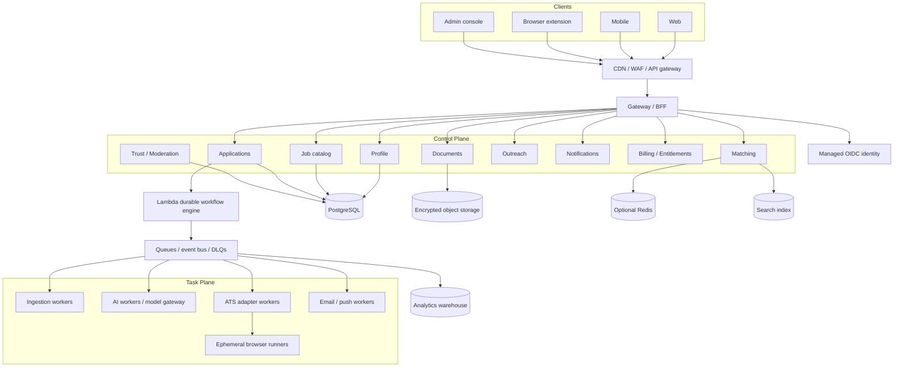
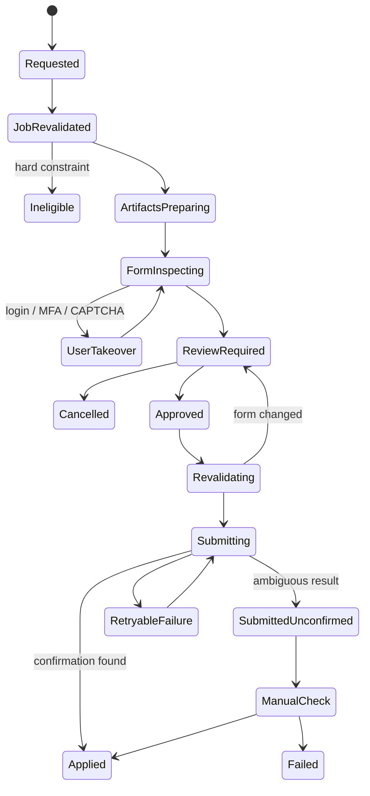

# AI Job Search and Application Platform: Product and System Architecture

Status: Initial architecture and implementation guide
Last updated: 2026-07-28
Audience: Founders, product, design, engineering, data/ML, security, and operations

> This is a candidate-first platform inspired by the problem Jobright addresses, not a copy of Jobright's code, branding, visual design, content, or proprietary data. **ApplyDash** and `applydash.ai` are the provisional presentation identity; **the Platform** remains the brand-neutral architectural term, and `ai-job-apply` remains the stable technical identifier until a public name is approved.

## 1. Recommended repository structure

Use a monorepo so shared types, design components, event contracts, validation rules, and test fixtures remain synchronized. Keep frontend applications and backend services in clearly separate top-level folders as requested.

```text
ai-job-apply/
├── frontend/
│   ├── web/                         # Next.js web app and public job pages
│   ├── mobile/                      # React Native/Expo iOS and Android app
│   ├── extension/                   # Chrome/Edge MV3 extension (WXT + React)
│   └── admin/                       # Internal operations, support, and trust console
│
├── backend/
│   ├── gateway/                     # Public API gateway/BFF; REST or GraphQL facade
│   ├── services/
│   │   ├── profile/                 # Candidate facts, preferences, answer vault
│   │   ├── jobs/                    # Canonical job catalog and lifecycle
│   │   ├── matching/                # Retrieval, ranking, recommendations
│   │   ├── documents/               # Resume, cover letter, artifact versions
│   │   ├── applications/            # Application packet and workflow control
│   │   ├── outreach/                # Referral/contact drafts and follow-ups
│   │   ├── notifications/           # In-app, email, push, and preference routing
│   │   ├── integrations/            # Outreach sending accounts, ATS/public feeds
│   │   ├── billing/                 # Subscription, entitlement, metering
│   │   ├── trust/                   # Moderation, fraud/staleness, abuse controls
│   │   └── analytics/               # Product events and application efficiency
│   ├── workers/
│   │   ├── ingestion/               # API/feed/UGC normalization and verification
│   │   ├── ai/                      # Model calls, evaluation, structured generation
│   │   ├── browser-automation/       # Ephemeral remote browser runs
│   │   ├── ats-greenhouse/
│   │   ├── ats-lever/
│   │   ├── ats-ashby/
│   │   ├── ats-workday/
│   │   └── messaging/               # Email, push, webhooks, scheduled digests
│   └── workflows/                   # Durable code-first workflow definitions
│
├── packages/
│   ├── api-contracts/               # OpenAPI/GraphQL schemas and generated clients
│   ├── event-contracts/             # Versioned async event schemas
│   ├── domain/                      # Shared domain types, no infrastructure imports
│   ├── validation/                  # Field ontology and deterministic validators
│   ├── ats-sdk/                     # Adapter interfaces and reusable DOM utilities
│   ├── ai-sdk/                      # Model gateway, prompts, schemas, safety checks
│   ├── auth/                        # Client/server auth helpers
│   ├── observability/               # Logging, tracing, metrics, correlation IDs
│   ├── design-system/               # Shared web/mobile design tokens and components
│   ├── config/                      # Typed config; no secrets committed
│   └── test-fixtures/               # Sanitized ATS pages, resumes, jobs, email samples
│
├── data/
│   ├── taxonomies/                  # Skills, titles, seniority, location mappings
│   ├── evals/                       # Versioned matching/generation evaluation sets
│   └── seeds/                       # Development-only synthetic data
│
├── infrastructure/
│   ├── terraform/                   # Cloud resources by environment
│   ├── kubernetes-or-ecs/           # Deployment manifests if needed
│   ├── observability/               # Dashboards and alerts as code
│   └── runbooks/                    # Incident, restore, provider-failure procedures
│
├── docs/
│   ├── adr/                         # Architecture Decision Records
│   ├── product/                     # Journeys, policies, requirements
│   ├── security/                    # Threat models and data maps
│   └── PRODUCT_AND_SYSTEM_ARCHITECTURE.md
│
├── scripts/                         # Local setup, codegen, fixtures, release checks
├── .github/workflows/               # CI, security, preview, and release pipelines
├── pnpm-workspace.yaml
├── turbo.json
└── README.md
```

### Repository rules

- `frontend/*` may use generated clients from `packages/api-contracts`; it must not import backend implementation code.
- Every backend service owns a module/schema and exposes a versioned API or event. No service reaches into another service's tables directly.
- ATS adapters implement the same contract and ship their own fixtures, capability declaration, health checks, and rollback switch.
- Prompts, model schemas, evaluation data, and model configuration are versioned like code.
- Domain events are append-only and schema-versioned. Consumers tolerate old and new versions during deployments.
- Real resumes, application pages, email bodies, tokens, and user PII never enter fixtures or logs.
- Changes to user-visible automated actions require an ADR, threat-model update, tests, and an audit-event definition.

### Deployable shape: start bounded, not fragmented

The folders above define durable ownership boundaries. They do **not** require deploying fifteen tiny services on day one. Begin with these independently deployable units:

1. `web` and `admin`
2. `gateway + core-api` containing profile, jobs, documents, billing, and application-history modules
3. `workflow-workers` containing matching, notifications, and durable orchestration workers
4. `ingestion-workers`
5. `browser-automation` pools, isolated by ATS
6. `ai-workers`
7. `mobile`
8. `extension`

Split a module into its own deployment and database only when its load, security boundary, failure rate, or team ownership justifies it. This preserves fault isolation without paying the operational cost of premature microservices.

### Deployment posture: scale to zero until measured demand

Per [ADR-016](adr/016-scale-to-zero-application-runtime.md), default the application control plane
to scale-to-zero managed compute through pre-launch and after launch until production evidence
requires reserved capacity. The primary AWS region is `us-east-2`.

- Use API Gateway with a direct versioned Lambda integration for synchronous APIs.
- Use the transactional outbox, SQS/DLQ, and versioned Lambda durable functions for long-running
  orchestration. PostgreSQL remains product and audit truth.
- Reserve ECS/Fargate for explicitly started migrations, isolated browser/ATS runs, or a measured
  workload that cannot fit Lambda safely; do not run a general gateway or workflow poller 24/7.
- Provision isolated staging application compute on demand for release candidates,
  restore/migration rehearsals, security acceptance, and launch.
- Start with encrypted Single-AZ PostgreSQL plus automated backups and tested restore.
- Do not provision provisioned Lambda concurrency, a NAT gateway, RDS Proxy, Redis, a search
  cluster, extra replicas, or dedicated services until an implemented capability or measured
  signal needs them.
- Preserve stable contracts, durable workflows, idempotency, least-privilege execution roles,
  observability, backups, rollback, and explicit scaling inputs from the first implementation.

[ADR-013](adr/013-lean-until-demand-cloud-runtime.md) remains historical evidence for the proven
Phase 0 Fargate baseline and continues to govern its non-superseded database, environment,
recovery, and measured-scaling decisions.

Lean capacity is not permission to weaken security, privacy, correctness, recovery, or safe
failure behavior.

## 2. Product thesis

The Platform should optimize for **rapid, high-quality, confirmed applications**, not downstream hiring outcomes.

The promise is:

> Tell us the truth about your experience and what you want. We will continuously find fresh, relevant jobs; prepare an accurate, job-specific application; show only the important changes and uncertain answers; and submit after a fast final review.

The differentiators are:

- **Personal, not generic:** preferences, career history, constraints, prior edits, saves, hides, and preparation choices shape every result.
- **Review by exception:** users inspect only changed, uncertain, sensitive, or newly requested fields.
- **ATS-aware preparation:** Workday, Ashby, Greenhouse, Lever, and later ATS families use different adapters, policies, tests, and fallback behavior.
- **Community freshness:** explicit user-saved public job postings improve the shared catalog for everyone.
- **Trustworthy automation:** the system never invents credentials or experience, never silently answers sensitive questions, and never bypasses CAPTCHA/MFA.
- **Low-click workflow:** one action inbox, sensible defaults, precomputed packets, continuous autosave, and a single approval action.
- **Lower cost:** one free plan and one paid plan, with compute controlled through routing, caching, deterministic logic, and transparent fair-use safeguards.

### North-star metric

`quality-gated confirmed applications / active application hour`

Supporting metrics:

- Median time from “Apply” to a review-ready packet
- Median user review time and number of fields changed
- Confirmed submission rate by ATS and adapter version
- Quality-gated confirmed applications per active user hour
- Duplicate or stale job exposure rate
- Job save-to-active-catalog latency
- Match-score calibration and “not interested” reasons
- Resume/answer factuality violation rate
- Notification open-to-action rate and unsubscribe rate
- Cost per review-ready packet and per confirmed application
- Support contacts per 100 application attempts

Application throughput is useful only while relevance, factuality, correction, duplicate-prevention, and confirmation guardrails remain healthy.

## 3. What Jobright currently establishes as the benchmark

Research was checked on 2026-07-27. Public Jobright materials currently describe:

- Personalized job matching with fit scores and filters
- A large aggregated job catalog and fresh-job alerts
- Job-specific resume tailoring and cover-letter generation
- Insider/referral connection recommendations
- A 24/7 career copilot
- Chrome-extension autofill across ATS sites
- An agent that matches, customizes, applies, and tracks
- An application tracker
- iOS and Android apps for matches, alerts, connections, and tracking
- A candidate-first product plus a newer employer/recruiting surface

The official Chrome Web Store listing says the extension handles personally identifiable information, user activity, and website content. That is a useful warning: our extension must use explicit user actions, minimum permissions, narrow host access where practical, and transparent disclosures.

The Google Play listing also contains a valuable product signal: public reviews mention inaccurate matching and slow or incorrect autofill. Those are precisely the failure modes the Platform should measure by ATS, field type, adapter version, and user cohort.

The research supports the product category, not Jobright's marketing performance claims. Claims such as interview multipliers, time saved, catalog size, and match quality should not be copied into our marketing without our own reproducible measurement.

Jobright's career-copilot and downstream hiring-outcome features are benchmark context only. The Platform intentionally excludes coaching, interview preparation, and tracking whether a user receives an interview, offer, rejection, or other post-submission result.

## 4. Scope and non-goals

### Candidate product scope

The complete candidate system includes:

1. Identity, onboarding, and candidate profile
2. Resume import, editing, versioning, and generation
3. Search, filters, recommendations, saved jobs, and company views
4. Community/UGC job contribution through the extension
5. Job normalization, deduplication, verification, and expiry
6. Match scoring with explanations and hard-constraint checks
7. Application preparation and ATS-specific automation
8. Final review, approval, submission, and confirmation
9. Technical application history through confirmed submission
10. Referral/contact discovery from permitted sources
11. Personalized outreach and follow-up drafts
12. Job alerts and transactional notifications
13. Application-focused agent for matching, tailored materials, form answers, and submission
14. Web, limited mobile, Chrome/Edge extension, and internal admin
15. Free and one paid subscription
16. Analytics, experimentation, support, privacy, security, and operations

### Non-goals for the first release

- Copying Jobright's brand, UI, text, private APIs, or proprietary job database
- Applying blindly to hundreds of loosely related roles
- Circumventing CAPTCHA, MFA, anti-bot systems, rate limits, or site restrictions
- Scraping LinkedIn profiles or auto-sending LinkedIn messages without permitted APIs
- Guessing protected-class, disability, veteran, work authorization, salary, or legally binding answers
- Editing the substance of a user's career history to create experience they do not have
- Career, interview, or other coaching; mock interviews; interview questions; or interview preparation
- Reading inboxes/calendars or tracking recruiter responses, interviews, offers, rejections, or other post-submission outcomes
- Launching an employer marketplace before the candidate loop is reliable
- Global coverage before one geography's work authorization, salary, privacy, and job taxonomies are correct

An employer portal can be added later as a separate bounded context. Do not let it compromise the candidate data model or user trust.

## 5. Experience architecture

### 5.1 Onboarding: build the reusable “truth profile”

The best way to reduce future clicks is to capture facts once and distinguish facts from preferences.

Onboarding should:

1. Create an account with email/passkey or OIDC.
2. Upload one or more resumes or import a structured profile with permission.
3. Parse experience, education, projects, skills, certifications, links, and contact information.
4. Show extracted facts for confirmation; never silently accept low-confidence parsing.
5. Ask only critical missing questions:
   - Target titles and acceptable adjacent titles
   - Locations, remote/hybrid/onsite, commute radius, and relocation
   - Employment types
   - Minimum compensation and currency
   - Seniority
   - Industries/companies to prefer or avoid
   - Work authorization and sponsorship needs
   - Earliest start date
   - Willingness to travel
6. Configure application behavior:
   - Always ask before submission
   - Resume tailoring level
   - Cover-letter preference
   - Default response for voluntary demographic questions
   - Notification channels, quiet hours, and digest frequency
7. Produce a short search strategy and initial matched feed.

The answer vault grows progressively from later applications. Each stored answer includes:

- Canonical question
- Answer type and normalized value
- Human-readable answer
- Source: user-entered, resume fact, calculated, or generated draft
- Confidence
- Sensitivity class
- When it was last confirmed
- ATS/site-specific variants
- Whether it may be reused automatically

### 5.2 Discovery and feed

The main feed should be ranked, explainable, and action-oriented:

- “Strong match” with top reasons
- Missing or unclear qualifications
- Hard-constraint warnings
- Freshness and source confidence
- Compensation, work model, location, sponsorship, and seniority
- Company summary and permitted external research
- Already viewed/saved/applied state
- One primary action: `Prepare application`
- Secondary actions: save, hide, explain, report stale/incorrect

Do not make users choose a resume and a strategy on every job. Preselect the best base resume and show what will change.

### 5.3 One-click preparation and review by exception

When a user clicks `Prepare application`, the Platform should:

1. Lock a canonical job version and recheck that it is still open.
2. Evaluate eligibility and hard constraints.
3. Select a truthful base resume.
4. Produce a targeted resume version and visible diff.
5. Generate a cover letter only when requested or beneficial.
6. Discover the ATS and exact form shape.
7. Fill deterministic fields from verified profile facts.
8. Match known custom questions to the answer vault.
9. Draft answers for new narrative questions using verified evidence.
10. Mark uncertain, sensitive, changed, or unsupported fields for review.
11. Validate format, required fields, dates, file types, and contradictions.
12. Present a compact application packet.

The review screen should show:

- Job title, company, canonical URL, and “verified open” timestamp
- Match summary and any disqualifying constraints
- Resume changes grouped by section, not an entire PDF reread
- Cover-letter preview if included
- New/custom answers with supporting profile facts
- Sensitive answers in a clearly separate section
- Any unanswered blockers
- What the system will do after approval
- One `Approve and submit` action

If the page or questions change after preparation, invalidate only the changed fields and return to review by exception.

### 5.4 Application completion modes

Offer modes based on adapter capability, not marketing:

- **Assisted fill:** the extension fills the active browser tab; the user handles login/CAPTCHA and submits.
- **Prepared submission:** a remote runner prepares the form, pauses for final review, then submits after approval.
- **Partner/API submission:** only when the employer/ATS provides authorized application credentials.
- **Manual fallback:** open the original posting with the application packet and field answers ready to copy.

The same application workflow state and audit record must be used in every mode.

### 5.5 Application workflow history

Canonical states:

```text
discovered
  → saved
  → preparing
  → review_required
  → approved
  → submitting
  → submitted_unconfirmed
  → applied
  ↘ failed | cancelled
```

Every transition records source, actor, evidence, timestamp, and confidence. Sources can be user, extension, application agent, or ATS confirmation. `applied` is terminal for product tracking: the Platform does not collect or infer what happens in the employer's hiring process.

### 5.6 Personalized outreach

There are three different email products and they must remain separate:

1. **Transactional product email:** verification, security, application confirmation, billing, and workflow failures.
2. **Personalized job communication:** fresh-job alerts, digests, application-action reminders, and workflow status.
3. **Candidate outreach:** a user-approved email to an employee, alumnus, recruiter, or hiring manager.

For candidate outreach:

- Use contacts supplied by the user, publicly supplied business contact information where lawful, or a licensed data provider.
- Generate short messages grounded in actual shared context: school, former employer, role, relevant work, or a specific question.
- Never fabricate a mutual connection or claim an application was submitted when it was not.
- Show recipient, subject, full body, sending account, and timing before send.
- Send from the user's connected mailbox only with appropriate OAuth permission and explicit approval.
- Add per-user/per-domain rate limits, duplicate prevention, bounce handling, and complaint suppression.
- Provide a draft/deep-link flow for LinkedIn rather than automating LinkedIn scraping or messaging.
- Let the user schedule one restrained follow-up; do not build bulk cold-email sequences.

Connect Gmail/Outlook only when the user wants to send approved outreach from their own account. Request the narrowest send-only permission, never read the inbox or calendar, and provide copy/deep-link drafts when a sending connection is unavailable.

### 5.7 Notifications

Events that may notify:

- A high-fit fresh job appears
- A saved job is about to close or has gone stale
- An application packet is ready
- A workflow needs login, CAPTCHA, MFA, or a missing answer
- A submission is confirmed or failed
- A follow-up is due
- A subscription/payment state needs attention
- Security-sensitive account activity occurs

Routing rules:

- Respect channel preferences and quiet hours.
- Collapse duplicate jobs and multiple workflow updates.
- Prefer in-app inbox for low urgency, push for action-required, and email for durable summaries.
- Use stable notification idempotency keys.
- Keep an in-app copy even when external delivery fails.
- Let users tune immediate vs daily/weekly behavior by notification family, not through dozens of switches.

### 5.8 Mobile scope

Mobile is a companion and approval surface, not a DOM automation surface.

Mobile should support:

- Onboarding and profile corrections
- Resume upload and document preview
- Personalized feed, search, save, hide, and report
- Push alerts
- Application packet review and approval
- Application workflow history through confirmed submission
- Application-agent actions and explanations
- Billing/account management where store rules permit
- Secure handoff to a remote browser or desktop extension

Mobile should not attempt to inject into arbitrary ATS pages. When an application requires the extension, explain that clearly and deep-link to a resumable task on desktop. Remote agent runs may be approved and monitored from mobile.

### 5.9 Application agent

The application agent is an execution interface for the rapid-application workflow, not a coach or career adviser. With the user's permission it can:

- Explain why a job matched and identify hard constraints or missing application facts
- Refine job preferences and hide irrelevant job families
- Start and monitor an application preparation workflow
- Select a base resume and explain proposed job-specific changes
- Draft grounded cover letters, application answers, referral emails, and recruiter outreach
- Inspect supported ATS forms, identify blockers, and prepare fields for final review
- Submit an approved immutable packet and report technical confirmation or failure

Its memory is limited to user-approved profile facts, preferences, saved jobs, document edits, and application workflow state through confirmed submission. It must show what it uses, support correction/deletion, and never promote generated speculation into a profile fact.

The agent provides no coaching, interview preparation, mock interviews, career plans, or post-submission hiring analysis. Outbound messages, profile changes, application approvals, and submissions use the same service APIs and consent rules as the normal UI. The agent receives no unrestricted browser, database, email, or shell access.

### 5.10 Remaining product surfaces

The full product also needs:

- Public marketing, pricing, trust/security, legal, status, and accessibility pages
- Crawlable canonical job-detail pages with correct structured data and expiry
- Company pages with jobs, permitted public context, and application history
- Visa/sponsorship insights sourced from government or properly licensed datasets
- Search strategy and funnel analytics for each user
- Settings for profile, privacy, devices, integrations, notifications, billing, data export, and deletion
- Help center, guided troubleshooting, contact support, and incident status
- An internal CMS for product/help content without coupling it to application services
- An accessible design system targeting WCAG 2.2 AA, keyboard operation, reduced motion, screen readers, and clear focus/error states

### 5.11 Optional future employer product

If an employer product is added, keep it in a separate bounded context with:

- Verified organizations, team membership, roles, and audit logs
- Job posting and must-have/ideal criteria
- Candidate/application review only for candidates who applied or explicitly enabled visibility
- Application receipt and ATS handoff without candidate outcome tracking
- Employer billing separate from candidate Pro
- Fairness, retention, access, and deletion controls designed for recruiting data

Do not quietly expose candidate profiles to employers to subsidize the candidate subscription. Candidate visibility must be explicit, reversible, and understandable.

## 6. High-level system architecture



### Control plane vs task plane

- The **control plane** owns durable state, decisions, approvals, audit logs, entitlements, and user-visible status.
- The **task plane** performs unreliable external work: fetching a job page, calling an AI provider, driving an ATS, sending a push, or parsing an email.

Task workers may crash, time out, be rate-limited, or encounter changed pages. The control plane remains available and can retry, pause, reroute, or offer a fallback.

## 7. Service responsibilities

| Service/module | Owns | Must not own |
|---|---|---|
| Gateway/BFF | Client-specific aggregation, auth enforcement, rate limits, API versioning | Business workflows or long-running tasks |
| Profile | Candidate facts, preferences, answer vault, consent references | Generated job-specific documents |
| Jobs | Canonical listings, sources, company identity, lifecycle, reports | Per-user match rank |
| Matching | Retrieval, filters, scoring, explanation, feedback features | Canonical source truth |
| Documents | Base resumes, tailored versions, cover letters, rendering | Submission state |
| Applications | Application packet, approval, state machine, audit | Direct long-running browser execution |
| Outreach | Contact context, drafts, send approvals, follow-up state | Bulk marketing campaigns |
| Notifications | Preferences, templates, routing, delivery records | Deciding application workflow truth |
| Integrations | Send-only outreach accounts, ATS/feed connections, provider adapters | Inbox/calendar reading or raw provider tokens in logs/events |
| Billing | Subscription truth, receipts, grace period, internal entitlements | Feature implementation |
| Trust | Moderation, source reputation, abuse signals, removal requests | Candidate ranking based on protected traits |
| Analytics | De-identified product events, experiments, metrics | Operational source of truth |

### Core synchronous APIs

Representative endpoints:

```text
POST   /v1/profile/import-resume
PATCH  /v1/profile/facts/:factId
GET    /v1/jobs
GET    /v1/jobs/:jobId
POST   /v1/jobs/contributions
POST   /v1/jobs/:jobId/reports
POST   /v1/applications/prepare
GET    /v1/applications/:applicationId
POST   /v1/applications/:applicationId/approve
POST   /v1/applications/:applicationId/takeover-complete
POST   /v1/applications/:applicationId/cancel
POST   /v1/outreach/drafts
POST   /v1/outreach/:draftId/approve-send
GET    /v1/action-inbox
POST   /v1/integrations/:provider/connect
DELETE /v1/integrations/:provider
GET    /v1/entitlements
```

All mutation endpoints accept an idempotency key. The server returns a durable resource ID quickly; it does not hold a request open while an AI model or browser runs.

### Core events

```text
job.contributed.v1
job.normalized.v1
job.verified.v1
job.expired.v1
profile.fact_confirmed.v1
application.preparation_requested.v1
application.packet_ready.v1
application.review_required.v1
application.approved.v1
application.submission_started.v1
application.user_takeover_required.v1
application.submission_unconfirmed.v1
application.submission_confirmed.v1
application.submission_failed.v1
document.generated.v1
outreach.send_approved.v1
outreach.sent.v1
notification.requested.v1
subscription.entitlement_changed.v1
```

Events carry IDs and references, not full resumes, OAuth tokens, or unnecessary PII.

## 8. Shared community job catalog

### 8.1 Source strategy

Use sources in this order:

1. Employer-authorized feeds and partnerships
2. Public ATS job-posting APIs where their terms permit use
3. Employer career pages with explicit permission or compliant access
4. User-initiated extension contributions
5. Broad crawling only after legal/terms review, robots/rate-limit compliance, and a clear removal process

Greenhouse, Lever, and Ashby publish official job-posting APIs. Their application submission endpoints generally require employer-side credentials, so a public job feed must not be confused with permission to submit applications through a private API.

### 8.2 User contribution flow

The extension exposes a clear `Save to Platform` or `Share public job` action on a job detail page:

1. Detect source and ATS.
2. Extract only the current public job posting and canonical URL.
3. Preview the fields the user is contributing.
4. Let the user remove notes/private data.
5. Send an idempotent contribution with source URL, extracted fields, content hash, page timestamp, and adapter version.
6. Immediately save the job privately for the contributor.
7. Normalize, deduplicate, trust-score, malware/sanitize-check, and verify server-side.
8. Publish to the shared catalog only when it passes policy.
9. Reward the user with useful feedback, not cash or incentives that encourage spam.

The extension must not upload unrelated pages, browsing history, cookies, form values, or other candidates' data. Chrome's user-data policy restricts browsing-activity collection to disclosed user-facing features and requires minimum permissions.

As adoption grows, independent extension observations become the main freshness signal for frequently viewed postings. They reduce broad polling, but do not eliminate targeted server verification for newly submitted, high-interest, conflicting, or pre-application listings.

### 8.3 Canonicalization and deduplication

Canonical identity precedence:

1. `(ats_provider, ats_tenant, external_job_id)`
2. Employer job/requisition ID plus verified company domain
3. Canonical URL after removing tracking parameters
4. Fuzzy fingerprint over company, normalized title, locations, department, and description

Keep `job` separate from `job_source`. One canonical job can have several source URLs and observations.

Deduplication states:

- `exact`
- `probable` awaiting review
- `related_repost`
- `not_duplicate`

Never merge only because titles and company names match; companies can legitimately have several location- or team-specific openings.

### 8.4 Job lifecycle and automatic expiry

Do not immediately hard-delete a job just because it is old. Remove it from discovery while retaining a small tombstone for deduplication, audit, and user application history.

```text
pending → active → suspect_stale → expired | withdrawn | blocked
                    ↘ active (after successful re-verification)
duplicate → canonical job
```

Recommended initial policy:

- Use source `validThrough` or explicit closed state when present.
- Recheck high-interest jobs and jobs with pending applications more frequently.
- Recheck official/API sources at their efficient change interval.
- Mark a job `suspect_stale` after repeated fetch failures or community closed reports.
- Unless the source provides a later valid date, remove a listing from active search 30 days after the last positive verification.
- Reverify shortly before application preparation and again before submission.
- Retain a minimal expired tombstone; purge raw snapshots on the retention schedule.
- Allow configurable TTL by source/ATS because repost cadence differs.

For public SEO pages, populate accurate `JobPosting.validThrough`. When a job closes, remove its job structured data or return `404/410`, and notify Google's Indexing API. Google explicitly warns against leaving expired jobs active.

### 8.5 Source and contributor trust

Signals include:

- Official API or verified employer-domain provenance
- Successful recent fetch
- Content consistency between contributors
- Number and diversity of contributors
- Contributor history: accepted vs spam/incorrect submissions
- Apply link validity
- Employer/user closure reports
- Suspicious redirects, payment requests, or identity harvesting

Keep contributor reputation internal and appealable. Never expose who contributed a listing to other users by default.

## 9. Matching and recommendation system

Use a staged ranker:

1. **Hard constraint gate:** geography, work model, authorization, sponsorship, employment type, compensation floor, seniority extremes, blocked companies.
2. **Candidate retrieval:** title taxonomy, keyword/BM25 search, skills, location, and vector similarity.
3. **Feature scoring:** relevant skills, recency, depth, industry, title trajectory, education only where actually required, preferences, job freshness, source trust, and prior feedback.
4. **Learning-to-rank:** train only on explicit in-product preference and workflow-quality signals with understood selection bias.
5. **Calibration:** convert rank into an interpretable fit band; do not pretend an arbitrary score is a hiring probability.
6. **Explanation:** list supporting profile facts, missing requirements, and hard constraints.

Protected-class and voluntary demographic fields must not be matching features. Do not infer them.

### Cold start

- Parse and confirm the resume.
- Ask target role/location/work-model questions.
- Use content-based retrieval.
- Mix exploration into results so a narrow initial profile does not trap the user.
- Use dismiss reasons such as wrong title, level, pay, location, technology, industry, or company.

### In-product learning signals

Learning events must distinguish:

- User did not like a recommendation
- User saved a recommendation
- User started but abandoned preparation
- Application failed technically
- Application was confirmed submitted
- User corrected a generated document or form field

Never train the match model as though a technical ATS failure or stale job were a negative candidate/job fit signal. Do not collect or use recruiter responses, interviews, offers, rejections, or other post-submission outcomes.

## 10. Resume, cover letter, and application-answer intelligence

### 10.1 Candidate fact graph

All generated content is grounded in a fact graph:

- Employers, roles, dates, and responsibilities
- Projects and outcomes
- Skills with evidence and recency
- Education, certifications, awards, and public work
- User-confirmed preferences and answers
- Source document and exact supporting span

Each fact has provenance and confidence. Generated claims must link to one or more verified facts.

### 10.2 Resume pipeline

1. Parse source files into a normalized resume AST.
2. Preserve an immutable original.
3. Ask the user to correct low-confidence facts.
4. Select content relevant to the job.
5. Reorder or rewrite for clarity without changing meaning.
6. Run factuality, dates, length, grammar, and ATS-format checks.
7. Render PDF and DOCX.
8. Compare extracted text from the final rendered file with intended content.
9. Store a versioned diff and prompt/model metadata.

The generator may emphasize or clarify true experience. It may not invent employers, dates, degrees, skills, metrics, security clearance, or authorization.

### 10.3 Answers

Use deterministic resolution before an LLM:

- Contact details, dates, addresses, URLs
- Yes/no preferences already confirmed
- Work authorization and sponsorship
- Compensation, availability, travel, relocation
- Employment and education history

Use a model only for narrative questions and return:

- Draft answer
- Supporting fact IDs
- Confidence
- Missing information
- Sensitivity classification
- Whether human review is mandatory

Mandatory review examples:

- Legal attestations and signatures
- Security clearance
- Work authorization/sponsorship if not freshly confirmed
- Compensation when format or intent is unclear
- Criminal-history questions
- Voluntary self-identification
- “Why this company?” or other free text without strong grounding
- Any answer below confidence threshold

### 10.4 Model gateway

Centralize model use behind one service that provides:

- Provider routing and failover
- Structured output validation
- Timeouts, retries, budgets, and circuit breakers
- Prompt registry and versioning
- PII-aware policies
- No-training/retention configuration where vendors support it
- Input/output audit metadata
- Cache keys for safe, deterministic results
- Online quality metrics and offline evaluations

Treat job descriptions, resumes, emails, and page text as **untrusted data**, not instructions. Wrap and label them as data, filter active content, restrict agent tools to allowlisted calls, and ignore embedded prompt-injection attempts.

## 11. ATS-specific application architecture

### 11.1 Adapter contract

Every ATS adapter implements:

```text
detect(page) → provider, tenant, confidence
extractJob(page) → canonical job observation
inspectForm(page/session) → sections, fields, constraints, blockers
mapFields(form, packet) → proposed values + evidence + confidence
fill(page, mappedFields) → per-field results
validate(page) → missing/invalid/changed fields
submit(page) → submission attempt
confirm(page/email) → confirmation evidence
```

It also declares capabilities:

```text
supports_active_tab
supports_remote_prepare
supports_remote_submit
requires_account
supports_resume_upload
supports_dynamic_questions
supports_confirmation_detection
```

### 11.2 Field ontology

Normalize page fields into stable concepts:

```text
person.first_name
person.email
person.phone
address.city
work_authorization.country
sponsorship.now_or_future
employment[].company
employment[].start_date
education[].degree
links.portfolio
preference.salary_expectation
voluntary.gender
voluntary.race_ethnicity
custom.short_text
custom.long_text
attestation.signature
```

Mapping precedence:

1. ATS/job-specific learned mapping that passed tests
2. Stable DOM/accessibility attributes and labels
3. Deterministic synonym/rule mapping
4. Model-assisted classification
5. User review

Never identify fields only by DOM position.

### 11.3 ATS strategies

| ATS | Initial approach | Important behavior |
|---|---|---|
| Greenhouse | Public API for job ingestion; extension for applications | Job-specific questions; employer API credentials are required for direct application API submission |
| Lever | Public postings API for ingestion; extension for applications | Custom form requirements and rate limits; direct application API normally needs employer credentials |
| Ashby | Public job-posting API for ingestion; extension/remote runner for forms | Dynamic custom questions and structured locations/compensation |
| Workday | Extension first; remote preparation later | Tenant-specific accounts, multi-step widgets, resume parsing that may overwrite fields, session/MFA complexity |
| SmartRecruiters/iCIMS/Taleo | Add after telemetry identifies demand | Each receives its own adapter and fixtures; no universal “generic ATS” promise |
| Unknown/custom | Generic assisted fill with conservative confidence | Fill only high-confidence standard fields; leave the rest highlighted |

“Different algorithms” should mean separate behavior packs, tests, capability flags, and rollout metrics—not separate ungoverned agents.

### 11.4 Extension

Use Manifest V3 and minimum permissions:

- Side panel/popup for the current job/application
- Content script activated by explicit user action or narrow supported hosts
- Background service worker for authenticated API calls and resumable task metadata
- No remote executable code
- No collection of general browser history
- Clear preview before contributing a job
- Local redaction before telemetry
- Signed adapter/config bundles delivered as data, never executable arbitrary code
- Short-lived access tokens scoped to the extension

For new/custom sites, request optional host permission at the moment the user activates autofill.

### 11.5 Remote browser runner

Remote execution should use one ephemeral sandbox per application:

- Isolated container/VM and browser profile
- Short lifetime and strict network egress policy
- Encrypted session material with narrowly scoped access
- No plaintext passwords in logs or databases
- Video/screenshot capture off by default; if enabled for support, explicit consent and aggressive redaction/retention
- User takeover channel for login, MFA, CAPTCHA, or ambiguous legal consent
- Domain and redirect allowlists
- Resource/time limits
- Full action audit with sensitive values redacted
- Session destroyed after completion

Do not bypass CAPTCHA. Pause and ask for user takeover. Do not retry a final submission blindly after a timeout; inspect confirmation evidence first to avoid duplicates.

### 11.6 Durable application workflow



Workflow invariants:

- Unique active application per `(user_id, canonical_job_id)` unless the user explicitly starts a new attempt.
- Submission has an idempotency token and immutable approved packet hash.
- Approval expires if job/form/artifact hashes materially change.
- An ambiguous submit response is never automatically retried as a fresh submission.
- Cancellation prevents future side effects but preserves audit history.
- Every wait can last days without holding a server process open.

## 12. Data architecture

### 12.1 Primary stores

Start with:

- **PostgreSQL:** transactional source of truth; separate schemas and row-level ownership rules
- **pgvector + PostgreSQL full-text:** initial retrieval to reduce cost and operations
- **Redis:** short-lived caches, rate limiting, locks/leases, never durable truth
- **S3-compatible object storage:** encrypted resumes, PDFs, DOCX, sanitized snapshots
- **Queue/event service:** durable task dispatch, dead-letter queues, and backpressure
- **Lambda durable execution state:** encrypted, bounded operational history for long-running
  application, ingestion, and notification workflows; PostgreSQL remains user-visible status and
  retained audit truth
- **Analytics warehouse:** de-identified events and model/product analysis

Move the public job/search workload to OpenSearch or another dedicated index when PostgreSQL latency or scale proves the need. Split public job data from candidate PII into separate databases before catalog traffic becomes large or external employer access is added.

### 12.2 Essential entities

```text
User
CandidateProfile
ProfileFact
JobPreferenceSet
AnswerVaultEntry
Resume
ResumeVersion
GeneratedDocument
Company
CanonicalJob
JobSource
JobObservation
JobContribution
JobReport
MatchScore
RecommendationFeedback
Application
ApplicationPacket
ApplicationField
ApplicationAttempt
WorkflowAction
SubmissionEvidence
Contact
OutreachDraft
OutreachSend
OutreachSendingConnection
OutreachDeliveryEvent
Notification
Subscription
Entitlement
ConsentRecord
AuditEvent
ExperimentAssignment
```

### 12.3 Data classification

| Class | Examples | Minimum controls |
|---|---|---|
| Public | Public job description, company site URL | Integrity, provenance, content sanitization |
| Internal | Match features, operational workflow state | Authz, encryption, audit |
| Confidential PII | Resume, address, phone, email, work history | Field/object encryption, strict service access, redacted logs |
| Restricted | OAuth/session tokens, voluntary demographic data, disability/veteran answers | Separate keys/storage boundary, just-in-time access, mandatory audit, no analytics payloads |

### 12.4 Retention and deletion

Set policy before launch:

- Account/profile: while active; confirmed deletion is non-recoverable, active access ends
  immediately, and inaccessible backup copies age out within the documented window
- OAuth tokens: revoke and delete immediately on disconnect/account deletion
- Generated application artifacts: user-controlled retention; default tied to account
- Raw contributed page snapshots: short operational window, for example 90 days, then delete
- Public canonical job tombstones: retain minimal non-PII identity/status for dedupe and history
- Detailed automation logs: short retention, redacted
- Security audit logs: longer, access-controlled retention
- Analytics: de-identified/aggregated wherever possible

Deletion is a durable workflow covering primary DB, objects, search indexes, caches, analytics deletion queues, and subprocessors. Publish a clear subprocessor list and data-use explanation.

## 13. Reliability and fault tolerance

### 13.1 Reliability principles

- Single-AZ managed transactional infrastructure is acceptable in the lean pre-demand profile only
  with encryption, automated backups, point-in-time recovery, deletion protection, and restore
  evidence; enable Multi-AZ when launch review, recovery requirements, or measured demand justifies it
- Stateless APIs with health checks and configurable replica counts; begin at one replica and add
  health-based routing/autoscaling from evidence
- Durable queues and workflows for every external or long-running action
- Timeouts, bounded exponential backoff, jitter, and circuit breakers
- Idempotent consumers and transactional outbox for database-to-event publication
- Per-provider and per-ATS bulkheads so one failure cannot exhaust all workers
- Dead-letter queues with replay tooling
- Backpressure and user-visible queue state
- Cached last-known feed and entitlement grace periods
- Feature flags and adapter kill switches
- Automated backups plus tested restores
- Audit evidence for every irreversible action

### 13.2 Graceful degradation

| Failure | What still works | User experience |
|---|---|---|
| Matching unavailable | Search, saved jobs, application history, cached recommendations | Show cached feed and temporarily hide live score |
| AI provider unavailable | Original resume, deterministic autofill, application history | Queue tailoring or use a tested alternate model/template |
| Document renderer unavailable | Existing documents and packet data | Queue rendering; do not block saving a job |
| One ATS adapter broken | All other ATS and manual fallback | Disable that adapter version and open assisted/manual flow |
| Remote browsers saturated | Search, prep queue, extension mode | Show wait estimate and offer active-tab autofill |
| Notifications unavailable | In-app action state persists | Retry delivery; show action inbox on next visit |
| Outreach sending unavailable | Copyable approved draft and application workflow remain available | Retry only with user-visible state; never duplicate a send |
| Search index unavailable | Canonical DB and cached feed | Reduced filters with a clear degraded banner |
| Billing provider unavailable | Existing cached entitlements | Grace period; do not revoke paid access on transient failure |
| UGC ingestion unavailable | Extension stores a safe pending contribution locally | Retry after connectivity/service recovers |

### 13.3 Initial service objectives

These are public-service objectives and measurement targets, not a mandate to pre-provision
redundant capacity before launch. Pre-launch environments report their single-instance posture
honestly and use failures, recovery exercises, and representative load to decide which
availability controls to activate.

| Capability | Initial objective |
|---|---|
| Authenticated read APIs | 99.9% monthly availability |
| Profile/application state writes | 99.95% monthly availability |
| No lost approved application state | 99.99% durability objective |
| Application workflow update propagation | 99% within 60 seconds |
| Action-required notification enqueue | 99% within 5 minutes |
| UGC contribution acknowledgment | 99% within 2 seconds; processing async |
| High-interest job revalidation before review | 99% attempted |

Use error budgets to decide whether a team ships features or reliability work. Do not promise end-to-end ATS availability because external sites are outside our control; publish Platform success separately from third-party blocking/failure.

### 13.4 Disaster recovery

Initial target:

- Pre-demand RPO: the configured managed-backup/PITR window; never claim five minutes without
  deployed evidence
- Pre-demand RTO: measured restore and redeploy time; never claim 60 minutes without evidence
- Single-AZ primary database with point-in-time recovery in the lean profile
- Encrypted backup copies and cross-region copies when the launch risk review requires them
- Restore exercises before real-user launch and after material storage/migration changes
- Re-creatable search indexes and caches
- Workflow/event reconciliation after restore

Do not begin with active-active multi-region writes. Enable Multi-AZ, then add a warm secondary
region only when measured usage, recovery evidence, or contractual requirements justify it.

## 14. Security, privacy, trust, and compliance

### 14.1 Key threats

- Account takeover and resume/identity theft
- Malicious job pages and redirected phishing pages
- Prompt injection inside job descriptions, emails, or form labels
- Extension over-permission and accidental browsing-data collection
- Cross-user data leakage through retrieval, caches, or model prompts
- Leaked OAuth tokens or remote browser sessions
- Fabricated resume/answer content
- Duplicate or unintended submissions
- Spam/abuse through outreach
- Malicious UGC, fake jobs, and copyright/removal complaints
- Insider/admin access to candidate data

### 14.2 Required controls

- Managed OIDC, passkeys/MFA, session/device management
- Short-lived JWT/access tokens and rotating refresh tokens
- RBAC/ABAC with least privilege and service identity
- Encryption in transit and at rest; envelope encryption for restricted data
- Secrets manager and automated key rotation
- CSP, CSRF protection, output encoding, upload scanning, and HTML sanitization
- Dependency, secret, SAST, IaC, container, and license scanning in CI
- Egress allowlists for automation workers
- Tenant/user scoping in every repository query and cache key
- Audit trails for profile changes, approvals, sends, submissions, exports, and admin access
- “Break glass” admin access with reason, time limit, and alerting
- An owned exposure class for every public, candidate, service, administrative, webhook, and
  temporary-object interface; intentional public endpoints expose only their declared minimum
  data and behavior
- Server-side object, function, and property authorization plus anonymous, cross-user,
  cross-role, revoked-session, and wrong-environment negative tests for every sensitive API family
- API inventory, schema/method allowlists, payload/concurrency/cost limits, business-flow abuse
  controls, safe third-party consumption, and unknown-endpoint denial

Auth0 is the initial managed OIDC provider under
[ADR-012](adr/012-auth0-initial-managed-identity.md). The provider-neutral `issuer + subject` to
internal-UUID boundary remains authoritative so identity can be migrated without moving candidate
or application-domain records.

[ADR-014](adr/014-shared-development-auth0-for-synthetic-staging.md) permits synthetic-only
pre-launch staging to trust the exact development Auth0 issuer while the current Free subscription
provides one tenant. This exception does not provide identity-provider isolation and permits no
real users, public access, or release-candidate claim. Dedicated staging and production tenants
and replayed environment-specific conformance remain mandatory launch gates; production never
trusts development identity.

- User data export, correction, disconnect, and deletion
- Subprocessor contracts and AI vendor retention/training settings
- Regular penetration tests and a vulnerability disclosure program
- Independent open-book assessment of the exact launch candidate under
  [ADR-015](adr/015-independent-prelaunch-security-review.md), with complete surface discovery,
  API/web/mobile/extension/cloud/business-logic testing, remediation, retest, and signed release
  disposition; see the [API security and final-review baseline](security/api-security-and-final-review.md)

### 14.3 Consent design

Store immutable, versioned consent records for:

- Terms/privacy acceptance
- Sharing a public job contribution
- Using resume/profile data with AI providers
- Connecting a send-only outreach account
- Sending outreach
- Preparing and submitting an application
- Optional support recording/screenshots
- Optional product analytics only after Phase 0, with an explicit preference and applicable review;
  marketing consent remains separate

Consent must be specific. Clicking `Save job` is not consent to upload unrelated browsing history. Clicking `Prepare` is not submission approval. The approved packet hash defines what the user authorized.

### 14.4 Legal/product review checklist

Obtain counsel before launch for:

- Rights and licenses to aggregate, reproduce, and retain job descriptions
- Each source site's terms, robots directives, API terms, and rate limits
- User-contribution license, takedown process, and repeat-abuse policy
- Candidate authorization for agent-prepared and agent-submitted applications
- Electronic signatures and attestations
- Cold outreach, CAN-SPAM/state/international rules, provider anti-abuse terms
- Privacy laws, sensitive-data handling, retention, and international transfers
- Employment/intermediary laws in each launch market
- Accessibility obligations
- Mobile store billing and subscription disclosures

Apple and Google policies change by region. As of this research, digital functionality/subscriptions sold in-app generally trigger store billing rules unless an applicable exception/program is used. Keep billing entitlements provider-neutral and verify current rules immediately before release.

## 15. Billing: free plus one paid plan

There are exactly two user states:

- **Free**
- **Pro** (one subscription product; monthly and annual billing intervals are not separate tiers)

Suggested starting packaging:

| Capability | Free | Pro |
|---|---:|---:|
| Profile, search, save, application history | Included | Included |
| Community job contribution | Included | Included |
| Personalized matches | Useful daily amount | Full feed and faster alerts |
| Extension standard autofill | Included with sensible limits | Included |
| Tailored application packets | Trial/limited monthly amount | Generous fair-use |
| Remote agent preparation | Preview or small trial | Included with transparent fair-use |
| Personalized outreach drafts | Limited | Included |
| Personalized outreach | Copyable drafts | Approved connected-account sending |
| Application agent | Limited preparations | Included with fair-use safeguards |

Do not create hidden “Pro Plus” credit packs. If compute needs protection:

- Publish a simple fair-use policy.
- Cap simultaneous workflows and abusive volume, not normal job seeking.
- Show users current usage and queue state.
- Allow support overrides.
- Optimize cost before restricting real users.

Provisional launch-price hypothesis: test a price below Jobright's historically publicized premium price, such as **$19/month**, with one discounted annual billing interval. This is a hypothesis, not an architecture decision. Validate willingness to pay, model/browser unit costs, app-store fees, support cost, churn, confirmed-application throughput, and quality guardrails before committing publicly.

Billing architecture:

- Stripe for web subscriptions and internal entitlement events
- StoreKit/Google Play receipts if in-app purchase is offered
- One internal entitlement service normalizes all providers
- Webhooks are signed, idempotent, replayable, and reconciled daily
- Cache paid entitlement with a grace period
- Cancellation stops renewal but retains access through paid-through date
- Self-service receipts, cancellation, deletion, and support

## 16. Suggested technology stack

### Client

- Web/admin: Next.js, React, TypeScript
- Mobile: React Native with Expo
- Extension: WXT, React, TypeScript, Manifest V3
- Data fetching: generated typed clients plus TanStack Query
- Shared design: tokens and accessible primitives, not forced identical layouts

### Backend

- Product APIs: TypeScript with NestJS using the Fastify adapter
- AI/data workers: Python with FastAPI only where Python libraries add real value
- Workflow: versioned TypeScript AWS Lambda durable functions in `us-east-2`
- PostgreSQL, pgvector, Redis, S3-compatible object storage
- Managed queues/event bus; avoid introducing Kafka until throughput and replay needs justify it
- OpenAPI plus JSON Schema/Protobuf for versioned events

### Infrastructure

- Regional API Gateway HTTP API with Auth0 JWT authorization and a direct versioned Lambda proxy
  integration
- SQS-triggered starters and versioned Lambda durable functions for orchestration; private
  database activities and non-VPC provider activities remain separate trust boundaries
- ECS/Fargate only for on-demand migration, isolated browser/ATS, or measured non-Lambda workloads;
  no continuously running general application service by default
- RDS PostgreSQL Single-AZ initially; Multi-AZ is an explicit launch/risk/usage decision
- Redis/ElastiCache only after a concrete cache, distributed rate-limit, or lease use case exists
- S3, SQS/DLQ, KMS, Secrets Manager, and CloudWatch from the first deployed environment
- CloudFront/WAF and additional rate-limiting capacity at public-launch or measured-abuse gates
- Dedicated isolated compute pool for browser automation
- Terraform for all persistent cloud resources
- GitHub Actions for CI/CD
- OpenTelemetry, Sentry, and a managed metrics/logs backend
- Feature flags with audit history

Managed services are preferred initially because the main engineering risk is application quality and changing ATS behavior, not operating databases or clusters.

## 17. Observability and operations

Every request/workflow carries:

```text
trace_id
user_id_hash
workflow_id
application_id
job_id
ats_provider
adapter_version
prompt_version
model_provider/model_version
release_sha
```

Never log field values by default.

Dashboards:

- API latency/error by endpoint and release
- Invocation errors, throttles, duration, concurrency, terminal durable-execution events, and
  privacy-safe synthetic checks; idle scale-to-zero functions do not emit artificial heartbeats
- Queue depth/age, DLQ messages, outbox reconciliation lag, and durable workflow failures
- ATS preparation/submission/confirmation rate by adapter version
- Field-fill accuracy and user corrections by ontology field
- AI latency/cost/schema failure/factuality results
- Job ingestion freshness, duplicate rate, and source failures
- Notification send/delivery/action rate
- Billing webhook lag and entitlement mismatches
- Extension version adoption and site compatibility
- Security/abuse signals

Admin tools:

- Search by opaque user/application ID
- View redacted workflow timeline
- Retry safe steps, never blind-submit
- Kill switch by ATS/domain/adapter version
- Merge/unmerge canonical jobs
- Moderate contributions and handle takedowns
- Inspect provider status
- Grant time-bound entitlement/support adjustments
- Start account export/deletion workflows

Runbooks must cover provider outage and recovery, missing log delivery, ATS layout break,
double-submit concern, queue backlog, compromised token, bad model release, stale catalog spike,
failed billing webhooks, and database restore.

## 18. Testing and release strategy

### Testing pyramid

- Unit tests for domain rules, normalization, constraints, and state machines
- Contract tests for APIs and versioned events
- Golden tests for resume parsing/generation and answer grounding
- Sanitized DOM fixtures for every ATS and important form variant
- Adapter replay tests against captured, permitted fixtures
- Browser end-to-end tests in controlled test tenants/pages
- Extension permission and privacy tests
- Mobile/web accessibility and visual tests
- Workflow crash/retry/idempotency tests
- Chaos tests for model, queue, browser, email, search, and billing failures
- Security tests for prompt injection, malicious HTML/files, SSRF, redirects, and cross-user access

### AI evaluations

Release-blocking evaluation sets:

- Resume factuality and date consistency
- Skill evidence and unsupported-claim detection
- Custom-question classification
- Sensitive-question routing
- Answer-vault reuse correctness
- Job extraction and normalization
- Hard-constraint recall
- Match explanation grounding
- Email personalization truthfulness
- Prompt-injection resistance

Model upgrades run offline evaluation, shadow traffic, a small canary, then gradual rollout. Keep immediate rollback by prompt/model/adapter version.

### ATS releases

Release adapters independently:

1. Fixtures and contract tests pass.
2. Internal/synthetic run passes.
3. Shadow inspection without filling.
4. Canary to a small percentage.
5. Compare fill accuracy, correction rate, failure, and confirmation rate.
6. Ramp gradually.
7. Automatic rollback/kill switch when thresholds breach.

## 19. Product analytics and experimentation

Use a documented event taxonomy and collect the minimum necessary data.

Measure funnels:

```text
job_impression
→ job_opened
→ preparation_requested
→ packet_ready
→ review_started
→ approved
→ submission_confirmed
```

Experiments should optimize rapid, accurate, confirmed applications—not notification clicks or unguarded application volume. Predefine metrics and guardrails. Do not experiment with sensitive answers, legal attestations, hidden resume fabrication, or submission consent.

Useful analysis:

- Preparation and confirmed-submission rate by match band and freshness band
- User edits by generated field and prompt version
- Technical failure by ATS, tenant, browser, and adapter version
- Time saved based on observed interaction time, not a marketing guess
- Discovery source contribution to confirmed applications
- UGC coverage, verification speed, and abuse rate
- Free-to-Pro conversion vs actual delivered value

## 20. Delivery roadmap

The phases below are ordered by architectural dependency and quality readiness, not calendar estimates. Progress to the next phase only when the current phase's exit criteria are met.

All phases follow the scale-to-zero and lean-until-demand runtime policies. Adding a feature does
not automatically add continuously running Fargate, provisioned Lambda concurrency, a NAT gateway,
database proxy, service replica, load balancer, cache, search cluster, always-on staging
environment, or Multi-AZ data service. Capacity and availability changes require a launch gate, a
security/recovery requirement, or measured latency, saturation, queue, failure, or usage evidence.
This rule reduces idle infrastructure; it does not reduce product-quality, safety, privacy,
testing, observability, backup, or maintainability requirements.

When making technical decisions within this roadmap, give little weight to predicted development cost or delivery time. Prefer, in order:

1. Quality and correctness
2. Simplicity and clear ownership
3. Robustness and safe failure behavior
4. Scalability appropriate to the system's expected growth
5. Long-term maintainability and evolvability

Schedule pressure is not a reason to weaken consent, factuality, security, observability, test coverage, data ownership, workflow durability, or fallback behavior. Scope may be reduced to preserve these properties. Operating cost remains a measured system constraint, but predicted implementation cost and speed should not drive the architecture.

### Phase 0 — Product, data, and legal foundation

- Replace the proven continuously running Fargate gateway/worker with the scale-to-zero runtime in
  [D0-016](product/delivery/phase-0-serverless-runtime-migration.md), prove behavioral equivalence,
  and remove every obsolete deployment and executable code path
- Choose launch geography and target candidate segment
- Obtain foundational legal/privacy and security approval; assign source-, UGC-, automation-,
  outreach-, store-, provider-, and jurisdiction-specific questions as blocking gates to the
  delivery that implements them
- Define truth profile, job schema, field ontology, event taxonomy, and consent model
- Build the threat model, privacy impact assessment, data map, consent/retention/rights designs,
  subprocessor gate, and security-control evidence matrix
- Create monorepo, CI, environments, observability, ADR process
- Create ATS fixture acquisition/sanitization process
- Establish application quality, reliability, safety, and efficiency baselines; record operating cost as a guardrail

Exit: approved foundational schemas, policies, legal/privacy and security controls; enforceable
feature-specific release gates; and a thin authenticated end-to-end skeleton operating through the
scale-to-zero runtime with no obsolete always-on gateway/worker path.

### Phase 1 — Useful web product and canonical job catalog

- Auth, onboarding, resume parsing/confirmation, preferences
- Job ingestion from permitted Greenhouse, Lever, and Ashby public feeds
- Source-specific legal approval and deployed real-candidate privacy/security approval
- Canonicalization, dedupe, lifecycle, freshness, reporting
- Search, filters, saved jobs, basic explainable match
- Application workflow history and in-app action inbox
- Admin moderation and job/source controls
- Free/Pro entitlement skeleton without aggressive paywalls

Exit: users can find, trust, save, and track fresh jobs.

### Phase 2 — Extension and community loop

- MV3 extension authentication and side panel
- Explicit save/contribute flow with preview
- Client extraction plus server verification
- Pending-offline retry
- Greenhouse/Lever/Ashby job detection
- Community trust signals, moderation, removal process
- Freshness revalidation and automatic active-index expiry
- UGC license/takedown and extension permission/privacy/store approval

Exit: users expand catalog coverage without sharing private browsing data.

### Phase 3 — High-quality application preparation

- Candidate fact graph and answer vault
- Resume AST, tailoring, render/diff, factuality checks
- Cover letters and grounded custom answers
- Application state machine and durable workflows
- Extension-based autofill for Greenhouse, Lever, and Ashby
- Review-by-exception UI and submission confirmation
- Conservative generic fallback
- ATS-, AI-, authorization-, signature-, sensitive-field-, and submission-specific approval

Exit: a user can prepare, skim, approve, and submit on supported ATS sites with measured accuracy.

### Phase 4 — Workday and remote preparation

- Workday tenant/session/form behavior pack
- Ephemeral remote browser infrastructure
- User takeover for login/MFA/CAPTCHA
- Mobile/web review and approval channel
- Packet-hash revalidation and ambiguous-submit handling
- Per-ATS canaries, kill switches, and reliability dashboards
- Workday/tenant, remote-browser, session, legal, privacy, and independent security approval

Exit: remote preparation works safely for supported variants, with active-tab/manual fallback.

### Phase 5 — Personalized outreach and application notifications

- Notification preference center and digests
- Push/email transactional messaging
- Permitted contact enrichment
- Grounded referral/recruiter emails with user approval
- Send-only Gmail/Outlook connection with copyable-draft fallback
- Delivery reconciliation, suppression, disconnect, and restrained follow-up workflow
- Contact-source, anti-spam, send-only OAuth, legal, privacy, and security approval

Exit: users receive relevant application notifications and can send truthful, approved outreach without inbox/calendar access or post-submission outcome tracking.

### Phase 6 — Mobile and paid launch

- React Native candidate companion
- Dedicated mobile OIDC client and device conformance for PKCE, secure credential storage,
  refresh rotation/replay, logout, revocation, cancellation, recovery, and lost-device behavior
- Feed, save, review/approve, application history, alerts, and application agent
- Deep links and desktop handoff
- Stripe plus StoreKit/Play receipt normalization
- One Pro product, grace periods, self-service lifecycle
- Accessibility, store privacy disclosures, support operations
- Storefront, billing, account-deletion, legal, privacy, and security approval
- Final public product name/domain ownership, conflict screening, counsel/product approval, and
  consistent production OAuth/email/store/support configuration
- Complete API and external-surface inventory, independent launch-candidate security assessment
  and penetration test, zero unresolved Critical/High findings, expiring treatment for remaining
  risks, independent retest, and staffed incident/vulnerability intake

Exit: reliable cross-device experience and simple monetization, with the exact public launch
candidate independently security-tested and approved under the documented finding policy.

### Phase 7 — Quality optimization, expansion, and optional employer product

- Preference- and workflow-signal ranking improvements
- More ATS adapters based on measured user demand
- New countries only after localization/legal/taxonomy support
- Permitted company/job context for tailored applications
- Optional employer posting/matching portal in a separate bounded context
- SOC 2 readiness, advanced security, warm-region DR
- Staff vulnerability intake and repeat independent security assessment at least annually and
  after material trust-boundary changes or serious control failure
- Per-country, source, ATS, data-use, and employer-capability legal/privacy/security delta approval

## 21. Team ownership

Minimum durable responsibilities:

- Product/design lead: end-to-end candidate experience and review-by-exception
- Web/full-stack engineers: web, gateway, profile, application history, billing
- Automation engineers: extension, browser runtime, ATS adapters
- Data/ML engineers: ingestion, taxonomy, matching, evaluations, model gateway
- Mobile engineer: React Native and push/deep links
- Platform/security engineer: infrastructure, workflow, observability, privacy controls
- QA/automation: ATS fixtures, release matrix, end-to-end and regression
- Operations/support/trust: moderation, incidents, source removals, user issues
- Legal/privacy counsel: data rights, source terms, automation, outreach, mobile stores

At small scale, people can cover multiple responsibilities. No launch should leave ATS quality, security, or support ownerless.

## 22. Cost controls that preserve quality

- Scale synchronous APIs and durable orchestration to zero when idle; use provisioned concurrency
  only from measured latency and availability evidence.
- Keep isolated staging application compute disabled outside acceptance work.
- Start Fargate tasks only for owned on-demand migrations, browser/ATS runs, or measured workloads
  that cannot safely fit Lambda, and terminate them at completion/timeout.
- Use direct API Gateway/Lambda integration before provisioning VPC Link, Cloud Map, or an ALB.
- Keep PostgreSQL Single-AZ with backups/PITR until launch risk or measured availability requires
  Multi-AZ.
- Do not provision Redis, dedicated search, per-AZ NAT gateways, or always-on browser capacity
  before their owning workload exists.
- Use deterministic parsing/rules before models.
- Route simple structured tasks to cheaper models and difficult writing to stronger models.
- Cache job-level extraction; do not regenerate the same normalized description per user.
- Reuse base resume parsing and embeddings.
- Batch embeddings/notifications and use incremental updates.
- Limit remote browser concurrency and prefer active-tab automation when equally good.
- Terminate browser sandboxes immediately after use.
- Use pgvector/full-text before adding a dedicated search cluster.
- Store structured diffs instead of repeatedly processing full documents.
- Track cost by workflow, user cohort, ATS, prompt, and model.
- Set hard provider budgets and graceful fallbacks.
- Treat support burden and failed application retries as real unit costs.

Set engineering budgets after measurement, for example:

```text
application packet AI cost target
browser-minute target
notification cost per active user
job revalidation cost per active listing
support minutes per confirmed application
```

Do not pick artificial numbers before running representative workloads.

The current pre-deployment estimate and its explicit assumptions live in the
[initial operating-cost baseline](product/foundation/initial-operating-cost-baseline.md). Replace
planning estimates with Cost and Usage Report, provider invoice, and per-workflow evidence after
deployment.

## 23. Launch gates

Do not launch automated submission broadly until:

- Resume and answer factuality evaluation meets the agreed threshold
- No protected/sensitive answer is inferred
- Duplicate-submit prevention is tested under network timeouts
- Each supported ATS has a documented capability and failure matrix
- CAPTCHA/MFA/user takeover works
- User approval is bound to an immutable packet hash
- Adapter kill switches and manual fallback are live
- Security review covers extension, uploads, remote browser, model tools, and OAuth
- Data export/deletion and token revocation work end to end
- Job takedown/report/expiry flows are operational
- On-call alerts and support tooling exist
- Terms, privacy, contribution license, and AI/application disclosures are reviewed
- Free and Pro entitlements fail safely during billing outages

## 24. Immediate implementation backlog

The living delivery tracker is authoritative. Current dependency order is:

1. Complete [D0-016](product/delivery/phase-0-serverless-runtime-migration.md): implement and accept
   the scale-to-zero gateway/workflow replacement, then remove the obsolete Fargate/Temporal path.
2. Reconcile delivered two-account billing against the revised runtime cost baseline under D0-008.
3. Obtain the accountable legal/privacy and security/privacy reviews in D0-014 and D0-015.
4. Acquire representative sanitized ATS fixtures under the approved D0-007 policy.
5. Complete the evidence-based D0 exit review before beginning D1 product capability work.
11. Instrument time, correction rate, factuality, failure reason, and cost.
12. Test with real consenting users before expanding ATS coverage.

## 25. Decisions to revisit with product detail

- Initial job seeker segment: new graduate, technical, mid-career, international/H-1B, or broad
- Launch geography and languages
- Which job sources can be lawfully ingested and republished
- Default active-job TTL and source-specific revalidation intervals
- Whether Pro begins at $19/month and what fair-use means in plain language
- Send-only mailbox provider approval and fallback readiness
- Whether remote submission is always approval-gated or an explicit pre-approved mode is added later
- First Workday variants to support
- Contact data provider and outreach limits
- How much original resume wording may be rewritten by default
- Mobile billing approach by storefront/region
- Whether and when to build an employer product

## 26. Research references

### Jobright benchmark

- [Jobright home and product overview](https://jobright.ai/)
- [Jobright AI Agent](https://jobright.ai/ai-agent)
- [Jobright Agent workflow description](https://jobright.ai/blog/what-is-the-jobright-agent-automate-your-job-search/)
- [Jobright AI matching](https://jobright.ai/ai-job-match)
- [Jobright autofill](https://jobright.ai/job-autofill)
- [Jobright cover-letter generator](https://jobright.ai/tools/cover-letter-generator)
- [Jobright insider connections](https://jobright.ai/job-referral)
- [Jobright mobile app page](https://jobright.ai/mobile-app)
- [Jobright Chrome Web Store listing](https://chromewebstore.google.com/detail/jobright-autofill-%E2%80%93-insta/odcnpipkhjegpefkfplmedhmkmmhmoko)
- [Jobright iOS App Store listing](https://apps.apple.com/us/app/jobright-ai-job-search/id6738236788)
- [Jobright Google Play listing](https://play.google.com/store/apps/details?id=ai.jobright.orion)
- [Jobright privacy policy](https://jobright.ai/legal/privacy)
- [Jobright terms of service](https://jobright.ai/legal/service)

### ATS and platform constraints

- [Greenhouse Job Board API](https://developer.greenhouse.io/job-board.html)
- [Lever Postings API](https://github.com/lever/postings-api)
- [Ashby public Job Postings API](https://developers.ashbyhq.com/docs/public-job-posting-api)
- [Chrome Manifest V3](https://developer.chrome.com/docs/extensions/mv3/manifest)
- [Chrome Web Store user-data and minimum-permission policy](https://developer.chrome.com/docs/webstore/user_data)
- [Gmail API scopes and verification](https://developers.google.com/workspace/gmail/api/auth/scopes)
- [Google OAuth production policy](https://developers.google.com/identity/protocols/oauth2/production-readiness/policy-compliance)
- [Google JobPosting and expired-job guidance](https://developers.google.com/search/docs/appearance/structured-data/job-posting)
- [Apple App Review Guidelines](https://developer.apple.com/app-store/review/guidelines/)
- [Google Play Payments policy](https://support.google.com/googleplay/android-developer/answer/10281818)
- [Stripe Billing Entitlements](https://docs.stripe.com/billing/entitlements)

---

This document is an engineering/product plan, not legal advice. Policies, APIs, ATS behavior, prices, and app-store rules change; assign owners to revalidate them before implementation and release.
