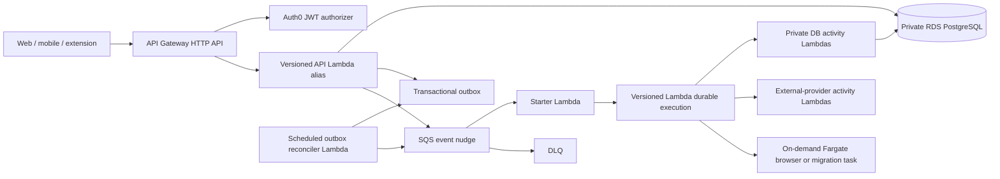

# D0-016 — Scale-to-Zero Runtime Migration

- Status: In progress
- Start: 2026-07-31
- Completion: Not completed
- Owner: Platform engineering
- Parent delivery: [Phase 0 foundation](phase-0-foundation.md)
- Decision: [ADR-016](../../adr/016-scale-to-zero-application-runtime.md)
- Current deployed state: retained API Gateway → VPC Link/Cloud Map → gateway ECS service at
  `0/0/0`; retained Temporal-worker ECS service at `0/0/0`; zero running ECS tasks in development
  and synthetic staging; both environments have trigger-disabled gateway/workflow Lambda dark
  boundaries, with workflow dark conformance passing in both environments
- Target state: API Gateway → Lambda; SQS/outbox → Lambda durable functions; Fargate only on demand

## Outcome

Replace every continuously running Phase 0 application container with a scale-to-zero runtime while
preserving the already proven identity, ownership, persistence, outbox, workflow, observability,
recovery, restore, and isolated-environment behavior. Finish with one maintained implementation:
no compatibility shim, duplicate dispatcher, unused VPC Link, stale Cloud Map service, retired
Temporal secret, obsolete heartbeat alarm, or abandoned gateway/worker image remains.

This is an engineering migration, not an authorization to process real candidate data or perform
external ATS submissions.

## Architecture

### Trust and network boundaries

- API Gateway is the only public invocation path for the API Lambda. Its resource policy permits
  the exact API/stage only; IAM deployment roles retain separately audited administrative access.
- API Gateway validates the exact Auth0 issuer/audience and route scopes. The Lambda reconstructs
  its principal only from authorizer claims and fails closed when they are absent or malformed.
- Authorization remains server-side: every database access is scoped to the mapped internal user,
  and cross-user identifiers still return the existing non-disclosing response.
- API, starter, reconciler, and database-activity functions use private subnets and the database
  security group path. They have no public IP and no default internet route.
- One environment-scoped Secrets Manager interface endpoint and restrictive endpoint policy permit
  cached database-secret retrieval without NAT. The endpoint is initially single-AZ in development
  and on-demand staging; multi-AZ is a launch/recovery decision.
- External-provider functions are not VPC attached and receive no database URL. Inputs contain
  identifiers or encrypted S3 references, never unbounded candidate records or secrets.
- Durable execution state uses the environment KMS key. PostgreSQL remains the durable product and
  audit truth because Lambda durable execution history retention is bounded.

## Component replacement

### API gateway Lambda

1. Extract application construction from the current listening process so local/Fastify injection
   tests and a Lambda adapter use the same NestJS modules, validators, stores, and error mapping.
2. Target the supported Node.js 24 runtime and bundle a minimal immutable ZIP artifact. Generate an
   SBOM, scan dependencies/artifact, publish a Lambda version, and deploy through an environment
   alias; never route an API stage to `$LATEST`.
3. Use API Gateway payload format `2.0`, explicit route/method allowlists, bounded request/response
   sizes, existing OpenAPI validation, and consistent problem responses. No catch-all business
   route may bypass authorization metadata.
4. Configure route-specific JWT scopes and preserve application-level ownership checks. Prove wrong
   issuer, audience, algorithm, scope, expired/revoked session, missing authorizer context, direct
   invocation, and cross-user access all fail closed.
5. Retrieve and cache the database URL through the Parameters and Secrets extension. Set the
   application pool to a small explicit maximum and bound Lambda reserved concurrency from the
   measured RDS connection budget. Do not add RDS Proxy until connection saturation evidence shows
   it improves reliability enough to justify its fixed capacity.
6. Replace process startup/termination and heartbeat assumptions with cold/warm invocation-safe
   initialization, connection validation/recovery, deadline propagation, and structured per-request
   telemetry. One invocation must not depend on prior in-memory state.

### Transactional outbox and event start

1. Preserve the atomic transaction that writes domain state, operation, audit record, outbox event,
   and idempotent response.
2. After commit, attempt an SQS nudge containing only the schema version, immutable event ID, event
   type, trace context, and integrity metadata. Failure to send must not roll back a committed user
   operation or mark the outbox row dispatched.
3. Run a low-frequency EventBridge-scheduled reconciler Lambda that claims bounded undispatched
   pages using `FOR UPDATE SKIP LOCKED`, sends missing nudges, and records attempt/error metadata.
   The schedule is recovery, not the normal delivery path.
4. Configure the SQS event source with a small batch, partial-batch failure reporting, bounded retry,
   visibility timeout greater than starter timeout, age alarm, redrive policy, and encrypted DLQ.
5. The starter reloads the authoritative outbox record, validates schema/type, starts the durable
   function asynchronously with an execution name derived from the event ID, and acknowledges the
   outbox row only after AWS accepts the idempotent start.
6. Duplicate nudges, starter retries, a crash after start/before acknowledgement, and reconciler
   overlap must converge on one execution and one terminal operation result.

### Durable workflow

1. Port each Temporal workflow to a TypeScript Lambda durable function with deterministic replay.
   Record a mapping from old workflow ID/event ID to new execution name for migration evidence.
2. Wrap every retryable unit in a named checkpointed step. Define timeouts, retry classification,
   exponential backoff with jitter, cancellation, compensation, and terminal error mapping.
3. Require a provider idempotency key for every external effect. An ambiguous timeout after a
   potentially irreversible effect enters reconciliation/manual-takeover state and is never blindly
   repeated.
4. Implement final user review as a durable callback bound to the authenticated user, immutable
   application packet hash, workflow state, expiry, and one-time nonce. The browser never receives
   a raw AWS callback token.
5. Pin every execution to a published function version. Retain old versions until no running
   execution references them; replay and compatibility tests gate alias movement.
6. Configure customer-managed KMS encryption, execution timeout, history retention, DLQ, status
   events, and an EventBridge terminal-event handler that updates PostgreSQL idempotently.
7. Keep durable payloads identifier-only. Large or sensitive artifacts remain in encrypted S3 and
   are loaded only by the least-privileged activity that owns them.

### On-demand Fargate boundary

Fargate remains permitted only for a migration, isolated browser/ATS run, or future workload that
cannot safely fit Lambda limits. Each task is started by an authorized durable step, uses an
immutable digest, has no inbound public listener, receives short-lived minimum credentials, emits
heartbeats/results through managed APIs, and terminates at completion/timeout. The ECS cluster may
remain empty because the cluster itself is not a continuously running task.

## Infrastructure disposition

| Current resource/capability | Target action | Completion condition |
|---|---|---|
| API Gateway HTTP API/stage | Retain; add JWT authorizer and Lambda integration | Exact stage invokes only the versioned environment alias |
| VPC Link | Delete after gateway cutover/rollback window | No route/integration references it; Terraform and AWS inventory agree |
| Cloud Map gateway service/private namespace | Delete | No registered instances, consumers, outputs, dashboard widgets, or runbooks remain |
| Gateway ECS service/task definition and ADOT sidecar | Set desired count to zero under ADR-017, then delete after cutover acceptance | Zero-traffic/outbox/Temporal preflight passes before idle; Lambda gateway later passes full conformance and rollback window expires |
| Temporal worker ECS service/task definition and ADOT sidecar | Set desired count to zero under ADR-017, then delete after cutover acceptance | Zero-traffic/outbox/Temporal preflight passes before idle; all old executions remain terminal/disposed and durable replacement later passes recovery |
| Gateway/worker public task IPs | Release with task removal | Cost/inventory proves no continuously assigned application IPv4 address |
| Gateway/worker ECR repositories | Delete after immutable rollback artifacts expire | No migration/browser consumer or supported rollback references them |
| Temporal Cloud key and Secrets Manager secret | Revoke provider key, delete secret/version and IAM access | Namespace has no required live execution and sanitized retirement evidence exists |
| Container heartbeat filters/alarms | Disable actions and missing-data breach behavior while intentionally idle; delete at retirement | No expected-silence notification during idle; Lambda/API/durable/SQS alarms and notification recovery pass before deletion |
| Shared application log group/dashboard | Replace ECS widgets/queries with Lambda and durable metrics | Dashboard and runbook contain no nonexistent ECS service dimensions |
| Event SQS/DLQ, S3, KMS, RDS, backups/PITR | Retain and narrow policies | Existing recovery/security evidence is preserved or replayed after policy change |
| ECS cluster and migration task | Retain only as owned on-demand capability | Zero running services/tasks at idle; remove if no on-demand owner remains |
| Gateway and workflow source entrypoints | Replace, then delete obsolete process-only code | One production entrypoint per capability; no dormant Temporal/Fargate path compiles or deploys |

## Migration and rollback sequence

No production-shaped resource is destroyed in the same change that first introduces its
replacement.

1. **Baseline and freeze:** record exact Terraform state, API/workflow conformance, open outbox
   count, running Temporal executions, alarms, current immutable digests, backup/PITR status, and
   service-attributed cost. Pause unrelated runtime refactors.
2. **Source implementation:** add handler boundaries, JWT-authorizer mapping, bounded DB access,
   SQS starter/reconciler, durable workflow, telemetry, tests, Terraform resources, deployment
   tooling, and runbooks. Keep deployed traffic on ECS.
3. **Dark deployment:** deploy versioned Lambdas, aliases, endpoint policies, queues/event rules,
   and replacement alarms without changing the public API integration or normal outbox route.
   Prove direct-invocation denial and synthetic function-level checks.
4. **Zero-traffic pre-cutover idle shutdown:** under [ADR-017](../../adr/017-zero-traffic-precutover-ecs-idle-posture.md),
   require explicit product-owner acceptance of environment unavailability, zero undispatched
   outbox rows, and zero running Temporal workflows. Apply separate checksum-reviewed development
   and staging plans containing only two ECS desired-count and two heartbeat-alarm updates. Retain
   the services and every rollback/persistent resource while releasing task public IPs.
5. **Coordinated replacement rollback:** with ECS retained idle, complete the separately reviewed
   development workflow release rollback/restoration and zero-drift evidence between the two
   accepted Lambda release sets. Do not resume ECS merely to exercise dark Lambda rollback.
6. **Isolated staging cutover:** deploy and migrate the synthetic staging slice first. Recheck the
   empty outbox/Temporal boundary, migrate the API integration and new-event route, then run
   authenticated, cross-user, failure, recovery, restore, and fixed-workload gates against Lambda.
7. **Development cutover:** apply the exact reviewed development plan. Recheck the empty outbox and
   move new workflows only; never dual-start one event in both engines. Preserve time-bounded API
   integration/outbox-routing and explicit ECS-resume rollback switches.
8. **Rollback window:** retain old task definitions/images and ECS service definitions without
   running tasks. Resume only if data/schema compatibility and old Temporal credentials are intact;
   reconcile every event created during an attempted cutover before routing it.
9. **Retirement plan:** after acceptance and the recorded rollback expiry, create a separate
   refresh-backed Terraform plan listing every deletion. Verify databases, buckets, queues, KMS,
   backups, state, budgets, and cost exports are untouched. Apply only that reviewed plan.
10. **Provider retirement:** verify zero required Temporal executions, revoke/delete Temporal keys,
   remove the managed secret and IAM access, and close the namespace/account only when billing and
   retained evidence obligations allow it.
11. **Repository cleanup:** remove Temporal SDK/config/code/tests/Compose services, ECS gateway/worker
   definitions, Cloud Map/VPC Link variables/outputs, container-only scripts, heartbeat logic,
   obsolete CI, skills, docs/runbooks, and unused dependencies. Repository-wide search must find no
   active reference outside historical evidence and superseded ADRs.
12. **Final proof:** replay the complete Phase 0 acceptance in both isolated environments, verify
    no drift, prove zero idle ECS tasks, inspect the first billing window, update the cost baseline,
    and only then complete D0-016.

## Required tests and evidence

### Functional and contract

- Existing OpenAPI/generated-client compatibility and web preference persistence.
- Authenticated create/read, idempotent replay, changed-payload conflict, and operation completion.
- Anonymous, invalid-token, wrong-scope, cross-user, cross-environment, revoked/disabled-account,
  direct-Lambda, unknown-route/method, oversized-payload, and malformed-authorizer denial.

### Durability and failure

- Crash after database commit before SQS send; reconciler recovers exactly once.
- Duplicate and reordered SQS messages; one durable execution and one terminal result.
- Starter crash after durable start before outbox acknowledgement.
- Durable step retry, non-retryable failure, timeout, cancellation, callback expiry, compensation,
  and ambiguous external-effect reconciliation.
- Function termination/cold start, database connection loss, secret rotation/cache expiry, queue
  backlog/DLQ redrive, execution-version upgrade, alias rollback, and old-version reachability.

### Operations, privacy, and cost

- Logs, traces, metrics, durable history, queues, and DLQ contain no token, secret, email, resume,
  preference body, sensitive answer, raw provider page, or unbounded identifier.
- API Gateway, Lambda, durable terminal-event, SQS/DLQ, database, and alert-notification drills pass.
- PostgreSQL PITR/restore evidence remains valid after security-group and role changes.
- Terraform plan/apply/no-drift and AWS inventory show no gateway/worker ECS services or tasks,
  VPC Link, Cloud Map gateway namespace, Temporal runtime secret/key, stale heartbeat alarms, or
  continuously assigned application public IPv4 address.
- A repository search and dependency/build/lockfile audit find no executable obsolete runtime path.
- CUR/Cost Explorer after billing latency attributes no new gateway/worker Fargate compute; Lambda,
  endpoint, queue, durable-operation, log, and data-transfer charges are reconciled against the
  revised baseline without claiming a hard spending cap.

## Task register

| ID | Task | State | Evidence required |
|---|---|---|---|
| SR-001 | Accept the target decision, inventory current runtime, and baseline cost/security/recovery state. | In progress | ADR-016, exact inventory, current-cost snapshot, open-execution/outbox baseline |
| SR-002 | Implement and locally verify the versioned API Lambda boundary and JWT-authorizer contract. | Complete | Unit/API tests, direct-invocation denial, build/SBOM/scan, deployed authenticated owner-isolation evidence |
| SR-003 | Implement the SQS nudge, starter, reconciler, and exactly-once-effective outbox protocol. | Complete | Crash/duplicate/reorder/oldest-page source tests and real PostgreSQL migration/failure/claim integration pass. Deployment remains owned by SR-004/SR-005. [Source evidence](evidence/d0-serverless-outbox-source-2026-08-02.md) |
| SR-004 | Port and verify workflows using versioned Lambda durable functions. | Complete | The profile-readiness workflow, private activity boundary, terminal recovery, exact-version guard, official local-runner durability matrix, repeatable PostgreSQL integration, and reproducible artifacts pass. Callback success/expiry is a conformance-only fixture because this workflow has no product callback. Deployment remains under SR-005. [Source evidence](evidence/d0-profile-readiness-durable-source-2026-08-02.md) |
| SR-005 | Implement Terraform, IAM, KMS, private secret access, observability, deployment, rollback, and retirement automation. | In progress | Source, both environments' dark deployment/conformance, and coupled accepted-release rollback/restoration now pass with disabled replacement triggers, idle ECS, unchanged routing, end-to-end alert delivery, cleanup, and zero drift. Controlled cutovers, rollback-window expiry, and obsolete-runtime retirement remain open. [Staging rollback/restoration evidence](evidence/d0-staging-workflow-release-rollback-restoration-2026-08-04.md), [development rollback/restoration evidence](evidence/d0-development-workflow-release-rollback-restoration-2026-08-04.md), [staging gateway deployment evidence](evidence/d0-staging-gateway-dark-deployment-2026-08-04.md) |
| SR-005A | Place confirmed zero-traffic development and staging ECS rollback services into the retained zero-task idle posture before Lambda cutover. | Complete | Separate zero-work preflights and exact four-update plans pass. Both environments retain services at `0/0/0`, have zero running ECS tasks or task public IPs, keep quiet `OK` heartbeat alarms, and report targeted zero drift without deleting persistent/rollback resources. [Acceptance evidence](evidence/d0-precutover-ecs-idle-shutdown-acceptance-2026-08-03.md) |
| SR-006 | Cut over and accept isolated synthetic staging. | In progress | Exact gateway/workflow artifacts, both dark deployments, two independently accepted workflow releases, both release-conformance drills, coupled rollback/restoration, alert delivery, cleanup, and zero drift pass. Authenticated gateway acceptance and controlled cutover remain open. [Staging rollback/restoration evidence](evidence/d0-staging-workflow-release-rollback-restoration-2026-08-04.md), [staging conformance acceptance](evidence/d0-staging-workflow-dark-conformance-acceptance-2026-08-04.md), [staging workflow deployment evidence](evidence/d0-staging-workflow-dark-deployment-2026-08-04.md) |
| SR-007 | Cut over and accept development. | Not started | Exact-plan apply and equivalent deployed evidence |
| SR-008 | Apply the separately reviewed old-runtime retirement plan. | Not started | Resource deletion inventory, zero idle tasks, retained persistent resources, no drift |
| SR-009 | Revoke Temporal access and remove every obsolete code/config/dependency/doc/runbook path. | Not started | Provider retirement record and clean repository/inventory searches |
| SR-010 | Reconcile post-cutover cost and complete D0-016. | Not started | Delivered CUR/Cost Explorer evidence and updated Phase 0 records |

## Completion gate

- [ ] Every SR task is complete with linked evidence.
- [ ] Both isolated environments pass the replacement acceptance matrix.
- [x] No general application service runs continuously on Fargate.
- [ ] No obsolete gateway/worker/Temporal deployment resource or executable repository path remains.
- [ ] Persistent data, restore, tenant isolation, audit, workflow durability, and rollback evidence pass.
- [ ] Post-cutover billing is reconciled and the master Phase 0 tracker is synchronized.

## External technical basis

- [AWS launch and `us-east-2` availability for Lambda durable functions](https://aws.amazon.com/blogs/aws/build-multi-step-applications-and-ai-workflows-with-aws-lambda-durable-functions/)
- [Lambda durable invocation, suspension, and idempotent execution names](https://docs.aws.amazon.com/lambda/latest/dg/durable-invoking.html)
- [Lambda durable configuration, KMS, timeout, and retention](https://docs.aws.amazon.com/lambda/latest/dg/durable-configuration.html)
- [API Gateway HTTP API Lambda proxy integration](https://docs.aws.amazon.com/apigateway/latest/developerguide/http-api-develop-integrations-lambda.html)
- [API Gateway HTTP API JWT authorizers](https://docs.aws.amazon.com/apigateway/latest/developerguide/http-api-jwt-authorizer.html)
- [Lambda VPC connectivity](https://docs.aws.amazon.com/lambda/latest/dg/configuration-vpc.html)
- [Secrets Manager retrieval from VPC-connected Lambda](https://docs.aws.amazon.com/secretsmanager/latest/userguide/retrieving-secrets_lambda.html)
- [SQS event-source behavior for durable functions](https://docs.aws.amazon.com/lambda/latest/dg/durable-invoking-esm.html)
- [Temporal Serverless Workers pre-release status](https://github.com/temporalio/temporal/releases)

## Work log

| Date | Update | Evidence |
|---|---|---|
| 2026-07-31 | Product owner made removal of continuously running Fargate gateway/worker capacity the highest-priority open Phase 0 engineering change. The target architecture, migration sequence, rollback boundary, retirement inventory, and acceptance gates were documented; no application or AWS resource was changed. | [ADR-016](../../adr/016-scale-to-zero-application-runtime.md) |
| 2026-07-31 | Recorded the read-only development/staging runtime baseline and implemented the shared HTTP/Lambda gateway application boundary with fail-closed JWT-authorizer context mapping and bounded Lambda database pooling. Both environments remain on the existing ECS path; SR-001 and SR-002 remain in progress for the explicitly recorded baseline and deployment gaps. | [Runtime baseline and Lambda boundary evidence](evidence/d0-serverless-runtime-baseline-and-lambda-boundary-2026-07-31.md) |
| 2026-07-31 | Added the bounded read-only outbox inspector/operator, reproducible gateway ZIP/manifest/SBOM workflow, managed-secret Lambda bootstrap, and disabled-by-default dark Lambda/IAM/VPC/authorizer/alarm Terraform. Fresh provider-6 validation passes, but no artifact was published, no refresh-backed live plan exists, and no AWS resource or route changed. | [Gateway dark-source evidence](evidence/d0-serverless-gateway-dark-source-2026-07-31.md) |
| 2026-07-31 | Published the exact merged development gateway ZIP, CycloneDX SBOM, manifest, and checksum through GitHub OIDC to the private versioned KMS-encrypted artifact bucket. AWS read-back matched the source/digest metadata, full-object checksum, and exact object version. No Lambda or route was created; SR-002 and SR-005 remain in progress for dark deployment and conformance. | [Development artifact evidence](evidence/d0-development-gateway-artifact-2026-07-31.md) |
| 2026-07-31 | Rejected a provider-6 plan that would replace live Cloud Map, added a warning-free compatibility guard for the rollback-only service, and implemented an exact-input plan operator. The corrected refresh-backed diagnostic contains only the 11 reviewed dark creates with zero updates, deletes, replacements, or traffic change; it remains unapplied pending merge and exact-main regeneration. | [Development dark-plan evidence](evidence/d0-development-gateway-dark-plan-2026-07-31.md) |
| 2026-07-31 | Regenerated and explicitly applied the exact merged 11-create plan. AWS accepted four dormant resources, then rejected the Secrets Manager endpoint policy; Terraform stopped before Lambda creation and live checks proved ECS and API routing unchanged. Added a least-privilege principal-condition correction and guarded partial-resume mode; its unmerged diagnostic accounts for four existing resources plus exactly seven creates and remains unapplied. | [Development dark-plan evidence](evidence/d0-development-gateway-dark-plan-2026-07-31.md) |
| 2026-08-01 | The exact recovery apply successfully retained the corrected private Secrets Manager endpoint, then the exact six-create completion apply failed closed because the older ECS-oriented workload boundary omitted Lambda VPC ENI permission. ECS/API traffic remained unchanged and no Lambda exists. Added minimum ENI boundary/role actions, environment-scoped Lambda deployment permissions, exact update guards, and explicit CMK backend initialization after discovering an SSE-S3 state-object discrepancy. Corrective source remains unmerged and unapplied. | [Development dark-recovery evidence](evidence/d0-development-gateway-dark-recovery-2026-08-01.md) |
| 2026-08-01 | Merged and applied the IAM/KMS correction, then the exact platform completion plan created an active tracked dark Lambda but stopped at reserved concurrency before alias, permission, or alarms. AWS restored effective concurrency to `1000`. After an explicitly authorized KMS-version-backed state-only untaint, the recovery operator rejected moving official layer `latest` from deployed `114` to `115` and now pins the live layer. Its unmerged diagnostic contains only five creates and the in-place `-1` to `2` concurrency update, with no delete, replacement, or traffic change. | [Development dark-recovery evidence](evidence/d0-development-gateway-dark-recovery-2026-08-01.md) |
| 2026-08-01 | Merged the pinned-layer recovery guard and applied its exact five-create/one-update plan with zero destroys. The complete but unrouted development Lambda is capped at `2`, alias `development` targets immutable version `1`, exact-stage permission and three `OK` alarms exist, state is KMS encrypted, readiness proves managed-secret/PostgreSQL access, missing authorizer context fails closed, logs/tracing exist, and ECS/API routing is unchanged. An unmerged completed-dark verifier accounts for all 11 resources with zero drift. | [Development dark-recovery evidence](evidence/d0-development-gateway-dark-recovery-2026-08-01.md) |
| 2026-08-01 | Merged PR #69 and reran completed-dark verification from exact synchronized `main`. The immutable artifact, pinned layer `114`, concurrency `2`, KMS state, all 11 reviewed resources, stable ECS rollback services, and unchanged API routing passed with zero creates, updates, deletes, or replacements; the diagnostic plan was not applied. | [Development dark-recovery evidence](evidence/d0-development-gateway-dark-recovery-2026-08-01.md) |
| 2026-08-02 | Corrected the real Fastify lifecycle's loss of the already validated authorizer principal, added concurrency-safe invocation-scoped identity capabilities and a real application regression test, published the merged immutable artifact, and applied an exact two-update function/alias release with no traffic change. All 11 dark resources returned to zero drift, the bridge preflight passed, and the product owner completed authenticated preference persistence plus two-account operation isolation. SR-002 is complete; the Lambda remains unrouted while alarm/rollback, staging, SQS/durable workflows, cutover, retirement, and cost gates remain open. | [Authenticated isolation evidence](evidence/d0-development-dark-lambda-authenticated-isolation-2026-08-02.md) |
| 2026-08-02 | Verified all three dark Lambda alarms are `OK`, enabled, exact-function scoped, and share one ALARM/OK destination with the accepted canary. The canary completed `OK → ALARM → OK`, and the product owner confirmed both notifications; the final dark/ECS/API preflight passed. Alias rollback remains deliberately open because the only older version contains the known identity defect; rollback will be tested only after a second known-good accepted release exists. | [Alert-delivery evidence](evidence/d0-development-dark-lambda-alert-delivery-2026-08-02.md) |
| 2026-08-02 | Implemented the SR-005 workflow infrastructure source slice with all deployment and trigger switches defaulted off: exact immutable artifacts, CMK-encrypted durable state and DLQ, retained versions, exact-version activity invocation, private one-concurrency database handlers, terminal recovery, alarms, bounded IAM, and an OIDC-only publication workflow. Terraform/policy/build checks pass; no artifact, plan, AWS resource, trigger, route, or traffic changed. | [Workflow infrastructure source evidence](evidence/d0-serverless-workflow-infrastructure-source-2026-08-02.md) |
| 2026-08-02 | Published the three exact merged development workflow Lambda ZIPs plus nine SBOM/manifest/checksum companions through the protected GitHub Environment and short-lived AWS OIDC. Independent AWS read-back proved one current version per key, exact checksums/metadata, and KMS encryption. No function, trigger, route, traffic, or other runtime resource changed. | [Development workflow artifact evidence](evidence/d0-development-workflow-artifacts-2026-08-02.md), [publication run](https://github.com/Vrixic/project-ai-job-apply/actions/runs/30769223210) |
| 2026-08-02 | Reconstructed the encrypted development bootstrap from committed source and generated a guarded saved plan. Immutable GitHub identity/effective trust, the successful OIDC publication, private versioned customer-KMS state, and exact policy semantics pass. The plan contains only three in-place IAM policy updates and zero creates, deletes, or replacements; checksum `3c0cc743d4a08bb1ee0b97a452889aad75d4d4598b02e0e80bb532e226dcea43` remains unapplied. | [Development workflow bootstrap-plan evidence](evidence/d0-development-workflow-bootstrap-plan-2026-08-02.md) |
| 2026-08-02 | Regenerated the bootstrap plan from exact merged `main`, received explicit authorization for its new checksum, and applied only its three in-place IAM updates. Refresh-backed zero drift, effective managed/inline parity, immutable trust, exact CloudFormation/EventBridge/Lambda/SQS/KMS scopes, zero Access Analyzer errors/security warnings, and versioned customer-KMS state pass. No runtime resource, trigger, route, workflow path, or traffic changed. | [Development workflow bootstrap-apply evidence](evidence/d0-development-workflow-bootstrap-apply-2026-08-02.md) |
| 2026-08-02 | Added the guarded development workflow dark planner and produced a refresh-backed diagnostic from exact live inputs and all three immutable artifacts. It accepts only 37 creates and five bounded updates, keeps dispatch on Temporal and every replacement trigger disabled, rejects API/ECS change and all deletion/replacement, and remains unapplied pending merge/exact-main regeneration. | [Development workflow dark-plan evidence](evidence/d0-development-workflow-dark-plan-2026-08-02.md) |
| 2026-08-02 | Applied the explicitly authorized exact merged-main dark plan. Five bounded updates and 23 creates completed before the durable CloudFormation stack hit an IAM propagation race while validating its exact DLQ grant; the failed stack/function rolled back and Terraform stopped before 13 downstream creates. Effective IAM now passes, all triggers remain disabled/absent, API Gateway remains HTTP proxy to Cloud Map, and both ECS gateway/Temporal worker services remain healthy. Added a policy-hash-keyed 45-second propagation dependency and guarded partial-recovery mode; no recovery apply occurred. | [Development dark-apply failure evidence](evidence/d0-development-workflow-dark-apply-failure-2026-08-02.md) |
| 2026-08-02 | Generated the guarded partial-recovery diagnostic from committed source and encrypted live state. Effective exact durable-DLQ permission, three immutable artifacts, the pinned layer, Temporal dispatch, disabled triggers, and stable API/ECS capacity pass. The ignored plan contains only the policy-hash propagation gate and 14 remaining AWS creates, with zero updates/deletes/replacements; it remains unapplied pending merge/exact-main regeneration. | [Development dark-recovery plan evidence](evidence/d0-development-workflow-dark-recovery-plan-2026-08-02.md) |
| 2026-08-02 | Applied the explicitly authorized exact-main recovery plan after its policy-hash-keyed 45-second gate. All 15 creates completed with no update/delete/replacement. Five immutable workflow functions are active with bounded concurrency, the SQS mapping and two EventBridge rules remain disabled, seven alarms are `OK`, the DLQ is empty, private endpoints and the durable stack are healthy, ECS/API/Temporal remain unchanged, state stays versioned/customer-KMS encrypted, and the refresh-backed post-apply plan is zero drift. | [Development dark-recovery apply evidence](evidence/d0-development-workflow-dark-recovery-apply-2026-08-02.md) |
| 2026-08-03 | Added repeatable completed-dark zero-drift verification plus a checksum/source/live-boundary-gated conformance operator and runbook. The live read-only preflight passes and plans only four synchronous synthetic rejection paths; reconciler, product writes, SQS send, triggers, and traffic changes are excluded. Wrong checksum and dirty-source execution reject before invocation, and the abandoned diagnostic context was safely cleaned. No Lambda was invoked; merge, exact-main regeneration, and separate checksum authorization remain required. | [Development workflow dark-conformance operator evidence](evidence/d0-development-workflow-dark-conformance-operator-2026-08-03.md) |
| 2026-08-03 | Executed the exact checksum-authorized development workflow dark-conformance context. The operator stopped after the first of four probes when the activity artifact failed during Node.js 24 module initialization; no other function was invoked, the DLQ stayed empty, and triggers, routes, ECS, product data, and Terraform remained unchanged. Root cause is an ESM bundle lacking a CommonJS require bridge. The shared builder now locally injects that bridge and imports every bundle to verify all declared handlers before publication. Corrected artifacts are not published or deployed, and a new plan/checksum will be required. | [Failed conformance evidence](evidence/d0-development-workflow-dark-conformance-failure-2026-08-03.md) |
| 2026-08-03 | Published all three corrected workflow Lambda artifacts from exact merged commit `f207bc0` through the protected development GitHub Environment. Tests, High-severity audit, two deterministic builds, Node.js 24 bundle imports, OIDC, and private versioned KMS storage passed. Independent AWS read-back verified the three ZIPs and nine evidence companions. No Lambda, alias, trigger, route, ECS, Temporal, or Terraform change occurred; a separately reviewed release plan is next. | [Corrected artifact evidence](evidence/d0-development-workflow-artifact-correction-2026-08-03.md), [publication run](https://github.com/Vrixic/project-ai-job-apply/actions/runs/30786236433) |
| 2026-08-03 | Added a guarded corrected-artifact release mode and runbook. Live function/alias/concurrency, disabled-trigger, alarm, DLQ, durable-stack, ECS/API, and Temporal checks passed; the refresh-backed diagnostic accepts only 14 exact updates plus the create-before-delete IAM propagation gate and no standalone create/delete, route, trigger, or capacity change. It remains ignored and unapplied; merge and exact-main regeneration are required before authorization. | [Release-plan evidence](evidence/d0-development-workflow-artifact-release-plan-2026-08-03.md), [release runbook](../../../infrastructure/runbooks/deployments/development-serverless-workflow-artifact-release.md) |
| 2026-08-03 | Regenerated the corrected-artifact plan from exact merged `main` and applied its explicitly authorized checksum: 14 bounded updates and one policy-propagation-gate replacement, with no other action. Post-apply zero drift and unchanged trigger/API/ECS/Temporal boundaries pass. A fresh conformance plan rejected before context creation or invocation because its stack check omitted healthy `UPDATE_COMPLETE`; the narrow verifier correction is unmerged, so corrected-artifact conformance remains open. | [Release-apply evidence](evidence/d0-development-workflow-artifact-release-apply-2026-08-03.md) |
| 2026-08-03 | After the healthy stack-state fix merged, exact-main zero drift and a fresh context passed. The authorized run invoked only the activity, whose handled rejection omitted optional `FunctionError`; strict property access stopped the operator before starter/terminal/durable. Metrics show one activity invocation, zero Lambda errors, and zero other invocations. DLQ/triggers/alarms/ECS stayed healthy and checksum-gated cleanup removed the context without AWS mutation. Explicit optional-response parsing is implemented locally; merge and a new checksum are required. | [Operator-recovery evidence](evidence/d0-development-workflow-dark-conformance-operator-recovery-2026-08-03.md) |
| 2026-08-03 | After optional-response parsing merged, exact-main zero drift and a fresh authorized context again passed preflight. The AWS CLI rejected its first submission before any invocation appeared in aggregate metrics; the function remained active/unthrottled, DLQ stayed empty, and checksum-gated cleanup passed. The operator now base64-encodes payload blobs and reports only probe-scoped sanitized failure classes, with no automatic retry. The correction is unmerged and conformance remains open. | [Transport-rejection evidence](evidence/d0-development-workflow-dark-conformance-transport-rejection-2026-08-03.md) |
| 2026-08-03 | After the transport correction merged, exact-main zero drift and a fresh authorized context passed. Activity, starter, and terminal reached their expected rejection paths; the durable submission returned sanitized `InvalidParameterValueException` before invocation because the request did not express its required qualified target. Aggregate metrics/logs, zero throttles, empty DLQ, seven `OK` alarms, disabled triggers, stable ECS/API/Temporal boundaries, checksum-gated cleanup, and post-run zero drift pass. A durable-only `function:version` correction is local; merge and a new checksum remain required. | [Durable-qualification evidence](evidence/d0-development-workflow-dark-conformance-durable-qualification-2026-08-03.md) |
| 2026-08-03 | Repeated conformance from exact merged `main` after the qualified-target correction. The first three rejection probes passed; AWS again rejected the now-qualified durable request before invocation. Aggregate metrics/logs, cleanup, empty DLQ, seven healthy alarms, disabled triggers, unchanged ECS/API/Temporal boundaries, and post-run zero drift pass. The deployed one-hour durable timeout exceeds the synchronous-invocation limit. A local operator correction now uses one checksum-reviewed async invalid execution, proves and exactly cleans its synthetic DLQ entry, and requires both owned alarms to complete `OK → ALARM → OK`; nothing corrective was invoked or deployed. | [Invocation-mode evidence](evidence/d0-development-workflow-dark-conformance-invocation-mode-2026-08-03.md), [updated runbook](../../../infrastructure/runbooks/deployments/development-serverless-workflow-dark-conformance.md) |
| 2026-08-03 | Executed the checksum-authorized corrected drill from exact merged `main`. Activity, starter, terminal, and the async exact durable version reached their reviewed fail-closed results. The operator deleted exactly one byte-identical synthetic DLQ message; both durable-failure and dead-letter alarms completed `OK → ALARM → OK`; all seven alarms recovered; aggregate logs contained only the expected terminal error; the context removed itself; and post-run Terraform remained zero drift with unchanged triggers, API/ECS, and Temporal. Development dark conformance passes; human notification receipt is pending confirmation and known-good workflow rollback is next. | [Conformance acceptance](evidence/d0-development-workflow-dark-conformance-acceptance-2026-08-03.md) |
| 2026-08-03 | Product owner confirmed receipt of all four workflow-conformance notifications: durable-failure `ALARM`/`OK` and dead-letter `ALARM`/`OK`. Development dark conformance alert delivery is accepted without retaining destination or message content; known-good workflow release rollback is the next SR-005 gate. | [Conformance acceptance](evidence/d0-development-workflow-dark-conformance-acceptance-2026-08-03.md) |
| 2026-08-03 | Read-only inventory found every workflow alias on accepted version `2` with only known-bad pre-correction version `1` retained, so rollback was correctly refused and AWS remained unchanged. Added locally verified exact-source manifest/bundle attestation so a clean merged commit can produce a behavior-neutral, byte-distinct second release. Publication, deployment, conformance, reverse-plan authorization, rollback, restoration, and zero drift remain separate gates. | [Rollback-release preflight](evidence/d0-development-workflow-rollback-release-preflight-2026-08-03.md) |
| 2026-08-03 | Published and independently read back the exact-source second workflow release, applied its checksum-authorized 14-update/one-propagation-gate plan, and returned the complete dark boundary to zero drift. The separately authorized four-probe drill then passed exact-version failure, one reviewed DLQ deletion, four alarm transitions, context cleanup, privacy-safe aggregate logs, and another zero-drift plan without product write, reconciler, trigger, API/ECS, or Temporal change. Human notification receipt remains pending; coordinated rollback/restoration is next. | [Source-attested release evidence](evidence/d0-development-workflow-source-attested-release-2026-08-03.md), [publication run](https://github.com/Vrixic/project-ai-job-apply/actions/runs/30849025581) |
| 2026-08-03 | Product owner confirmed receipt of all four second-release conformance notifications: durable-failure `ALARM`/`OK` and dead-letter `ALARM`/`OK`. End-to-end alert delivery now passes for the source-attested release without retaining the destination or message content; coordinated rollback/restoration is next. | [Source-attested release evidence](evidence/d0-development-workflow-source-attested-release-2026-08-03.md) |
| 2026-08-03 | Product owner confirmed development and synthetic staging have zero traffic and accepted deliberate API/workflow unavailability so continuous ECS shutdown moves ahead of Lambda cutover. ADR-017 and locally implemented guarded source retain both services at zero desired tasks, require zero outbox/Temporal work, quiet only expected heartbeat silence, preserve an exact resume boundary, and forbid persistent/routing/trigger deletion. No AWS resource has changed; merge and separate environment plans/applies remain required. | [ADR-017](../../adr/017-zero-traffic-precutover-ecs-idle-posture.md), [source evidence](evidence/d0-precutover-ecs-idle-shutdown-source-2026-08-03.md), [runbook](../../../infrastructure/runbooks/deployments/phase0-ecs-idle-shutdown.md) |
| 2026-08-03 | Implemented a checksum-gated coordinator for the coupled development workflow release rollback and restoration. It reconstructs two accepted artifact sets from retained reviewed plans, delegates exact 14-update/one-propagation-gate semantics to the strict planner, proves zero drift before/after each separately authorized apply, and blocks restoration/cleanup until conformance is explicitly accepted. Local parser/help/status checks pass; no plan, Lambda invocation, AWS mutation, trigger, route, ECS, or product-data change occurred. | [Rollback coordinator source evidence](evidence/d0-development-workflow-release-rollback-source-2026-08-03.md), [runbook](../../../infrastructure/runbooks/deployments/development-serverless-workflow-release-rollback.md) |
| 2026-08-04 | Completed the checksum-authorized development workflow rollback and restoration between both accepted releases. Each direction changed only fourteen bounded resources plus the create-before-delete propagation gate and returned zero drift. Both releases independently passed the four-probe fail-closed drill, exact one-message DLQ cleanup, four alarm transitions, disabled triggers, idle ECS, unchanged API traffic, and human receipt of two `ALARM` plus two `OK` notifications. The accepted current release is restored and all ignored rollback/restoration contexts and plans are removed. | [Rollback/restoration evidence](evidence/d0-development-workflow-release-rollback-restoration-2026-08-04.md) |
| 2026-08-04 | Started SR-006 by completing the staging GitHub artifact boundary, publishing and independently reading back the exact gateway plus three workflow releases, and applying the checksum-authorized combined gateway/workflow bootstrap delta. The apply changed only three IAM policies, corrected the historical active-state SSE-S3 discrepancy to the staging CMK, and returned zero drift. No Lambda runtime, trigger, route, Temporal path, or traffic changed; a separately reviewed dark deployment is next. | [Staging artifact/bootstrap evidence](evidence/d0-staging-serverless-artifacts-and-bootstrap-2026-08-04.md), [gateway run](https://github.com/Vrixic/project-ai-job-apply/actions/runs/30881874730), [workflow run](https://github.com/Vrixic/project-ai-job-apply/actions/runs/30881876052) |
| 2026-08-04 | Generalized the proven gateway-dark planner across development and staging while retaining its development compatibility command. Clean exact-main provenance, environment/account isolation, immutable artifact checks, accepted idle ECS posture, unchanged API routing, and exact eleven-create first-deployment semantics are enforced. The staging account's effective Lambda concurrency quota is `10`; AWS reports the requested increase to `1001` as `CASE_OPENED`, so the planner now refuses initial deployment until at least `102` is effective. No Terraform plan, Lambda runtime, trigger, route, or traffic changed. | [Staging gateway planner/quota evidence](evidence/d0-staging-gateway-dark-planner-and-quota-2026-08-04.md) |
| 2026-08-04 | AWS made the staging concurrency increase effective at `1000`. Applied the exact checksum-authorized eleven-create gateway dark plan with no update, delete, replacement, route, trigger, or traffic action. The immutable alias, concurrency `2`, private secret/database readiness, fail-closed missing-authorizer response, three `OK` alarms, idle ECS boundary, sanitized logs, and post-apply zero drift pass. Full authenticated/rollback acceptance and workflow dark deployment remain open. | [Staging gateway dark deployment evidence](evidence/d0-staging-gateway-dark-deployment-2026-08-04.md) |
| 2026-08-04 | Generalized the proven workflow-dark planner across development and staging while retaining the development compatibility command. Environment/account/resource isolation, exact clean-main provenance, customer-KMS backend initialization, gateway/ECS/Temporal prerequisites, immutable artifacts, concurrency, strict action allowlists, and disabled-trigger/no-traffic guards pass local parser, wrapper-parity, fail-before-AWS, and repository checks. No Terraform plan or cloud resource changed. | [Staging workflow planner evidence](evidence/d0-staging-workflow-dark-planner-2026-08-04.md) |
| 2026-08-04 | The first merged-main staging workflow plan reached the expected 38-create/five-update boundary with zero deletes/replacements, then rejected before checksum output because its fresh durable role made the propagation role ARN and policy hash plan-time unknown. No apply occurred and the rejected plan was removed. A narrow local correction accepts coupled unknown role/hash values only for initial deployment while preserving exact known-role equality for recovery/verification; merge and fresh planning remain required. | [Staging workflow planner evidence](evidence/d0-staging-workflow-dark-planner-2026-08-04.md) |
| 2026-08-04 | After the initial-role correction merged, generated and independently inspected a fresh exact staging workflow plan, then applied only its product-owner-authorized checksum. All 38 creates and five bounded updates converged with no delete, replacement, route, ECS-capacity, data, or trigger-enablement action. Live AWS inventory and an exact-input refresh-backed zero-change plan prove five immutable workflow aliases, disabled SQS/EventBridge triggers, the completed customer-KMS durable stack and DLQ, two private endpoints, seven routed alarms, idle ECS, unchanged HTTP-proxy routing, and continued Temporal dispatch. SR-006 remains in progress for staging conformance, alert receipt, rollback, and cutover. | [Staging workflow deployment evidence](evidence/d0-staging-workflow-dark-deployment-2026-08-04.md) |
| 2026-08-04 | Replaced the development-only workflow conformance implementation with one selected-environment operator and thin compatibility wrappers. The shared source derives every environment-owned resource, context schema, state path, and default SSO profile; requires clean upstream-matched `main`; binds execution to the exact operator, zero-change plan, checksum, and unchanged live boundary; and limits cleanup to one reviewed execution/message. Parser, help, wrapper-parity, dirty-source fail-before-AWS, infrastructure-policy, formatting, and whitespace checks pass. No context or AWS mutation occurred; merge and a fresh exact-main staging context are next. | [Staging conformance-operator evidence](evidence/d0-staging-workflow-dark-conformance-operator-2026-08-04.md), [shared runbook](../../../infrastructure/runbooks/deployments/serverless-workflow-dark-conformance.md) |
| 2026-08-04 | Executed the exact checksum-authorized staging workflow drill from clean merged `main`. All four synthetic paths failed closed; the exact durable execution produced one byte-identical DLQ message, both owned alarms completed `OK → ALARM → OK`, the message was removed, all seven alarms recovered, the full live boundary remained unchanged, and the context was removed. A local command-host timeout during alarm recovery was contained without rerunning invocations; its recovery lookup exposed and corrected an invalid AWS CLI filter combination. Human notification receipt, accepted-release rollback, authenticated gateway acceptance, and cutover remain open. | [Staging conformance acceptance](evidence/d0-staging-workflow-dark-conformance-acceptance-2026-08-04.md) |
| 2026-08-04 | Product owner confirmed receipt of all four staging workflow-conformance notifications: durable-failure and dead-letter `ALARM`/`OK` pairs. End-to-end staging workflow alert delivery passes without retaining destination or message content; accepted-release rollback/restoration and authenticated gateway acceptance are next. | [Staging conformance acceptance](evidence/d0-staging-workflow-dark-conformance-acceptance-2026-08-04.md) |
| 2026-08-04 | Generalized the proven development workflow release-rollback coordinator into one environment-aware implementation with fixed development/staging wrappers and shared runbook. Exact upstream provenance, isolated state/context paths, retained-plan identity, strict planner delegation, separate checksums, conformance gates, and disabled-trigger/no-traffic/no-capacity guarantees pass parser, wrapper-parity, dirty-source, and infrastructure-policy checks. No artifact, plan, context, invocation, or AWS mutation occurred. Staging needs a second deployed/conformed accepted release before rollback planning. | [Staging rollback-operator evidence](evidence/d0-staging-workflow-release-rollback-operator-2026-08-04.md), [shared runbook](../../../infrastructure/runbooks/deployments/serverless-workflow-release-rollback.md) |
| 2026-08-04 | Completed staging accepted-release rollback and restoration through separately checksum-authorized plans and conformance contexts. Both releases passed exact four-probe failure behavior, one-message DLQ cleanup, four alarm transitions, human receipt of both `ALARM`/`OK` pairs, aggregate privacy checks, disabled triggers, idle ECS, unchanged traffic, context cleanup, and fresh zero drift. A pre-apply retained-plan filename collision was caught by checksum validation with no AWS mutation; PR #133 isolated immutable endpoint snapshots, and final cleanup removed every recovery artifact. Authenticated gateway acceptance and controlled staging cutover are next. | [Staging rollback/restoration evidence](evidence/d0-staging-workflow-release-rollback-restoration-2026-08-04.md) |
| 2026-08-02 | Published the exact merged gateway-boundary release, applied a checksum-matched plan containing only the function artifact/version and alias updates, and returned all 11 dark resources to zero drift without changing the ECS public route. The deployed 15-case no-write matrix passed status, trusted-authorizer, scope, route, request-shape, media-type, base64, and body-size boundaries. Its verifier now accepts valid problem-media-type parameters while retaining strict status/code/trace/cache assertions. Authenticated browser isolation replay and controlled alias rollback remain open. | [Gateway boundary-hardening evidence](evidence/d0-gateway-lambda-boundary-hardening-2026-08-02.md), [publication run](https://github.com/Vrixic/project-ai-job-apply/actions/runs/30735796145) |
| 2026-08-02 | The product owner repeated authenticated two-account isolation against immutable version `3`; account B received only the sanitized non-disclosing pass, so version `3` is accepted as the second rollback endpoint. Added a checksum-gated alias operator and runbook. Its read-only live preflight selected `3 → 2 → 3`, two alias updates, and zero public-traffic changes; missing execution authority, wrong checksum, version `1`, and overwrite were rejected, the alias stayed on `3`, and the ignored context was cleaned. Merge, exact-main replan, explicit execution, restoration, alarm/error inspection, and zero drift remain open. | [Gateway boundary-hardening evidence](evidence/d0-gateway-lambda-boundary-hardening-2026-08-02.md), [rollback preflight](evidence/d0-development-gateway-lambda-alias-rollback-preflight-2026-08-02.md) |
| 2026-08-02 | Executed the separately reviewed exact-main dark-alias rollback. Accepted versions `3 → 2 → 3` each passed `200/200/401`; optimistic revision locking, restoration in `finally`, full post-restore preflight, three healthy alarms, clean aggregate logs, ignored-context cleanup, and zero drift across all 11 reviewed resources passed. Public traffic remained on ECS. The gateway rollback gate is complete; SR-003 SQS/outbox implementation is the next migration task. | [Completed rollback evidence](evidence/d0-development-gateway-lambda-alias-rollback-2026-08-02.md) |
| 2026-08-02 | Completed SR-003 locally: immutable per-event Temporal/Lambda routing, forward-only nudge/start metadata, identifier-only integrity-checked SQS messages, post-commit nudge failure isolation, bounded `SKIP LOCKED` reconciliation, partial-batch starter handling, deterministic durable execution names, reproducible ZIP/SBOM output, and disabled least-privilege Terraform. Source/build/Terraform checks plus real PostgreSQL migration replay, failed-send durability, disjoint claims, and 26-row oldest-page advancement pass. No artifact, plan, AWS resource, trigger, route, or traffic changed. | [Serverless outbox source evidence](evidence/d0-serverless-outbox-source-2026-08-02.md) |
| 2026-08-02 | Completed SR-004 locally: ported profile readiness to an identifier-only version-one Lambda durable handler, isolated PostgreSQL work in a private activity boundary, made operation completion and failure replay-safe, and added exact-version, terminal-event, callback-expiry, retry, compensation, and reproducible-artifact evidence. The official local runner, source tests, and the real PostgreSQL suite pass twice consecutively. No AWS resource, artifact object, trigger, route, or traffic changed. | [Profile-readiness durable source evidence](evidence/d0-profile-readiness-durable-source-2026-08-02.md) |
