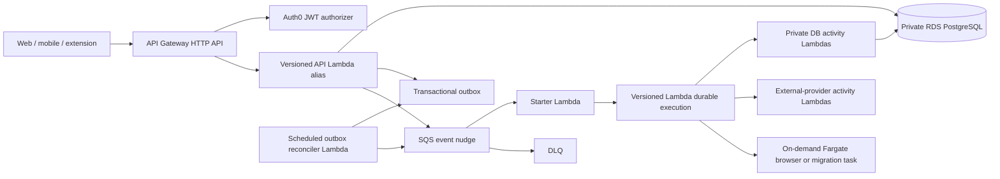

# D0-016 — Scale-to-Zero Runtime Migration

- Status: In progress
- Start: 2026-07-31
- Completion: Not completed
- Owner: Platform engineering
- Parent delivery: [Phase 0 foundation](phase-0-foundation.md)
- Decision: [ADR-016](../../adr/016-scale-to-zero-application-runtime.md)
- Current deployed state: API Gateway → VPC Link/Cloud Map → one gateway Fargate task; one
  continuously polling Temporal Fargate worker
- Target state: API Gateway → Lambda; SQS/outbox → Lambda durable functions; Fargate only on demand

## Outcome

Replace every continuously running Phase 0 application container with a scale-to-zero runtime while
preserving the already proven identity, ownership, persistence, outbox, workflow, observability,
recovery, restore, and isolated-environment behavior. Finish with one maintained implementation:
no compatibility shim, duplicate dispatcher, unused VPC Link, stale Cloud Map service, retired
Temporal secret, obsolete heartbeat alarm, or abandoned gateway/worker image remains.

This is an engineering migration, not an authorization to process real candidate data or perform
external ATS submissions.

## Architecture

### Trust and network boundaries

- API Gateway is the only public invocation path for the API Lambda. Its resource policy permits
  the exact API/stage only; IAM deployment roles retain separately audited administrative access.
- API Gateway validates the exact Auth0 issuer/audience and route scopes. The Lambda reconstructs
  its principal only from authorizer claims and fails closed when they are absent or malformed.
- Authorization remains server-side: every database access is scoped to the mapped internal user,
  and cross-user identifiers still return the existing non-disclosing response.
- API, starter, reconciler, and database-activity functions use private subnets and the database
  security group path. They have no public IP and no default internet route.
- One environment-scoped Secrets Manager interface endpoint and restrictive endpoint policy permit
  cached database-secret retrieval without NAT. The endpoint is initially single-AZ in development
  and on-demand staging; multi-AZ is a launch/recovery decision.
- External-provider functions are not VPC attached and receive no database URL. Inputs contain
  identifiers or encrypted S3 references, never unbounded candidate records or secrets.
- Durable execution state uses the environment KMS key. PostgreSQL remains the durable product and
  audit truth because Lambda durable execution history retention is bounded.

## Component replacement

### API gateway Lambda

1. Extract application construction from the current listening process so local/Fastify injection
   tests and a Lambda adapter use the same NestJS modules, validators, stores, and error mapping.
2. Target the supported Node.js 24 runtime and bundle a minimal immutable ZIP artifact. Generate an
   SBOM, scan dependencies/artifact, publish a Lambda version, and deploy through an environment
   alias; never route an API stage to `$LATEST`.
3. Use API Gateway payload format `2.0`, explicit route/method allowlists, bounded request/response
   sizes, existing OpenAPI validation, and consistent problem responses. No catch-all business
   route may bypass authorization metadata.
4. Configure route-specific JWT scopes and preserve application-level ownership checks. Prove wrong
   issuer, audience, algorithm, scope, expired/revoked session, missing authorizer context, direct
   invocation, and cross-user access all fail closed.
5. Retrieve and cache the database URL through the Parameters and Secrets extension. Set the
   application pool to a small explicit maximum and bound Lambda reserved concurrency from the
   measured RDS connection budget. Do not add RDS Proxy until connection saturation evidence shows
   it improves reliability enough to justify its fixed capacity.
6. Replace process startup/termination and heartbeat assumptions with cold/warm invocation-safe
   initialization, connection validation/recovery, deadline propagation, and structured per-request
   telemetry. One invocation must not depend on prior in-memory state.

### Transactional outbox and event start

1. Preserve the atomic transaction that writes domain state, operation, audit record, outbox event,
   and idempotent response.
2. After commit, attempt an SQS nudge containing only the schema version, immutable event ID, event
   type, trace context, and integrity metadata. Failure to send must not roll back a committed user
   operation or mark the outbox row dispatched.
3. Run a low-frequency EventBridge-scheduled reconciler Lambda that claims bounded undispatched
   pages using `FOR UPDATE SKIP LOCKED`, sends missing nudges, and records attempt/error metadata.
   The schedule is recovery, not the normal delivery path.
4. Configure the SQS event source with a small batch, partial-batch failure reporting, bounded retry,
   visibility timeout greater than starter timeout, age alarm, redrive policy, and encrypted DLQ.
5. The starter reloads the authoritative outbox record, validates schema/type, starts the durable
   function asynchronously with an execution name derived from the event ID, and acknowledges the
   outbox row only after AWS accepts the idempotent start.
6. Duplicate nudges, starter retries, a crash after start/before acknowledgement, and reconciler
   overlap must converge on one execution and one terminal operation result.

### Durable workflow

1. Port each Temporal workflow to a TypeScript Lambda durable function with deterministic replay.
   Record a mapping from old workflow ID/event ID to new execution name for migration evidence.
2. Wrap every retryable unit in a named checkpointed step. Define timeouts, retry classification,
   exponential backoff with jitter, cancellation, compensation, and terminal error mapping.
3. Require a provider idempotency key for every external effect. An ambiguous timeout after a
   potentially irreversible effect enters reconciliation/manual-takeover state and is never blindly
   repeated.
4. Implement final user review as a durable callback bound to the authenticated user, immutable
   application packet hash, workflow state, expiry, and one-time nonce. The browser never receives
   a raw AWS callback token.
5. Pin every execution to a published function version. Retain old versions until no running
   execution references them; replay and compatibility tests gate alias movement.
6. Configure customer-managed KMS encryption, execution timeout, history retention, DLQ, status
   events, and an EventBridge terminal-event handler that updates PostgreSQL idempotently.
7. Keep durable payloads identifier-only. Large or sensitive artifacts remain in encrypted S3 and
   are loaded only by the least-privileged activity that owns them.

### On-demand Fargate boundary

Fargate remains permitted only for a migration, isolated browser/ATS run, or future workload that
cannot safely fit Lambda limits. Each task is started by an authorized durable step, uses an
immutable digest, has no inbound public listener, receives short-lived minimum credentials, emits
heartbeats/results through managed APIs, and terminates at completion/timeout. The ECS cluster may
remain empty because the cluster itself is not a continuously running task.

## Infrastructure disposition

| Current resource/capability | Target action | Completion condition |
|---|---|---|
| API Gateway HTTP API/stage | Retain; add JWT authorizer and Lambda integration | Exact stage invokes only the versioned environment alias |
| VPC Link | Delete after gateway cutover/rollback window | No route/integration references it; Terraform and AWS inventory agree |
| Cloud Map gateway service/private namespace | Delete | No registered instances, consumers, outputs, dashboard widgets, or runbooks remain |
| Gateway ECS service/task definition and ADOT sidecar | Delete | Lambda gateway passes full conformance and rollback window expires |
| Temporal worker ECS service/task definition and ADOT sidecar | Delete | All old executions are terminal/disposed and durable replacement passes recovery |
| Gateway/worker public task IPs | Release with task removal | Cost/inventory proves no continuously assigned application IPv4 address |
| Gateway/worker ECR repositories | Delete after immutable rollback artifacts expire | No migration/browser consumer or supported rollback references them |
| Temporal Cloud key and Secrets Manager secret | Revoke provider key, delete secret/version and IAM access | Namespace has no required live execution and sanitized retirement evidence exists |
| Container heartbeat filters/alarms | Delete | Lambda/API/durable/SQS alarms and notification recovery pass |
| Shared application log group/dashboard | Replace ECS widgets/queries with Lambda and durable metrics | Dashboard and runbook contain no nonexistent ECS service dimensions |
| Event SQS/DLQ, S3, KMS, RDS, backups/PITR | Retain and narrow policies | Existing recovery/security evidence is preserved or replayed after policy change |
| ECS cluster and migration task | Retain only as owned on-demand capability | Zero running services/tasks at idle; remove if no on-demand owner remains |
| Gateway and workflow source entrypoints | Replace, then delete obsolete process-only code | One production entrypoint per capability; no dormant Temporal/Fargate path compiles or deploys |

## Migration and rollback sequence

No production-shaped resource is destroyed in the same change that first introduces its
replacement.

1. **Baseline and freeze:** record exact Terraform state, API/workflow conformance, open outbox
   count, running Temporal executions, alarms, current immutable digests, backup/PITR status, and
   service-attributed cost. Pause unrelated runtime refactors.
2. **Source implementation:** add handler boundaries, JWT-authorizer mapping, bounded DB access,
   SQS starter/reconciler, durable workflow, telemetry, tests, Terraform resources, deployment
   tooling, and runbooks. Keep deployed traffic on ECS.
3. **Dark deployment:** deploy versioned Lambdas, aliases, endpoint policies, queues/event rules,
   and replacement alarms without changing the public API integration or normal outbox route.
   Prove direct-invocation denial and synthetic function-level checks.
4. **Isolated staging cutover:** migrate the synthetic staging slice first. Quiesce writes, drain or
   explicitly dispose Temporal work, reconcile the outbox, migrate the API integration and new-event
   route, then run authenticated, cross-user, failure, recovery, restore, and fixed-workload gates.
5. **Development cutover:** apply the exact reviewed development plan, using a short write freeze
   around final outbox reconciliation. Move new workflows only; never dual-start one event in both
   engines. Preserve a time-bounded API integration/outbox routing rollback switch.
6. **Rollback window:** retain old task definitions/images and disabled service definitions without
   running tasks. Roll back only if data/schema compatibility and old Temporal credentials are
   intact; reconcile every event created during the attempted cutover before routing it.
7. **Retirement plan:** after acceptance and the recorded rollback expiry, create a separate
   refresh-backed Terraform plan listing every deletion. Verify databases, buckets, queues, KMS,
   backups, state, budgets, and cost exports are untouched. Apply only that reviewed plan.
8. **Provider retirement:** verify zero required Temporal executions, revoke/delete Temporal keys,
   remove the managed secret and IAM access, and close the namespace/account only when billing and
   retained evidence obligations allow it.
9. **Repository cleanup:** remove Temporal SDK/config/code/tests/Compose services, ECS gateway/worker
   definitions, Cloud Map/VPC Link variables/outputs, container-only scripts, heartbeat logic,
   obsolete CI, skills, docs/runbooks, and unused dependencies. Repository-wide search must find no
   active reference outside historical evidence and superseded ADRs.
10. **Final proof:** replay the complete Phase 0 acceptance in both isolated environments, verify
    no drift, prove zero idle ECS tasks, inspect the first billing window, update the cost baseline,
    and only then complete D0-016.

## Required tests and evidence

### Functional and contract

- Existing OpenAPI/generated-client compatibility and web preference persistence.
- Authenticated create/read, idempotent replay, changed-payload conflict, and operation completion.
- Anonymous, invalid-token, wrong-scope, cross-user, cross-environment, revoked/disabled-account,
  direct-Lambda, unknown-route/method, oversized-payload, and malformed-authorizer denial.

### Durability and failure

- Crash after database commit before SQS send; reconciler recovers exactly once.
- Duplicate and reordered SQS messages; one durable execution and one terminal result.
- Starter crash after durable start before outbox acknowledgement.
- Durable step retry, non-retryable failure, timeout, cancellation, callback expiry, compensation,
  and ambiguous external-effect reconciliation.
- Function termination/cold start, database connection loss, secret rotation/cache expiry, queue
  backlog/DLQ redrive, execution-version upgrade, alias rollback, and old-version reachability.

### Operations, privacy, and cost

- Logs, traces, metrics, durable history, queues, and DLQ contain no token, secret, email, resume,
  preference body, sensitive answer, raw provider page, or unbounded identifier.
- API Gateway, Lambda, durable terminal-event, SQS/DLQ, database, and alert-notification drills pass.
- PostgreSQL PITR/restore evidence remains valid after security-group and role changes.
- Terraform plan/apply/no-drift and AWS inventory show no gateway/worker ECS services or tasks,
  VPC Link, Cloud Map gateway namespace, Temporal runtime secret/key, stale heartbeat alarms, or
  continuously assigned application public IPv4 address.
- A repository search and dependency/build/lockfile audit find no executable obsolete runtime path.
- CUR/Cost Explorer after billing latency attributes no new gateway/worker Fargate compute; Lambda,
  endpoint, queue, durable-operation, log, and data-transfer charges are reconciled against the
  revised baseline without claiming a hard spending cap.

## Task register

| ID | Task | State | Evidence required |
|---|---|---|---|
| SR-001 | Accept the target decision, inventory current runtime, and baseline cost/security/recovery state. | In progress | ADR-016, exact inventory, current-cost snapshot, open-execution/outbox baseline |
| SR-002 | Implement and locally verify the versioned API Lambda boundary and JWT-authorizer contract. | In progress | Unit/API tests, direct-invocation denial, build/SBOM/scan |
| SR-003 | Implement the SQS nudge, starter, reconciler, and exactly-once-effective outbox protocol. | Not started | Crash/duplicate/reorder/oldest-page integration tests |
| SR-004 | Port and verify workflows using versioned Lambda durable functions. | Not started | Replay, failure, callback, cancellation, compensation, version tests |
| SR-005 | Implement Terraform, IAM, KMS, private secret access, observability, deployment, rollback, and retirement automation. | In progress | Validate/policy tests and reviewed no-mutation plans |
| SR-006 | Cut over and accept isolated synthetic staging. | Not started | Deployed identity/isolation/workflow/recovery/workload/no-drift evidence |
| SR-007 | Cut over and accept development. | Not started | Exact-plan apply and equivalent deployed evidence |
| SR-008 | Apply the separately reviewed old-runtime retirement plan. | Not started | Resource deletion inventory, zero idle tasks, retained persistent resources, no drift |
| SR-009 | Revoke Temporal access and remove every obsolete code/config/dependency/doc/runbook path. | Not started | Provider retirement record and clean repository/inventory searches |
| SR-010 | Reconcile post-cutover cost and complete D0-016. | Not started | Delivered CUR/Cost Explorer evidence and updated Phase 0 records |

## Completion gate

- [ ] Every SR task is complete with linked evidence.
- [ ] Both isolated environments pass the replacement acceptance matrix.
- [ ] No general application service runs continuously on Fargate.
- [ ] No obsolete gateway/worker/Temporal deployment resource or executable repository path remains.
- [ ] Persistent data, restore, tenant isolation, audit, workflow durability, and rollback evidence pass.
- [ ] Post-cutover billing is reconciled and the master Phase 0 tracker is synchronized.

## External technical basis

- [AWS launch and `us-east-2` availability for Lambda durable functions](https://aws.amazon.com/blogs/aws/build-multi-step-applications-and-ai-workflows-with-aws-lambda-durable-functions/)
- [Lambda durable invocation, suspension, and idempotent execution names](https://docs.aws.amazon.com/lambda/latest/dg/durable-invoking.html)
- [Lambda durable configuration, KMS, timeout, and retention](https://docs.aws.amazon.com/lambda/latest/dg/durable-configuration.html)
- [API Gateway HTTP API Lambda proxy integration](https://docs.aws.amazon.com/apigateway/latest/developerguide/http-api-develop-integrations-lambda.html)
- [API Gateway HTTP API JWT authorizers](https://docs.aws.amazon.com/apigateway/latest/developerguide/http-api-jwt-authorizer.html)
- [Lambda VPC connectivity](https://docs.aws.amazon.com/lambda/latest/dg/configuration-vpc.html)
- [Secrets Manager retrieval from VPC-connected Lambda](https://docs.aws.amazon.com/secretsmanager/latest/userguide/retrieving-secrets_lambda.html)
- [SQS event-source behavior for durable functions](https://docs.aws.amazon.com/lambda/latest/dg/durable-invoking-esm.html)
- [Temporal Serverless Workers pre-release status](https://github.com/temporalio/temporal/releases)

## Work log

| Date | Update | Evidence |
|---|---|---|
| 2026-07-31 | Product owner made removal of continuously running Fargate gateway/worker capacity the highest-priority open Phase 0 engineering change. The target architecture, migration sequence, rollback boundary, retirement inventory, and acceptance gates were documented; no application or AWS resource was changed. | [ADR-016](../../adr/016-scale-to-zero-application-runtime.md) |
| 2026-07-31 | Recorded the read-only development/staging runtime baseline and implemented the shared HTTP/Lambda gateway application boundary with fail-closed JWT-authorizer context mapping and bounded Lambda database pooling. Both environments remain on the existing ECS path; SR-001 and SR-002 remain in progress for the explicitly recorded baseline and deployment gaps. | [Runtime baseline and Lambda boundary evidence](evidence/d0-serverless-runtime-baseline-and-lambda-boundary-2026-07-31.md) |
| 2026-07-31 | Added the bounded read-only outbox inspector/operator, reproducible gateway ZIP/manifest/SBOM workflow, managed-secret Lambda bootstrap, and disabled-by-default dark Lambda/IAM/VPC/authorizer/alarm Terraform. Fresh provider-6 validation passes, but no artifact was published, no refresh-backed live plan exists, and no AWS resource or route changed. | [Gateway dark-source evidence](evidence/d0-serverless-gateway-dark-source-2026-07-31.md) |
| 2026-07-31 | Published the exact merged development gateway ZIP, CycloneDX SBOM, manifest, and checksum through GitHub OIDC to the private versioned KMS-encrypted artifact bucket. AWS read-back matched the source/digest metadata, full-object checksum, and exact object version. No Lambda or route was created; SR-002 and SR-005 remain in progress for dark deployment and conformance. | [Development artifact evidence](evidence/d0-development-gateway-artifact-2026-07-31.md) |
| 2026-07-31 | Rejected a provider-6 plan that would replace live Cloud Map, added a warning-free compatibility guard for the rollback-only service, and implemented an exact-input plan operator. The corrected refresh-backed diagnostic contains only the 11 reviewed dark creates with zero updates, deletes, replacements, or traffic change; it remains unapplied pending merge and exact-main regeneration. | [Development dark-plan evidence](evidence/d0-development-gateway-dark-plan-2026-07-31.md) |
