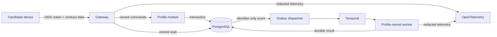

# Data Flow and Classification

- Status: Engineering baseline; accountable security/privacy approval pending
- Last updated: 2026-07-28

The Phase 0 slice does not call ATS, AI, email, calendar, billing, or browser-automation providers.

| Class | Examples | Required controls | Forbidden destinations |
|---|---|---|---|
| Public | Public job text, company URL | Provenance, integrity, sanitization | None |
| Internal | Operation state, match features, opaque IDs | Authorization, encryption, audit | Public responses without ownership |
| Confidential PII | Email, resume, history, preferences | TLS, KMS, owner-scoped access, redacted telemetry | Events, fixtures, analytics, logs |
| Restricted | OAuth/session tokens, sensitive answers | Separate secrets/keys, just-in-time access, mandatory audit | Logs, analytics, fixtures, general events |

## Phase 0 preference flow

- JWT subject and issuer resolve to an internal UUID; provider subjects never become public IDs.
- Preference values remain in the profile-owned PostgreSQL schema.
- The outbox carries only preference-set ID, version, operation ID, and trace correlation.
- The worker reloads the owned record, calculates deterministic readiness, and persists the result.
- Audit events record action, opaque resource ID, version, and trace ID—not candidate values.

## Ownership and recipient matrix

| Boundary/data | System of record/owner | Permitted recipients | Release gate |
|---|---|---|---|
| Identity mapping and sessions | Identity bounded context; managed OIDC for credentials | Gateway verifier, audited identity operations | Managed-provider security/privacy review |
| Candidate facts, preferences, answer metadata | Profile bounded context | Candidate, application service through versioned contract | Real-data onboarding approval |
| Resume and generated documents | Document/application bounded context; encrypted object storage | Candidate, approved renderer/model/ATS workflow only | AI/provider and application delta approval |
| Public jobs and provenance | Catalog bounded context | Public clients/search after source policy | Per-source legal approval |
| Contribution and contributor link | Trust/UGC bounded context | Moderation operations; public catalog excludes identity | UGC/extension approval |
| Application packet/approval/attempt | Application bounded context | Candidate and authorized workflow/adapter | ATS/application approval |
| Restricted tokens/session/sensitive answers | Dedicated restricted boundary and secrets/object stores | Just-in-time authorized worker only | Provider/remote/outreach approval |
| Billing identity/entitlement | Billing bounded context | Candidate, entitlement checks, approved billing provider | Billing/store approval |
| Audit evidence | Security/audit owner | Least-privilege security/support operations | Admin-access and retention approval |
| Operational telemetry | Platform/observability owner | Approved monitoring provider and on-call roles | Redaction/access/retention verification |

## Required delta data-flow diagrams

The Phase 0 diagram is not evidence for an unimplemented capability. Before activation, add and
approve a diagram for:

- resume parsing and AI-assisted tailoring;
- public source ingestion and UGC contribution;
- extension active-tab extraction;
- ATS autofill/submission;
- remote browser and user takeover;
- outreach OAuth and sending;
- billing/mobile/push; and
- export, deletion, incident, and backup-restore paths in deployed environments.
