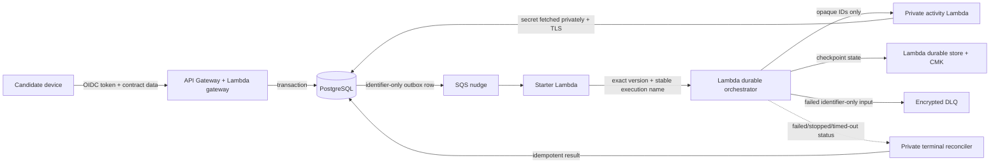
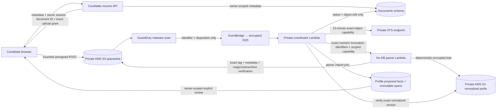
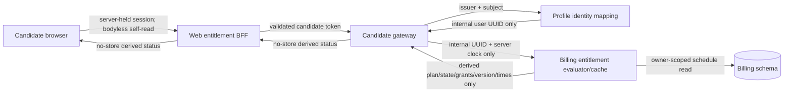
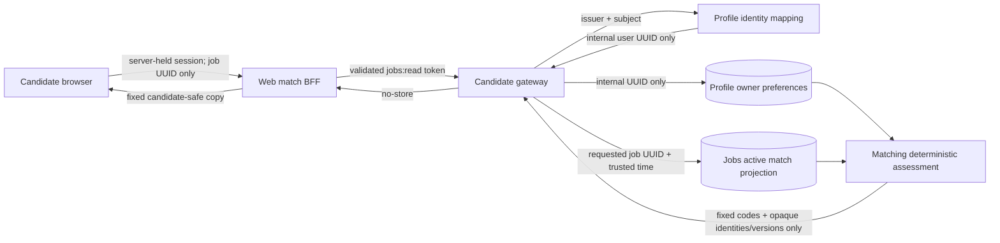
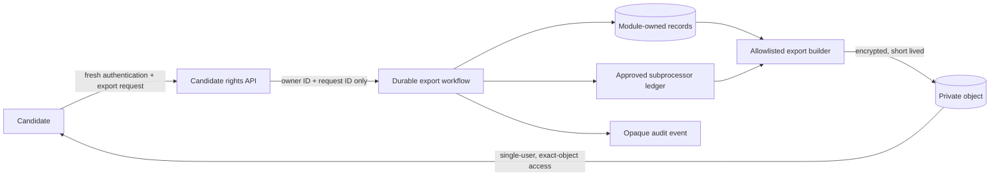
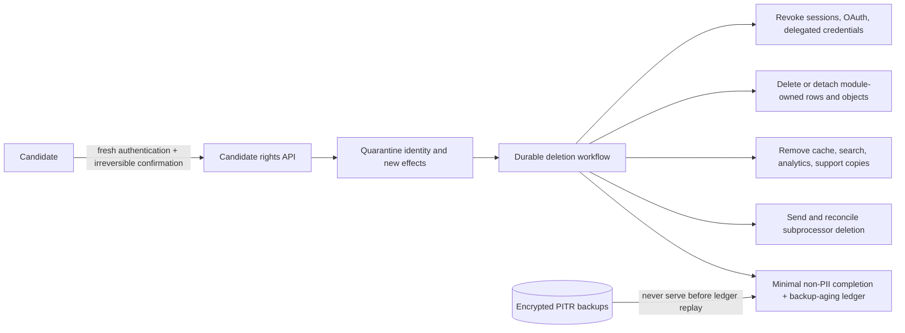
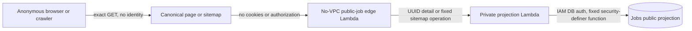

# Data Flow and Classification

The private Documents generation work ledger stores owner/document UUIDs, original request digest,
consent expiry, fixed phase, admission/settlement times and state only. It stores no candidate fact,
prompt/output, credential or provider body; references never include candidate text. These are
owned confidential operational metadata, not product analytics or public API responses. Unresolved
work prevents ledger/document deletion; terminal metadata disappears with the owning document.
Production actor/settlement, IAM, retention and restore enforcement remain uncomposed/default-off.

The source-only private initializer now uses a fresh ledger grant/claim before its three fixed
slot writes, and records settlement only after all original positive single-attempt acknowledgements
and pinned reads. A local timeout, late write, object presence or read-only replay never records
settlement. This connection adds no candidate values to control metadata or public responses.
Other actors and the production drain authority remain uncomposed.

The source-only isolated provider now claims existing fixed-purpose authority through a private
control capability before external effects. The request contains document ID, original digest and
consent expiry only; the acknowledgement contains an opaque authorization reference, not candidate
owner IDs, prompts or model text. Settlement is restricted to that provider phase and only follows
the original positive dispatch/model/result path. Connected local fixtures use in-process control
and offline object/model ports; authenticated remote control/IAM and production drain remain open.

- Status: Engineering baseline; accountable security/privacy approval pending
- Last updated: 2026-08-08

The deployed Phase 0 runtime follows this serverless flow:

Only the activity and terminal handlers enter the VPC or read the database secret. The durable
orchestrator receives opaque identifiers, runs outside the VPC, invokes one immutable numeric
activity version, and uses a separate CMK boundary for durable checkpoints. SQS, reconciliation,
and terminal-event triggers activate together behind one fail-closed runtime switch.

The Phase 0 slice does not call ATS, AI, email, calendar, billing, or browser-automation providers.

| Class | Examples | Required controls | Forbidden destinations |
|---|---|---|---|
| Public | Public job text, company URL | Provenance, integrity, sanitization | None |
| Internal | Operation state, match features, opaque IDs | Authorization, encryption, audit | Public responses without ownership |
| Confidential PII | Email, resume, history, preferences | TLS, KMS, owner-scoped access, redacted telemetry | Events, fixtures, analytics, logs |
| Restricted | OAuth/session tokens, sensitive answers | Separate secrets/keys, just-in-time access, mandatory audit | Logs, analytics, fixtures, general events |

## D3 requested cover-letter path (source and local evidence only)

The private owned-evidence factory now reads through the existing Applications, Jobs and Profile
owner APIs under an active-candidate lease. Application identity/ownership is checked before
posting or candidate values are read. Restricted facts are removed; detached fact-graph projections
omit transport timestamps and the complete posting is snapshotted before asynchronous Profile
reads. Kill-switch/expiry checks refuse stale outputs and fixed failures never reflect owner data.
Twenty-one offline and three PostgreSQL cases use the real local owner modules, each supported
client and a separate lease pool; simulated authentication is not managed-login/deployed evidence.
This default-off factory is not a composed production runtime and cannot call a provider or write
objects. Non-renewable dispatch/drain, retention and runtime/IAM remain required before activation.

The approved backend scope adds an optional versioned disclosure acknowledgement to Prepare.
Applications commits the base packet, short-lived preparation, identifier-only event, audit and
idempotency receipt atomically. A durable factory and private activity now have connected local
PostgreSQL tests. Gateway handlers now connect owner-scoped acceptance/status/preview/file ports;
production dispatch/recovery and isolated Documents/provider runtime composition remain unfinished.
Preparation acceptance/status stay explicitly default-off in the production runtime factory.
The owned outbox now stores only dispatch identifiers, exact numeric workflow targets, bounded
leases and execution/terminal metadata. The source-only starter matches event/preparation before
claiming and emits canonical identifier-only Invoke bytes; no prompt, result or trace is included.
Local PostgreSQL and offline SDK tests verify this boundary, not deployed delivery or recovery.
Source-only terminal handlers independently confirm EventBridge nudges through metadata-only
AWS reads, excluding input/result/error payloads. Exact stored execution identity and fixed
terminal status/times bind settlement; recovery may continue while new dispatch stays off.
SQS and scheduled reconciliation emit only identifiers, batch failures or aggregate counts.
Production clients, IAM, artifacts and trigger composition remain unfinished and unactivated.
The activity passes only server-owned identity/context/disclosure metadata to Documents, which
reloads candidate facts and the job through their owner APIs. Confirmed non-restricted career
facts alone enter the prompt; the job is untrusted data. The model remains default-off and is
called only through the AI SDK. Neither consent nor the dispatch claim is renewed on retry.

Documents reserves the exact normalized object key before any model call. A repeated internal
delivery can recover a ready draft or wait, never generate a second time. The bounded model call
holds Identity's active-candidate lease; quarantine prevents later dispatches. Grounding withholds
all text on findings, including citations excluded from this request's fact selection. Both PDF
and DOCX are verified with production parsers before immutable ready metadata is committed.
Draft text is confined to the encrypted Documents object boundary and owner responses, never
SQL, event payloads, durable checkpoints, audit values or telemetry. Pending and ready keys enter
exact candidate deletion inventory. Export content assembly and restore wiring remain unfinished.

Packet finalization binds the saved content hash and requires explicit review. Current evidence,
job and application changes prevent supersession/approval carryover; preview/file reads never
regenerate. Local tests use synthetic candidate facts and offline provider/object transports.
No AWS write, live model call, activation, deployment or accountable privacy/security approval is
claimed by this implementation. Provider activation/procurement/region/evaluation gates remain.

Production composition must preserve [ADR-016](../adr/016-scale-to-zero-application-runtime.md):
database activities use private access only; internet-facing provider activities run outside the
VPC with minimum identifier/object references, approved managed secrets and no database credentials.
The tested generation library's AI gateway port is not authority to compose the live provider
inside the private database activity. Owned encrypted transport and isolated runtime composition
remain unfinished; raw prompts/results must not enter durable invocation payloads or checkpoints.

A private isolated-provider transport foundation now defines reference-only invocation/output
envelopes and canonical encrypted request/dispatch/result slots under the already-reserved
normalized document ID. Request objects bind original consent/context; plaintext remains
Confidential PII, including in failed or abandoned generation. Slot references bind exact version,
hash, size, KMS key and document identity. Conditional-write conflicts return existing references
and never independently grant another model dispatch. Offline tests prove transport validation,
not provider execution or complete deletion safety. The existing owner inventory/prefix purge
must include every slot/version. Before composition/activation, implement one-dispatch recovery,
transient retention and bounded privacy quiescence for ambiguous Invoke: private cancellation
does not prove an isolated function stopped, so deletion protection cannot be released while
late provider/object writes remain possible. No provider credential enters this transport.

[Proposed ADR-037](../adr/037-precreated-cover-letter-provider-slots.md) defines owner-precreated
issued/pending slots and ETag-pinned claimed/ready replacement. Offline tests refuse duplicate,
missing or conflicting writes without creating a slot. Provider creation authority must be
excluded at composition. The source-only Workflows purge now preserves verified current delete
markers until historical versions are gone, then removes the fences and rechecks absence.
Offline tests probe late conditional writes inside delete batches; connected synthetic PostgreSQL
tests prove row retention on incomplete cleanup and successful retry. Required marker-creation
IAM is not configured, and conditional replacement does not establish remote dispatch quiescence
after quarantine. These production prerequisites remain blocking before activation.

The source-only isolated handler now takes a frozen transition-only object capability and calls
only ModelGateway, after a positively acknowledged dispatch claim and original consent/model
checks. Ambiguous claim/result writes report `in_progress` for original-result recovery rather
than prematurely asserting terminal product failure. Saved JSON includes strict approved model
provenance and original output size, never invocation text. Twenty-five offline handler cases
cover duplicate/lost-ACK recovery, expiry, missing slots, deletion during model execution and
late completion after a local deadline. Private partial-result grounding/rendering and
authorization/quiescence/retention composition are unfinished; these tests are not live-provider
or deployed privacy proof. Neither factory flags nor caller cancellation authorize activation.

The private recovery reader now checks owner-scoped SQL reservation metadata and freshly owned
evidence against the exact saved prompt, pinned encrypted references, original authorized dispatch
time and result/model binding before shared grounding. It has only find/read capabilities and no
model, write or dispatch port. Original results may be grounded after consent expiry without
renewal; missing/pending results do not grant another call. Twenty-three offline cases are not
deployed privacy or remote-quiescence evidence. The separate private recovery service now loads
owned reservation metadata without creating work, reads original results under an active-candidate
lease, and uses the shared PDF/DOCX parser checks before immutable completion. Completion reacquires
the active-candidate lease; the service has no ModelGateway, Invoke or reservation port. Seventeen
offline service cases and two new PostgreSQL cases verify finalization, immutable replay, owner
scope and quarantine refusal. Runtime initialization/invocation, remote quiescence and retention
remain uncomposed; all activation prerequisites above remain.

Private invocation now has a source-only default-off SDK adapter pinned to an exact numeric Lambda
version. Only document identifiers and encrypted object references enter its compact request;
only bounded strict original status/reference responses leave it. It requires single-attempt SDK
policy, requests no log tail and treats ambiguous remote responses as in progress. Sixty offline
tests include the installed SDK with synthetic HTTP responses, not live network/provider evidence.
Local timeout/cancellation is not remote quiescence. Authorization, retention and production
composition remain required before activation.

Candidate object cleanup now requires an injected private quiescence confirmation for every
inventoried cover-letter reservation before object deletion, including pending rows with no S3
versions. Observed generation slots/final drafts also trigger the gate in prefix cleanup. No
production confirmation authority is composed; missing or unknown proof fails closed and retains
the owner deletion/quarantine state. A ten-second read deadline causes refusal, not quiescence.
Eight offline gate cases and six real PostgreSQL cases use synthetic confirmation, not live drain
evidence. Ordinary resume-only cleanup is unchanged. Persisted authorization/drain remains open.

Private initialization now has a source-only default-off factory. Owned evidence and original
consent construct the immutable request; a committed SQL reservation precedes request/result/
dispatch creation under the active-candidate lease. Dispatch is created last. Only the first
reservation winner can create; replays read original pinned slots and never recreate missing
ones, including after partial creation or deletion. The factory has no model or Invoke capability
and returns only identifiers/references/statuses. Twenty-one offline cases and one real PostgreSQL
case do not prove live S3/KMS or remote-write quiescence. An abandoned private PUT could still
arrive after local abort; bounded authorization/drain/fencing and retention remain required before
composition or activation. Never use missing-slot recreation to recover an expired authorization.

## Phase 0 preference flow

- JWT subject and issuer resolve to an internal UUID; provider subjects never become public IDs.
- Preference values remain in the profile-owned PostgreSQL schema.
- The outbox carries only preference-set ID, version, operation ID, and trace correlation.
- The private activity Lambda reloads the owned record, calculates deterministic readiness, and
  persists the result.
- Audit events record action, opaque resource ID, version, and trace ID—not candidate values.

## Ownership and recipient matrix

| Boundary/data | System of record/owner | Permitted recipients | Release gate |
|---|---|---|---|
| Identity mapping and sessions | Identity bounded context; managed OIDC for credentials | Gateway verifier, audited identity operations | Managed-provider security/privacy review |
| Candidate facts, preferences, answer metadata | Profile bounded context | Candidate, application service through versioned contract | Real-data onboarding approval |
| Resume and generated documents | Document/application bounded context; encrypted object storage | Candidate, approved renderer/model/ATS workflow only | AI/provider and application delta approval |
| Public jobs and provenance | Catalog bounded context | Public clients/search after source policy | Per-source legal approval |
| Contribution and contributor link | Trust/UGC bounded context | Moderation operations; public catalog excludes identity | UGC/extension approval |
| Application packet/approval/attempt | Application bounded context | Candidate and authorized workflow/adapter | ATS/application approval |
| Restricted tokens/session/sensitive answers | Dedicated restricted boundary and secrets/object stores | Just-in-time authorized worker only | Provider/remote/outreach approval |
| Billing identity/entitlement | Billing bounded context | Candidate, entitlement checks, approved billing provider | Billing/store approval |
| Audit evidence | Security/audit owner | Least-privilege security/support operations | Admin-access and retention approval |
| Operational telemetry | Platform/observability owner | Approved monitoring provider and on-call roles | Redaction/access/retention verification |

### D1 candidate job-report and moderation source boundary

```mermaid
flowchart LR
  CandidateReport[Authenticated candidate] -->|job ID + fixed reason + idempotency key| GatewayReport[Gateway jobs:write route]
  GatewayReport -->|internal owner UUID + fixed command| JobsReport[Jobs report store]
  JobsReport -->|owner-isolated immutable row| JobsDB[(Jobs schema)]
  JobsDB -->|fixed-code aggregate only| InternalReview[Scoped human moderation console]
  InternalReview -->|explicit block or exact source pause decision| ModerationLedger[Append-only moderation ledger]
  ModerationLedger -->|exact source adapter config pause| IngestionGate[Fail-closed ingestion execution gate]
  IngestionGate -->|permit only while unpaused| SyntheticRuntime[Default-off synthetic ingestion runtime]
```

The report contract contains no free text, provider identity, source URL, candidate values, or
moderation outcome. Exact replay is owner-scoped, and aggregate review does not expose reporter
identities. The dedicated admin client requests only `jobs:moderate`; the gateway derives a stable
opaque audit identifier from the validated issuer and subject and never exposes either raw claim
or the derived identifier to the browser. A report never changes lifecycle automatically. Only an
explicit version-fenced internal decision can block a job or persist a source pause; there is no
source-resume operation in this slice. This is locally verified source only. The durable synthetic
runtime reads the exact pause before
schedule/resume, attempt execution, polling, and subsequent catalog writes while preserving
terminal reconciliation. One already issued idempotent catalog write may finish before the next
gate check. The admin API/UI and dedicated scope are implemented locally, but no managed-OIDC admin
grant, source resume, real reports, retention/deletion approval, alerting policy, database apply,
deployment, or live acceptance is claimed.

## Required delta data-flow diagrams

The Phase 0 diagram is not evidence for an unimplemented capability. Before activation, add and
approve a diagram for:

- resume parsing and AI-assisted tailoring;
- public source ingestion and UGC contribution;
- extension active-tab extraction;
- ATS autofill/submission;
- remote browser and user takeover;
- outreach OAuth and sending;
- billing-provider/mobile/push; and
- export, deletion, incident, and backup-restore paths in deployed environments.

### D1 resume intake and deterministic parsing design

The intake boundary is deployed in development. The processing boundary below is locally verified
and remains dark until its exact artifacts, migration, infrastructure, and synthetic deployment
evidence are recorded.

Resume bytes and extracted text exist only in the candidate device, quarantined/normalized object
storage, and bounded processor memory. Events carry the bucket/object version and opaque document
identity only. Telemetry records states, counts, byte/page/character totals, error codes, and
opaque IDs without filenames, candidate values, object contents, or identity-provider subjects.
The parser has no database secret, direct S3 role permission, application-log permission, trace
permission, or routed internet path. Its temporary session is the intersection of a bounded base
role and an inline exact-version/exact-output policy. AWS-managed DNS remains reachable and is a
documented covert-channel risk, so the processing triggers remain synthetic-only until the exact
deployed boundary and DNS treatment receive accountable review. The coordinator has database
access but never receives or parses source bytes. Event validation binds the exact AWS account,
region, GuardDuty protection-plan ARN, bucket, key pattern, and object version.

### D1 provider-neutral entitlement read design

This is a source and local-test boundary only. No Auth0/Terraform route change, migration-image
publication, AWS deployment, provider/payment integration, price, quota, paid-only feature,
webhook, or real billing data is included.

Billing never receives the identity-provider issuer, subject, email, browser-supplied owner, or
payment/provider payload. The gateway exposes no Billing account ID or internal user ID. Invalid
schedules, ownership mismatches, and unavailable Billing reads become one generic `503`. A bounded
warm-process owner-keyed cache can retain eligible Pro access only through its exact access/grace
boundary after a Billing-reader failure; Profile identity resolution still precedes the cache, so
this does not prove availability through a total identity/database outage.

### D1 owner-self match-assessment design

This is a source and local-test boundary only. Jobs migration `0007`, the gateway release, and the
web UI are not deployed or accepted through a managed-OIDC browser session.

Matching receives the owner-scoped preference snapshot and a Jobs allowlist containing no
description, company, source, provenance, raw content, or lifecycle reason. The response contains
no preference or job display values, restricted sponsorship value, score, rank, generated prose,
eligibility decision, or application outcome. A legacy sponsorship field blocks assessment for
review regardless of its boolean value. Unknown evidence never becomes a conflict, assessments are
not persisted or cached, and target expiry is rechecked after both reads complete.

## Rights-flow design boundary

Phase 1 implements and default-dark deploys the following export and account-deletion trust
boundaries. Stage A preprovisions 35-day development backup retention and an empty tagged identity
provider secret while runtime activation remains false. The diagrams describe deployed composition,
but do not prove a generated-synthetic lifecycle, managed recent-MFA identity, deletion-ledger replay,
or authority for real candidate onboarding.

### Authenticated export

The implementation must exclude credentials and restricted secret material, prevent cross-user
selection, define the portable schema, expire and delete the export object, audit access without
copying exported values, and fail closed when ownership or provider reconciliation is incomplete.

### Restricted-answer export delta (ADR-035)

The default-off `restricted_answer_export_enabled` gate permits the private rights activity to
read only exact owner/version references through Profile's restricted-answer reader, decrypt with
the dedicated vault key and exact vault encryption context, and include the latest non-deleted
candidate-supplied value in the encrypted, short-lived export artifact. Expired answers remain
portable; superseded values and deleted-entry values are excluded. The SQL export function remains
metadata-only. No new Gateway read route, general event, durable payload, log, or analytics value
is introduced. Detected correction/deletion during decryption refuses assembly before an artifact
write. Provider errors are fixed-code and candidate-value-free. The new role grant is Decrypt-only,
exact-key, and purpose-bound; ordinary settings retain metadata-only reads. See
[ADR-035](../adr/035-restricted-answer-values-in-candidate-export.md). Implementation, local tests,
guarded deployment, hosted acceptance, and accountable review remain distinct evidence levels.

### Confirmed account deletion

The implementation must block login and queued external effects before erasure, account for every
owned store and provider, prevent ordinary recovery after confirmation, replay the deletion ledger
before a restored database serves traffic, and expose an honest `backup-expired` state. A provider
acknowledgement or expired backup window cannot be assumed from elapsed time alone.

### Anonymous public job detail

Only the requested/canonical public UUIDs, reversible-alias flag, company display name, title,
locations, optional department, plain-text description, and bounded
observation/verification/expiry timestamps cross this boundary. Candidate data, provider/source
URLs and identifiers, raw snapshots, moderation/audit fields, verified domains, search cursors,
and database credentials do not. Warm edge caches contain only the same projection or generic
absence and never serve stale data after a read error. Crawlability remains off by default. The
anonymous edge has no VPC attachment, database identity, RDS-IAM grant, or database secret and may
invoke only the exact qualified private projection alias with an identifier-only message. The
edge and projection use distinct immutable artifacts; the edge build refuses database runtime and
configuration markers. The private projection retains the exact database role and code-path
KMS/VPC guards. The migration
proves table/schema/temp least privilege inside the application database; remaining cluster-global
catalog and other-database capabilities are contained behind the non-public fixed-query Lambda
rather than exposed to an anonymous runtime compromise. `public_job_route_activation_allowed`
remains false by default.

The sitemap branch returns only active, nonexpired, non-alias canonical UUIDv7 identifiers and the
public `last_verified_at` timestamp, in bounded keyset pages. It excludes detail text and every
candidate/source/internal field. The web emits no sitemap entries while indexing is disabled and
uses only its configured canonical origin when enabled. Projection, edge, or pagination failures
remain availability failures instead of false-empty deindexing signals; crawling and both public
API routes remain default-dark behind the same activation gate.

## Source-only private saved cover-letter reads

Owned context, packet binding, preview and PDF/DOCX reads use a separate read service with no
model, Invoke, reservation, recovery or mutation port. Only current owned evidence and an exact
saved-document reader enter this boundary. One Identity-owned active-candidate transaction holds
through metadata selection, pinned object bytes/digest verification, context comparison and
rendering. The transaction reader fixes the owner and reuses the reserved Documents connection;
owning-service evidence APIs retain independent pools. Inactive/missing candidates are refused
before evidence/object access. No new public schema, candidate data class, cloud call or deployment
is introduced. Source tests and real PostgreSQL synthetic races are layer evidence, not deployed
privacy approval, remote-provider quiescence or retention/export acceptance.

## Source-only cover-letter provider control

The owner-approved private version-one RPC carries only document/grant IDs, request hashes,
fixed provider purpose, original consent expiry and operational outcomes. Candidate owner selection,
prompt/result text, object credentials and SQL diagnostics never enter its envelopes. The isolated
provider has claim and positive settlement capabilities only; Documents resolves the stored owner
and enforces original active-candidate admission. Exact numeric targets, single SDK attempts,
bounded strict receipts and default-off gates are source controls, not deployed IAM evidence.
Target-context matching does not authenticate a caller. Lost acknowledgements do not authorize
re-dispatch or prove remote quiescence. Runtime/IAM, retention and trusted failed-call completion
authority remain unfinished; no public API, frontend or live AWS/model behavior changes here.
