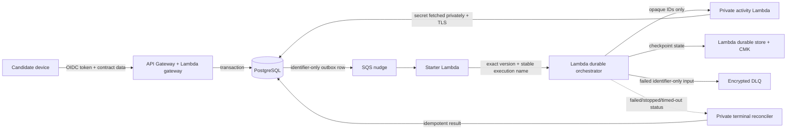
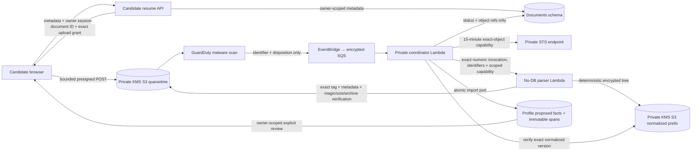
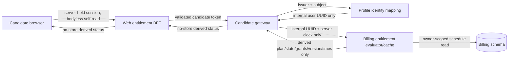
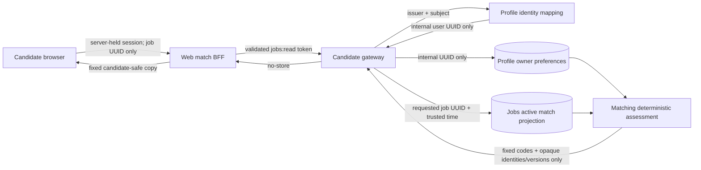
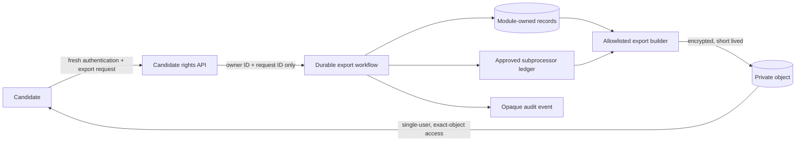
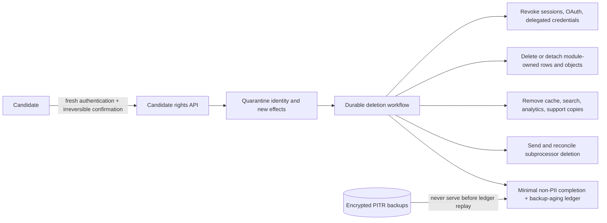

# Data Flow and Classification

2026-10-09 default-off observed questions: explicit trusted extension action -> protected owner/job
reads -> bounded top-frame structure without values -> candidate-controlled clipboard -> exact web
application -> metadata-only saved-version selection -> existing protected Applications packet read
and review. Raw question metadata remains browser memory/clipboard and is never included in the
preparation request; only canonical hashes and exact selection references cross that boundary.
No new service, host grant, persistent queue or external provider action is added.
See [ADR-046](../adr/046-observed-form-saved-answer-selection.md).

2026-10-06 native direct reads: authenticated original task admission -> current packet proof from
the scalar Gateway route -> original task admission again; HTTPS repeats this proof around
rendering. Sealed admission cannot serve a file while a stale packet reference remains. Gateway
authorization stays default off and requires existing packet-protection authority; no generated
body crosses Lambda. [Evidence](../product/delivery/evidence/d3-native-read-admission-2026-10-06.md).

2026-10-06 source-only native preparation activity: exact numeric private activity -> managed
database secret -> separate owning pools/current packet protection -> original scalar native
launcher. Fresh-launch shutdown preserves read-only original receipt recovery. This dedicated
artifact excludes legacy objects, generated content, model, rendering and ECS capabilities.
Managed caller IAM, key/role, target selection and routing/provider approval remain gates.
[Evidence](../product/delivery/evidence/d3-native-preparation-runtime-2026-10-06.md).

2026-10-06 source-only/default-off native preparation: claimed Applications preparation -> current
owner evidence -> memory-only canonical request digest -> original Documents reservation/grant ->
private native launcher. Recovery reads only exact current-admission scalar receipt -> original
temporary material/hash/citations/confidence -> Applications completion. No generated body or
legacy provider object crosses this path; launch and receipt ACKs grant no liveness authority.
[Evidence](../product/delivery/evidence/d3-native-preparation-flow-2026-10-06.md).

2026-10-06 scalar native ready receipt: verified bounded process -> signed exact-task owner RPC
-> active owning admission -> original completion/settled work/expiry checks -> Documents immutable
fact IDs/confidence. No generated body crosses this handoff. Identifiers and hashes remain candidate
metadata under existing owned-row retention/deletion; candidate portability includes the receipt.
This is not liveness, process-death, provider acceptance or production approval.
[Evidence](../product/delivery/evidence/d3-native-ready-receipt-2026-10-06.md).

2026-10-06 native task startup (source-only/default-off): original scalar launch environment
-> fixed link-local ECS self/container/task metadata -> detached allocation/work binding
-> signed owning admission -> original stored approval -> trusted image-owned ports -> kernel
-> scoped owner evidence -> existing memory-only generation/render/HTTPS. Metadata is not caller
authentication, image attestation, ongoing admission or death. The read-only startup wait cannot
claim/renew work or admit candidate evidence before the kernel. No SQL/object/task-control path
is added; executable image and real image-owned configuration/managed acceptance remain.
[Evidence](../product/delivery/evidence/d3-native-task-bootstrap-2026-10-06.md).

2026-10-06 private native bootstrap (source-only/default-off): authenticated original task request
-> owning Applications active-candidate/preparation read -> stored approval/context scalars
-> Documents original-work expiry/context check -> owning preparation recheck -> strict bound
eight-scalar response. Approval timestamps are never reconstructed from launch overrides or
renewed. No candidate body or new write capability crosses the bootstrap read. Current packet,
revision, claimed state and database-time freshness must still match; this does not supply
continuous admission, live provider permission or managed image trust.
[Evidence](../product/delivery/evidence/d3-native-approved-bootstrap-2026-10-06.md).

2026-10-06 authenticated native owner RPC (source-only/default-off): fixed task/recipient/operation
proof -> AWS identity verification -> lazy managed-secret owner composition -> exact native
admission -> original approved context/consent -> owner facts/job APIs or original scalar
controls -> proof-free bound response. Evidence is private candidate data, bounded in memory;
proofs contain credentials and are never logged/persisted/queued/exported or passed to owners.
Authentication precedes owner access; SQL admission/context checks surround owner awaits.
No generated content or new issue/renew/background/task-control authority crosses this RPC.
[Evidence](../product/delivery/evidence/d3-native-owner-rpc-2026-10-06.md). Managed rollout gates remain.

2026-10-06 original native caller proof (source-only/default-off): exact ECS credential endpoint
-> actual SDK signing of fixed regional STS identity/context -> ephemeral private proof -> fixed
AWS verification -> trusted role/original task-session match -> future separate owning admission.
Proof headers carry credential material and must never be logged, persisted, queued or exported.
Original allocation, recipient and request digest cannot be retargeted. Authentication is not
liveness, work settlement, death or purge authority. Reviewed ECS-only role trust and managed
conformance remain required before private RPC/image/bootstrap activation.
[Evidence](../product/delivery/evidence/d3-native-task-caller-proof-2026-10-06.md).

2026-10-06 native cover-letter composition checkpoint (source-only/default-off): fixed original
private admission precedes kernel loading; admission surrounds source-evidence awaits and repeats
before exposing the unbound authenticated HTTPS server. Original controls carry scalar metadata;
generated material and actual PDF/DOCX verification remain inside the kernel-bounded process.
Per-document PDF diagnostics are disabled. Source/admission/provider/TLS adapters and trusted
listener/image/IAM/routing/managed/client conformance remain activation requirements, not evidence
of authenticated deployment. Termination is a request, never provider settlement or death/purge
acknowledgement. [Local evidence](../product/delivery/evidence/d3-native-runtime-composition-2026-10-06.md).

## Source-only private maintenance-fence bootstrap (2026-10-03)

Original owned work references -> closed unchanged cleanup RPC -> independent default-off
numeric-target/managed-secret checks -> shared lazy bootstrap -> native bounded SQL ->
Documents' persisted-owner admission fence. No caller-selected owner, content or credentials
enter the RPC. Only original fence outcomes are returned; SQL/secret diagnostics remain hidden.
Running work remains pending, lost ACKs unavailable, and ledger-terminal never grants purge or
certifies provider/private-writer quiescence. No settlement, renewal, capture/read/disposal,
generation/model/object/render/Invoke port exists. Maintenance-only IAM, artifact/build guard
wiring, deployment and activation remain unproved; exact target matching is not authentication.

## Source-only private response-capture bootstrap (2026-10-03)

Original work/response identifiers -> closed unchanged capture RPC -> independent default-off
numeric-target and managed-secret checks -> shared lazy bootstrap -> native bounded SQL pool ->
original reserve/recordCreation transactions. No content is accepted, and secret/session/SQL
diagnostics are never projected into acknowledgements. Reservation replay cannot redispatch;
original creation capture follows the existing immutable quarantine/expiry-drain rules. No read,
disposal, settlement, renewal, model/object/render/Invoke or purge capability is supplied. Reviewed
caller IAM, artifact/build guard wiring, deployment and activation remain unfinished; target
matching alone does not authenticate a caller or prove provider/private-writer quiescence.

## Source-only private work-control Lambda bootstrap (2026-10-03)

Existing identifier-only provider RPC -> default-off gate and exact trusted numeric target ->
qualified same-account managed-secret extension -> single-flight one-connection private SQL
pool -> original Documents provider claim/settlement. Input validation precedes I/O; warm
configuration cannot rebind target/secret identity. Secret values, session credentials and SQL
diagnostics never enter RPC outputs or logs. Original effects are not locally raced or retried.
No model/object/render/Invoke, issue/renewal, maintenance or purge port is supplied. Target
matching is not caller authentication; reviewed IAM, artifact/build guards, deployment and
activation remain unfinished. No live cloud/provider/model call is part of this source work.

## Source-only private recovered-draft admission (2026-10-03)

Owned metadata and current evidence -> verified original provider-result read -> production
grounding/render checks -> Documents completion with reconstructed original request digest ->
existing one-shot final-document claim -> immutable object write and exact pinned read -> original
positive settlement. Recovery cannot issue a second grant or independently settle work. Pending
recovery defaults off; ready replay remains read-only. Exact descriptor-data references, document,
purpose and digest matching, and a local pre-write admission deadline fail closed. Lost ACKs,
late claims and read-only repair do not manufacture settlement or writer quiescence. This changes
private source only, not public routes, cloud composition, retention approval or activation.

## Source-only failed/abandoned response reconciliation (2026-10-03)

Trusted maintenance caller -> Documents-owned permanent admission fence -> exact original
response inventory -> isolated stop/delete capability -> positive original acknowledgement ->
Documents disposal persistence and readback. This source factory defaults off and is not an
authenticated runtime or scheduler. It carries identifiers only and cannot dispatch generation,
settle private writers, admit finalization or purge platform objects/rows. Unknown creation
identities, missing responses, lost deletion ACKs and local deadlines remain unresolved.
Positive response disposal does not prove writer quiescence or deletion of other provider copies.
No live model/cloud call, public API/frontend change, deployment or activation occurs.

## Source-only private original-response capture RPC (2026-10-03)

Trusted original provider actor -> separate exact-version single-attempt private RPC ->
Documents-owned reserve/creation-capture transaction -> original identity-only acknowledgement.
Envelopes contain the existing work UUID, document UUID, purpose and digest, plus response id/time
for capture; no candidate text, credentials or provider content. The client cannot read/dispose
inventory, settle work, renew authorization, generate or purge. Lost RPC ACKs remain unresolved
even after original commit. Capture draining after quarantine does not admit new dispatch.
Target matching is not caller authentication; reviewed IAM/runtime composition remains required.
The source is default-off with synthetic tests only, no live cloud/model call or activation.

## Source-only original background capture checkpoint (2026-10-03)

The opt-in isolated actor supplies its original provider-grant reserve/capture capability to the
AI gateway. Gateway disclosure checks and one committed inventory reservation precede external
creation; exact immutable id/time capture precedes polling or output acceptance. Request settings
remain the selected model, no tools/linkage, strict grounded output and `store:false`, with
background execution explicitly selected. Candidate text remains confined to the existing private
request/result boundaries and provider processing, never capture envelopes or diagnostics.
Unknown creation/capture ACKs retain unresolved inventory. No failed or timed-out call proves
provider stopping. Temporary polling state is not Zero Data Retention or platform-quiescence
evidence. Private capture RPC/IAM, maintained disposal, writer drain and deployed/accountable
acceptance remain pending; no live provider/cloud call or activation occurs in this source change.

## Source-only private cover-letter cleanup control

Owner-approved non-dispatch lifecycle receipts contain only original model/prompt identity and
fixed local refusal code. They are produced before gateway provider invocation, never reconstructed
from caught errors. The private `settle_undispatched` envelope contains only the exact existing
grant/document/purpose/request digest. Documents fences future phases before original settlement;
there is no candidate text, new provider authority, result write, deletion or quiescence certificate.
Runtime authentication/IAM, retention and production acceptance remain unimplemented/default-dark.

The separate maintenance boundary carries only the original grant/document UUIDs, fixed purpose,
request digest and fixed ledger outcome. Documents derives the owner from the exact persisted
binding; no caller owner, candidate values, diagnostics, credentials or stopping assertions enter
the envelope. Cleanup revokes unclaimed grants and permanently fences future phases, but cannot
settle running work or access/delete objects. `ledger_terminal` is operational metadata, never
remote-quiescence evidence for the candidate-rights purge gate. Reservation and object inventory
remain retained. Unknown bindings and ambiguous work fail closed. The isolated provider's existing
capabilities are unchanged. The source handler defaults off and requires exact numeric invoked
target matching; reviewed maintenance-only IAM/authentication and production composition remain
required. Offline boundary/real PostgreSQL synthetic evidence is not deployed privacy acceptance.

The private Documents generation work ledger stores owner/document UUIDs, original request digest,
consent expiry, fixed phase, admission/settlement times and state only. It stores no candidate fact,
prompt/output, credential or provider body; references never include candidate text. These are
owned confidential operational metadata, not product analytics or public API responses. Unresolved
work prevents ledger/document deletion; terminal metadata disappears with the owning document.
Production actor/settlement, IAM, retention and restore enforcement remain uncomposed/default-off.

The source-only private initializer now uses a fresh ledger grant/claim before its three fixed
slot writes, and records settlement only after all original positive single-attempt acknowledgements
and pinned reads. A local timeout, late write, object presence or read-only replay never records
settlement. This connection adds no candidate values to control metadata or public responses.
Other actors and the production drain authority remain uncomposed.

The source-only isolated provider now claims existing fixed-purpose authority through a private
control capability before external effects. The request contains document ID, original digest and
consent expiry only; the acknowledgement contains an opaque authorization reference, not candidate
owner IDs, prompts or model text. Settlement is restricted to that provider phase and only follows
the original positive dispatch/model/result path. Connected local fixtures use in-process control
and offline object/model ports; authenticated remote control/IAM and production drain remain open.

- Status: Engineering baseline; accountable security/privacy approval pending
- Last updated: 2026-08-08

The deployed Phase 0 runtime follows this serverless flow:

Only the activity and terminal handlers enter the VPC or read the database secret. The durable
orchestrator receives opaque identifiers, runs outside the VPC, invokes one immutable numeric
activity version, and uses a separate CMK boundary for durable checkpoints. SQS, reconciliation,
and terminal-event triggers activate together behind one fail-closed runtime switch.

The Phase 0 slice does not call ATS, AI, email, calendar, billing, or browser-automation providers.

| Class | Examples | Required controls | Forbidden destinations |
|---|---|---|---|
| Public | Public job text, company URL | Provenance, integrity, sanitization | None |
| Internal | Operation state, match features, opaque IDs | Authorization, encryption, audit | Public responses without ownership |
| Confidential PII | Email, resume, history, preferences | TLS, KMS, owner-scoped access, redacted telemetry | Events, fixtures, analytics, logs |
| Restricted | OAuth/session tokens, sensitive answers | Separate secrets/keys, just-in-time access, mandatory audit | Logs, analytics, fixtures, general events |

## D3 requested cover-letter path (source and local evidence only)

The private owned-evidence factory now reads through the existing Applications, Jobs and Profile
owner APIs under an active-candidate lease. Application identity/ownership is checked before
posting or candidate values are read. Restricted facts are removed; detached fact-graph projections
omit transport timestamps and the complete posting is snapshotted before asynchronous Profile
reads. Kill-switch/expiry checks refuse stale outputs and fixed failures never reflect owner data.
Twenty-one offline and three PostgreSQL cases use the real local owner modules, each supported
client and a separate lease pool; simulated authentication is not managed-login/deployed evidence.
This default-off factory is not a composed production runtime and cannot call a provider or write
objects. Non-renewable dispatch/drain, retention and runtime/IAM remain required before activation.

The approved backend scope adds an optional versioned disclosure acknowledgement to Prepare.
Applications commits the base packet, short-lived preparation, identifier-only event, audit and
idempotency receipt atomically. A durable factory and private activity now have connected local
PostgreSQL tests. Gateway handlers now connect owner-scoped acceptance/status/preview/file ports;
production dispatch/recovery and isolated Documents/provider runtime composition remain unfinished.
Preparation acceptance/status stay explicitly default-off in the production runtime factory.
The owned outbox now stores only dispatch identifiers, exact numeric workflow targets, bounded
leases and execution/terminal metadata. The source-only starter matches event/preparation before
claiming and emits canonical identifier-only Invoke bytes; no prompt, result or trace is included.
Local PostgreSQL and offline SDK tests verify this boundary, not deployed delivery or recovery.
Source-only terminal handlers independently confirm EventBridge nudges through metadata-only
AWS reads, excluding input/result/error payloads. Exact stored execution identity and fixed
terminal status/times bind settlement; recovery may continue while new dispatch stays off.
SQS and scheduled reconciliation emit only identifiers, batch failures or aggregate counts.
Production clients, IAM, artifacts and trigger composition remain unfinished and unactivated.
The activity passes only server-owned identity/context/disclosure metadata to Documents, which
reloads candidate facts and the job through their owner APIs. Confirmed non-restricted career
facts alone enter the prompt; the job is untrusted data. The model remains default-off and is
called only through the AI SDK. Neither consent nor the dispatch claim is renewed on retry.

Documents reserves the exact normalized object key before any model call. A repeated internal
delivery can recover a ready draft or wait, never generate a second time. The bounded model call
holds Identity's active-candidate lease; quarantine prevents later dispatches. Grounding withholds
all text on findings, including citations excluded from this request's fact selection. Both PDF
and DOCX are verified with production parsers before immutable ready metadata is committed.
Draft text is confined to the encrypted Documents object boundary and owner responses, never
SQL, event payloads, durable checkpoints, audit values or telemetry. Pending and ready keys enter
exact candidate deletion inventory. Export content assembly and restore wiring remain unfinished.

Packet finalization binds the saved content hash and requires explicit review. Current evidence,
job and application changes prevent supersession/approval carryover; preview/file reads never
regenerate. Local tests use synthetic candidate facts and offline provider/object transports.
No AWS write, live model call, activation, deployment or accountable privacy/security approval is
claimed by this implementation. Provider activation/procurement/region/evaluation gates remain.

Production composition must preserve [ADR-016](../adr/016-scale-to-zero-application-runtime.md):
database activities use private access only; internet-facing provider activities run outside the
VPC with minimum identifier/object references, approved managed secrets and no database credentials.
The tested generation library's AI gateway port is not authority to compose the live provider
inside the private database activity. Owned encrypted transport and isolated runtime composition
remain unfinished; raw prompts/results must not enter durable invocation payloads or checkpoints.

A private isolated-provider transport foundation now defines reference-only invocation/output
envelopes and canonical encrypted request/dispatch/result slots under the already-reserved
normalized document ID. Request objects bind original consent/context; plaintext remains
Confidential PII, including in failed or abandoned generation. Slot references bind exact version,
hash, size, KMS key and document identity. Conditional-write conflicts return existing references
and never independently grant another model dispatch. Offline tests prove transport validation,
not provider execution or complete deletion safety. The existing owner inventory/prefix purge
must include every slot/version. Before composition/activation, implement one-dispatch recovery,
transient retention and bounded privacy quiescence for ambiguous Invoke: private cancellation
does not prove an isolated function stopped, so deletion protection cannot be released while
late provider/object writes remain possible. No provider credential enters this transport.

[Proposed ADR-037](../adr/037-precreated-cover-letter-provider-slots.md) defines owner-precreated
issued/pending slots and ETag-pinned claimed/ready replacement. Offline tests refuse duplicate,
missing or conflicting writes without creating a slot. Provider creation authority must be
excluded at composition. The source-only Workflows purge now preserves verified current delete
markers until historical versions are gone, then removes the fences and rechecks absence.
Offline tests probe late conditional writes inside delete batches; connected synthetic PostgreSQL
tests prove row retention on incomplete cleanup and successful retry. Required marker-creation
IAM is not configured, and conditional replacement does not establish remote dispatch quiescence
after quarantine. These production prerequisites remain blocking before activation.

The source-only isolated handler now takes a frozen transition-only object capability and calls
only ModelGateway, after a positively acknowledged dispatch claim and original consent/model
checks. Ambiguous claim/result writes report `in_progress` for original-result recovery rather
than prematurely asserting terminal product failure. Saved JSON includes strict approved model
provenance and original output size, never invocation text. Twenty-five offline handler cases
cover duplicate/lost-ACK recovery, expiry, missing slots, deletion during model execution and
late completion after a local deadline. Private partial-result grounding/rendering and
authorization/quiescence/retention composition are unfinished; these tests are not live-provider
or deployed privacy proof. Neither factory flags nor caller cancellation authorize activation.

The private recovery reader now checks owner-scoped SQL reservation metadata and freshly owned
evidence against the exact saved prompt, pinned encrypted references, original authorized dispatch
time and result/model binding before shared grounding. It has only find/read capabilities and no
model, write or dispatch port. Original results may be grounded after consent expiry without
renewal; missing/pending results do not grant another call. Twenty-three offline cases are not
deployed privacy or remote-quiescence evidence. The separate private recovery service now loads
owned reservation metadata without creating work, reads original results under an active-candidate
lease, and uses the shared PDF/DOCX parser checks before immutable completion. Completion reacquires
the active-candidate lease; the service has no ModelGateway, Invoke or reservation port. Seventeen
offline service cases and two new PostgreSQL cases verify finalization, immutable replay, owner
scope and quarantine refusal. Runtime initialization/invocation, remote quiescence and retention
remain uncomposed; all activation prerequisites above remain.

Private invocation now has a source-only default-off SDK adapter pinned to an exact numeric Lambda
version. Only document identifiers and encrypted object references enter its compact request;
only bounded strict original status/reference responses leave it. It requires single-attempt SDK
policy, requests no log tail and treats ambiguous remote responses as in progress. Sixty offline
tests include the installed SDK with synthetic HTTP responses, not live network/provider evidence.
Local timeout/cancellation is not remote quiescence. Authorization, retention and production
composition remain required before activation.

Candidate object cleanup now requires an injected private quiescence confirmation for every
inventoried cover-letter reservation before object deletion, including pending rows with no S3
versions. Observed generation slots/final drafts also trigger the gate in prefix cleanup. No
production confirmation authority is composed; missing or unknown proof fails closed and retains
the owner deletion/quarantine state. A ten-second read deadline causes refusal, not quiescence.
Eight offline gate cases and six real PostgreSQL cases use synthetic confirmation, not live drain
evidence. Ordinary resume-only cleanup is unchanged. Persisted authorization/drain remains open.

Private initialization now has a source-only default-off factory. Owned evidence and original
consent construct the immutable request; a committed SQL reservation precedes request/result/
dispatch creation under the active-candidate lease. Dispatch is created last. Only the first
reservation winner can create; replays read original pinned slots and never recreate missing
ones, including after partial creation or deletion. The factory has no model or Invoke capability
and returns only identifiers/references/statuses. Twenty-one offline cases and one real PostgreSQL
case do not prove live S3/KMS or remote-write quiescence. An abandoned private PUT could still
arrive after local abort; bounded authorization/drain/fencing and retention remain required before
composition or activation. Never use missing-slot recreation to recover an expired authorization.

## Phase 0 preference flow

- JWT subject and issuer resolve to an internal UUID; provider subjects never become public IDs.
- Preference values remain in the profile-owned PostgreSQL schema.
- The outbox carries only preference-set ID, version, operation ID, and trace correlation.
- The private activity Lambda reloads the owned record, calculates deterministic readiness, and
  persists the result.
- Audit events record action, opaque resource ID, version, and trace ID—not candidate values.

## Ownership and recipient matrix

| Boundary/data | System of record/owner | Permitted recipients | Release gate |
|---|---|---|---|
| Identity mapping and sessions | Identity bounded context; managed OIDC for credentials | Gateway verifier, audited identity operations | Managed-provider security/privacy review |
| Candidate facts, preferences, answer metadata | Profile bounded context | Candidate, application service through versioned contract | Real-data onboarding approval |
| Original resumes and normalized source documents | Documents bounded context; encrypted object storage | Candidate, approved parser/renderer/model/ATS workflow only | Document/provider and application delta approval |
| Generated cover letters and improved/tailored resumes | Documents-owned temporary memory; no persisted content, including Applications packet fields; maximum 30 minutes ([ADR-038](../adr/038-one-off-generated-application-materials.md)) | Owning candidate and approved renderer/model/ATS workflow during the window; candidate download/employer copy outside platform cleanup | D3-064 expiry/no-persistence evidence and D3-012 AI/provider approval |
| Public jobs and provenance | Catalog bounded context | Public clients/search after source policy | Per-source legal approval |
| Contribution and contributor link | Trust/UGC bounded context | Moderation operations; public catalog excludes identity | UGC/extension approval |
| Application packet/approval/attempt | Application bounded context | Candidate and authorized workflow/adapter | ATS/application approval |
| Restricted tokens/session/sensitive answers | Dedicated restricted boundary and secrets/object stores | Just-in-time authorized worker only | Provider/remote/outreach approval |
| Billing identity/entitlement | Billing bounded context | Candidate, entitlement checks, approved billing provider | Billing/store approval |
| Audit evidence | Security/audit owner | Least-privilege security/support operations | Admin-access and retention approval |
| Operational telemetry | Platform/observability owner | Approved monitoring provider and on-call roles | Redaction/access/retention verification |

### D1 candidate job-report and moderation source boundary

```mermaid
flowchart LR
  CandidateReport[Authenticated candidate] -->|job ID + fixed reason + idempotency key| GatewayReport[Gateway jobs:write route]
  GatewayReport -->|internal owner UUID + fixed command| JobsReport[Jobs report store]
  JobsReport -->|owner-isolated immutable row| JobsDB[(Jobs schema)]
  JobsDB -->|fixed-code aggregate only| InternalReview[Scoped human moderation console]
  InternalReview -->|explicit block or exact source pause decision| ModerationLedger[Append-only moderation ledger]
  ModerationLedger -->|exact source adapter config pause| IngestionGate[Fail-closed ingestion execution gate]
  IngestionGate -->|permit only while unpaused| SyntheticRuntime[Default-off synthetic ingestion runtime]
```

The report contract contains no free text, provider identity, source URL, candidate values, or
moderation outcome. Exact replay is owner-scoped, and aggregate review does not expose reporter
identities. The dedicated admin client requests only `jobs:moderate`; the gateway derives a stable
opaque audit identifier from the validated issuer and subject and never exposes either raw claim
or the derived identifier to the browser. A report never changes lifecycle automatically. Only an
explicit version-fenced internal decision can block a job or persist a source pause; there is no
source-resume operation in this slice. This is locally verified source only. The durable synthetic
runtime reads the exact pause before
schedule/resume, attempt execution, polling, and subsequent catalog writes while preserving
terminal reconciliation. One already issued idempotent catalog write may finish before the next
gate check. The admin API/UI and dedicated scope are implemented locally, but no managed-OIDC admin
grant, source resume, real reports, retention/deletion approval, alerting policy, database apply,
deployment, or live acceptance is claimed.

## Required delta data-flow diagrams

The Phase 0 diagram is not evidence for an unimplemented capability. Before activation, add and
approve a diagram for:

- resume parsing and AI-assisted tailoring;
- public source ingestion and UGC contribution;
- extension active-tab extraction;
- ATS autofill/submission;
- remote browser and user takeover;
- outreach OAuth and sending;
- billing-provider/mobile/push; and
- export, deletion, incident, and backup-restore paths in deployed environments.

### D1 resume intake and deterministic parsing design

The intake boundary is deployed in development. The processing boundary below is locally verified
and remains dark until its exact artifacts, migration, infrastructure, and synthetic deployment
evidence are recorded.

Resume bytes and extracted text exist only in the candidate device, quarantined/normalized object
storage, and bounded processor memory. Events carry the bucket/object version and opaque document
identity only. Telemetry records states, counts, byte/page/character totals, error codes, and
opaque IDs without filenames, candidate values, object contents, or identity-provider subjects.
The parser has no database secret, direct S3 role permission, application-log permission, trace
permission, or routed internet path. Its temporary session is the intersection of a bounded base
role and an inline exact-version/exact-output policy. AWS-managed DNS remains reachable and is a
documented covert-channel risk, so the processing triggers remain synthetic-only until the exact
deployed boundary and DNS treatment receive accountable review. The coordinator has database
access but never receives or parses source bytes. Event validation binds the exact AWS account,
region, GuardDuty protection-plan ARN, bucket, key pattern, and object version.

### D1 provider-neutral entitlement read design

This is a source and local-test boundary only. No Auth0/Terraform route change, migration-image
publication, AWS deployment, provider/payment integration, price, quota, paid-only feature,
webhook, or real billing data is included.

Billing never receives the identity-provider issuer, subject, email, browser-supplied owner, or
payment/provider payload. The gateway exposes no Billing account ID or internal user ID. Invalid
schedules, ownership mismatches, and unavailable Billing reads become one generic `503`. A bounded
warm-process owner-keyed cache can retain eligible Pro access only through its exact access/grace
boundary after a Billing-reader failure; Profile identity resolution still precedes the cache, so
this does not prove availability through a total identity/database outage.

### D1 owner-self match-assessment design

This is a source and local-test boundary only. Jobs migration `0007`, the gateway release, and the
web UI are not deployed or accepted through a managed-OIDC browser session.

Matching receives the owner-scoped preference snapshot and a Jobs allowlist containing no
description, company, source, provenance, raw content, or lifecycle reason. The response contains
no preference or job display values, restricted sponsorship value, score, rank, generated prose,
eligibility decision, or application outcome. A legacy sponsorship field blocks assessment for
review regardless of its boolean value. Unknown evidence never becomes a conflict, assessments are
not persisted or cached, and target expiry is rechecked after both reads complete.

## Rights-flow design boundary

Phase 1 implements and default-dark deploys the following export and account-deletion trust
boundaries. Stage A preprovisions 35-day development backup retention and an empty tagged identity
provider secret while runtime activation remains false. The diagrams describe deployed composition,
but do not prove a generated-synthetic lifecycle, managed recent-MFA identity, deletion-ledger replay,
or authority for real candidate onboarding.

### Authenticated export

The implementation must exclude credentials and restricted secret material, prevent cross-user
selection, define the portable schema, expire and delete the export object, audit access without
copying exported values, and fail closed when ownership or provider reconciliation is incomplete.

### Restricted-answer export delta (ADR-035)

The default-off `restricted_answer_export_enabled` gate permits the private rights activity to
read only exact owner/version references through Profile's restricted-answer reader, decrypt with
the dedicated vault key and exact vault encryption context, and include the latest non-deleted
candidate-supplied value in the encrypted, short-lived export artifact. Expired answers remain
portable; superseded values and deleted-entry values are excluded. The SQL export function remains
metadata-only. No new Gateway read route, general event, durable payload, log, or analytics value
is introduced. Detected correction/deletion during decryption refuses assembly before an artifact
write. Provider errors are fixed-code and candidate-value-free. The new role grant is Decrypt-only,
exact-key, and purpose-bound; ordinary settings retain metadata-only reads. See
[ADR-035](../adr/035-restricted-answer-values-in-candidate-export.md). Implementation, local tests,
guarded deployment, hosted acceptance, and accountable review remain distinct evidence levels.

### Confirmed account deletion

The implementation must block login and queued external effects before erasure, account for every
owned store and provider, prevent ordinary recovery after confirmation, replay the deletion ledger
before a restored database serves traffic, and expose an honest `backup-expired` state. A provider
acknowledgement or expired backup window cannot be assumed from elapsed time alone.

### Anonymous public job detail

Only the requested/canonical public UUIDs, reversible-alias flag, company display name, title,
locations, optional department, plain-text description, and bounded
observation/verification/expiry timestamps cross this boundary. Candidate data, provider/source
URLs and identifiers, raw snapshots, moderation/audit fields, verified domains, search cursors,
and database credentials do not. Warm edge caches contain only the same projection or generic
absence and never serve stale data after a read error. Crawlability remains off by default. The
anonymous edge has no VPC attachment, database identity, RDS-IAM grant, or database secret and may
invoke only the exact qualified private projection alias with an identifier-only message. The
edge and projection use distinct immutable artifacts; the edge build refuses database runtime and
configuration markers. The private projection retains the exact database role and code-path
KMS/VPC guards. The migration
proves table/schema/temp least privilege inside the application database; remaining cluster-global
catalog and other-database capabilities are contained behind the non-public fixed-query Lambda
rather than exposed to an anonymous runtime compromise. `public_job_route_activation_allowed`
remains false by default.

The sitemap branch returns only active, nonexpired, non-alias canonical UUIDv7 identifiers and the
public `last_verified_at` timestamp, in bounded keyset pages. It excludes detail text and every
candidate/source/internal field. The web emits no sitemap entries while indexing is disabled and
uses only its configured canonical origin when enabled. Projection, edge, or pagination failures
remain availability failures instead of false-empty deindexing signals; crawling and both public
API routes remain default-dark behind the same activation gate.

## Source-only private saved cover-letter reads

Owned context, packet binding, preview and PDF/DOCX reads use a separate read service with no
model, Invoke, reservation, recovery or mutation port. Only current owned evidence and an exact
saved-document reader enter this boundary. One Identity-owned active-candidate transaction holds
through metadata selection, pinned object bytes/digest verification, context comparison and
rendering. The transaction reader fixes the owner and reuses the reserved Documents connection;
owning-service evidence APIs retain independent pools. Inactive/missing candidates are refused
before evidence/object access. No new public schema, candidate data class, cloud call or deployment
is introduced. Source tests and real PostgreSQL synthetic races are layer evidence, not deployed
privacy approval, remote-provider quiescence or retention/export acceptance.

## Source-only cover-letter provider control

D3-046's Documents ledger holds only original work/document/owner UUIDs, request digest,
reservation/acknowledgement timestamps, provider response id/creation time and fixed disposal
status. No prompt, response body, candidate value or credential is persisted. Original admission
uses the Identity-owned active-candidate lease and exact running grant; later ACK draining may
continue after quarantine without renewing authority. A duplicate reservation is readback only.
The default-off ledger is exported only by the private runtime, not a public candidate API.
Original-ACK provenance and caller authentication must be composed before activation; possession
of a response id is not ownership. Disposal records cannot settle private actors or certify
generation quiescence. Unknown identities stay inventoried. Strict source restore inventory is
58 migrations/84 relations; deployed inventories and acceptance are unchanged.

D3-045 adds a separate default-off AI SDK response cleanup transport. An isolated future
maintenance actor may pass only the original owned background response reference (id and creation
time), never a candidate-supplied response id. The transport retrieves/cancels at the fixed OpenAI
endpoint, validates terminal id/time/model/background/no-store/tool/linkage metadata, then requires
an exact positive response deletion acknowledgement. Byte-bounded provider output/error bodies
are not returned as content or diagnostics; receipts contain reference/status metadata only.
The owner approved source-only temporary background polling-state retention, not live processing
or a Zero Data Retention claim. This receipt cannot certify deletion of other provider copies,
settle private writers or satisfy platform generation-quiescence. Durable immutable capture,
authenticated runtime, disposal reconciliation and full private drain remain unfinished.

The owner-approved private version-one RPC carries only document/grant IDs, request hashes,
fixed provider purpose, original consent expiry and operational outcomes. Candidate owner selection,
prompt/result text, object credentials and SQL diagnostics never enter its envelopes. The isolated
provider has claim and positive settlement capabilities only; Documents resolves the stored owner
and enforces original active-candidate admission. Exact numeric targets, single SDK attempts,
bounded strict receipts and default-off gates are source controls, not deployed IAM evidence.
Target-context matching does not authenticate a caller. Lost acknowledgements do not authorize
re-dispatch or prove remote quiescence. Runtime/IAM, retention and trusted failed-call completion
authority remain unfinished; no public API, frontend or live AWS/model behavior changes here.

The approved source-only completion extension adds fixed `settle_rejected` to this private v1
boundary. Internal gateway receipts distinguish original fulfilled responses from later JSON/output
rejection and contain only original model/prompt/version/count metadata, never rejected text.
The trusted isolated actor validates provenance and performs no result write before requesting
closure. Documents consumes the exact existing provider reference, permanently fences future
phases, then settles original completed provider work. Errors, aborts, lost responses and timeouts
cannot invoke this path, and a receipt is not caller authentication or production quiescence proof.
Running/ambiguous work and retained reservation inventory remain protected; no purge occurs.
All flags remain dark. Matching control must precede the actor during any separately reviewed
rollout; public APIs, frontend, migrations, guard/Terraform and deployment are unchanged.

### Selected saved-answer packet admission (proposed ADR-039)

The default-off `RESTRICTED_ANSWER_REUSE_ENABLED` path reads only an exact candidate-selected
answer through Profile, outside SQL locks, into the candidate's immutable reviewed packet.
The packet binds its answer ID/version, exact context, observed question hash and expiry.
Approval, submission start/dispatch and asynchronous preparation admission use Profile-owned
metadata checks under the vault writers' advisory locks in the same Applications transaction.
The metadata capability receives a narrow tagged query function and exposes no plaintext, cipher,
general list, transaction lifecycle or write API. Events and generation inputs carry no saved
answer values. Corrected/deleted/expired references refuse admission; there is no latest-version
substitution. See [ADR-039](../adr/039-transactional-vault-reference-admission.md). Reader-first
strict-schema rollout, explicit migration 0006, candidate review UI and accountable/deployed
acceptance remain required before activation; this does not certify privacy writer drain.

The current source still persists selected scalar values in Applications packet JSON outside the
vault's separate key/storage boundary. D3-077 must protect packet-value persistence and owner
reads before the switch can be enabled. Default-off synthetic selection/admission tests do not
satisfy that storage requirement or authorize representative data.

D3-064 now adds a source-only Documents memory replacement for generated cover-letter completion
and reads. Exact generation metadata binds a non-renewable 1,800-second window; bounded buffers,
staged publication, idle cleanup, cancellation scopes and post-async checks refuse late content.
Original completion authority is mandatory but simulated in these tests; native immutable metadata
admission/RPC remains unfinished. No SQL/S3/provider/export or reconstruction capability exists
on the new content store. Production PDF verification uses separate scratch bytes so verification
does not detach the download; transient cover-letter renderer buffers/references are cleared.
This is managed memory/content-boundary evidence, not arbitrary string erasure, remote writer
quiescence, HTTP/browser cleanup, packet/ATS admission or approved provider-retention evidence.
Existing persisted generated-content paths remain ineligible for activation under ADR-038.
[Evidence](../product/delivery/evidence/d3-one-off-memory-runtime-2026-10-04.md).

## D3-064 held temporary response source boundary (2026-10-05)

Default-off cover-letter reads now hold a Documents managed byte lease with a 512 KiB outgoing
reservation through Applications/HTTP validation and release. Private revalidation, signal and
release callbacks are process-local capabilities and never serialized/persisted. Original fixed
expiry and owner disposal clear controlled output; request abort does not settle an unknown renderer
callback. Terminal cancellation/confirmation commits SQL evidence before requesting bounded scope
sealing/disposal; failed acknowledgement does not erase that evidence or permit redispatch.
No schema/event/content persistence or public transport change is introduced. Native session/transport
receipts, worker drain, client lifecycle, ATS and D3-012 retention approval still block activation.
[Source evidence](../product/delivery/evidence/d3-held-temporary-content-2026-10-05.md) does not certify
all-copy physical expiry, remote settlement or deployed candidate acceptance.

## D3-064 original memory-only generation source delta — 2026-10-05

Private owner evidence → bounded canonical request in memory → consume preissued native grant →
foreground SDK with `store:false`, `background:false`, `stream:false` → original completion clock
and grounding → positive scalar provider settlement → scalar native original completion →
managed temporary material. The replacement actor has no object or SQL capability and returns
only fixed statuses, identifiers, hashes/citations and expiry metadata. Generated paragraphs
actively clear on original expiry/cancellation while control acknowledgement waits. Native
completion/render admission uses the same cancellation signal and clears cancelled staged or
just-published content. The Gateway SDK import added for connected acceptance is test-only.

The new SDK path awaits the actual original promise through timeout; late fulfillment discards
content and authorizes only its original provider-phase closure. Unknown rejection/abort/deadline
never proves remote settlement, retention compliance, host drain or physical purge. One actor
admits one pending original promise; process-wide host admission, authenticated private issuer/
transport, physical expiry/shutdown and D3-012 provider terms remain activation gates. Default-off
source and simulated model/OIDC evidence do not expose generated material to real candidates.

## D3-079 native material-process source delta — 2026-10-05

Private admitted candidate/application/generation → default-off dedicated Linux session → one
original SDK dispatch → synchronous original completion clock → kernel deadline → existing
scalar native completion/temporary memory/read capabilities. The kernel module receives only
timestamps/limits, disables core dumps/dumpability and kills this allocation on fixed expiry or
invalid/repeat binding. Session admission refuses another allocation/worker-thread use. Native
process disposal cannot acknowledge its own death; the separate trusted task/process observer
must positively observe retirement. Remote provider settlement remains independent.

[Proposed ADR-040](../adr/040-native-temporary-material-processes.md) preserves private SQL/provider
separation and forbids native-module use in shared APIs, Lambda or clients. Authenticated
launcher/transport/task registry/stop observation, managed-runtime integrity/conformance, full
content routing, client/ATS cleanup and D3-012 terms remain gates. Local kernel tests use synthetic
provider/SQL/render adapters and cannot establish cleanup of a remote system or another process.

## D3-079 native HTTPS read source delta — 2026-10-05

Trusted admitted issuer/subject/internal owner → dedicated native session → fixed TLS 1.3
preview/file route → RS256 OIDC with required expiration and scope → private owning scalar
Applications packet/reference check → temporary read/render → repeated source/packet/token
checks → bounded no-store output within the same kernel-bounded content process. There is no
Gateway/Lambda content forwarding or durable content output in this new listener. Exact CORS
origin and strict request framing precede reads. Disconnect aborts controlled copies but retains
admission until real pending calls settle; native process expiry remains independent of JavaScript.

Local loopback TLS and real signed synthetic tokens exercise the listener in the actual native
process; SQL/provider/renderer/managed identity are simulated. Private remote authentication,
launch/task registry/TLS routing/managed stop, full client/ATS copy lifecycle and D3-012 provider
terms remain gates. No deployment, enabled hostname, all-copy purge or remote settlement follows.
[Evidence](../product/delivery/evidence/d3-native-memory-transport-2026-10-05.md).

## D3-079 scalar Gateway authorization source delta — 2026-10-05

The native HTTPS listener forwards its current verified candidate token only in Authorization
to a fixed HTTPS Gateway metadata endpoint. The normal Gateway identity/scope/owner boundary
reads Applications truth and returns only current packet ID/hash and original material metadata.
The native client strictly validates bounded scalar JSON, original identity/hash/time and expiry;
there is no content forwarding, caching, durable token payload, retry, model or object read.
Generated bodies remain in the kernel-bounded native process. Native direct response JSON matches
existing preview/file schemas. The new Applications capability defaults off and its production
flag is not composed. Private launch/control adapters, registry/managed routing/positive stop,
full client/ATS copy lifecycle and D3-012 terms remain gates. Local real SQL/Gateway and Linux/TLS
proof have different simulated external boundaries; no deployed/UI/all-copy purge claim follows.
[Evidence](../product/delivery/evidence/d3-native-read-authorization-2026-10-05.md).

The proposed native task-retirement control path uses only trusted immutable allocation scope
UUIDs and exact ECS task/cluster/task-definition/container metadata. Production pins signed
regional HTTPS and one SDK attempt with no diagnostic logger. StopTask replies, disappearance,
timeouts and local process responses are not terminal authority. Only a fresh exact stopped
task/container description yields a scalar receipt. No generated body or provider completion
passes through it. The missing owning registry must seal admission and account for every bound
allocation before application-wide disposal can be acknowledged. IAM, managed-task conformance,
launch/routing and all-copy/client cleanup remain separate activation requirements.

## Source-only native one-attempt launch control (2026-10-05)

Trusted original allocation -> signed fixed task-definition envelope verification -> Applications
same-transaction owner/status admission and Documents immutable launch claim -> one signed ECS
RunTask -> exact fulfilled task capture. Private claims contain operational IDs, original grant
binding and static configuration hash only; no generated content, candidate facts or credentials.
No SQL lock spans AWS. Lost acknowledgements/absence/time do not grant another task or prove
retirement. Positive exact-task recovery can drain sealed/quarantined scope independently of new
launch activation; provider work stays unresolved. Managed image/native deadline, authenticated
issuer/private adapters, task-state routing, reviewed IAM/TLS and actual runtime conformance remain
unproved. No deployment or activation. See [source evidence](../product/delivery/evidence/d3-native-task-launch-2026-10-05.md).

Positive native task capture also binds the observed task environment to all seven original
allocation/owner/application/generation/epoch/work/hash values. Extra/missing values and command,
role or resource retargeting refuse capture; refusal leaves pending launch and provider settlement
independent. This is local source evidence with simulated ECS, not deployed authentication.

## Private native launch runtime source (2026-10-06)

Original metadata -> fixed signed numeric Lambda -> managed-secret bootstrap -> same owning
transaction admission/claim -> one signed ECS launch -> exact original task capture. No generated
bodies, model keys or object capabilities cross this path. Sender and receiver switches default
off; new-launch shutdown leaves positive original recovery independent. Caller IAM, task roles,
managed image/authenticated owner adapters/TLS routing and complete copy disposal remain review
and deployment gates. Unknown Invoke/RunTask outcomes retain pending authority and unsettled
provider work. [Local evidence](../product/delivery/evidence/d3-native-launch-control-2026-10-06.md).

## Native task-state recovery hints (2026-10-06)

Private ECS event -> bounded inert deployment/allocation metadata -> numeric signed original
recovery -> owning claim plus fresh exact task/override observation -> durable original capture.
Only five IDs and task ARN cross Invoke; arbitrary event metadata is discarded. STOPPED,
event time/version and lost replies never prove absence/retirement or settle provider work.
Event/source equality does not authenticate senders. Reviewed service resource policies, original
version/configuration retention, durable retry/DLQ routing and actual managed event serialization
remain gates. No generated body/model/database credentials enter this receiver; activation stays
off. [Local evidence](../product/delivery/evidence/d3-native-task-event-recovery-2026-10-06.md).

## Allocation-bound native scalar controls (2026-10-06)

Dedicated content process -> fixed original claim/settlement/completion metadata -> signed numeric
owning controls. The adapter cannot issue/renew work, select another owner/document, settle a
background terminal phase, launch/stop tasks or certify purge. Only acknowledged normal original
provider settlement permits one completion attempt; unknown/late replies never authorize replay.
Transport holds one active send until actual settlement; kernel host retirement is independent
from remote provider/work outcomes. The trusted input/task binding is not IAM authentication.
Per-task/private admission, managed sender/receiver IAM and content runtime remain release gates;
all flags stay off. [Local evidence](../product/delivery/evidence/d3-native-material-controls-2026-10-06.md).

## Native original owner evidence admission (2026-10-06)

Trusted fixed allocation/work/context -> short owning native admission -> lease-bound owner APIs
(excluding restricted facts) -> original context comparison -> repeat owning admission -> detached
original evidence. SQL locks end before content reads; no grant/renewal/body persistence follows.
Active identity/application and current bound/unsealed exact task gates differ from recovery after
seal. Point-in-time metadata checks do not authenticate callers or prove task liveness/retirement.
Private task transport/IAM and managed bootstrap remain gates; activation stays off.
[Local evidence](../product/delivery/evidence/d3-native-evidence-admission-2026-10-06.md).

## Native image port checkpoint — 2026-10-06

The image reads only exact-version provider/TLS secrets with ECS task credentials. Secret values,
TLS private key and original principal stay in dedicated process memory; no environment secret,
SQL/object/task-control authority, logs or candidate content forwarding is added. Profile's owning
active-candidate projection refuses missing/ambiguous subjects and is surrounded by authenticated
original work admission. Direct reads reverify managed OIDC and normal Gateway scalar authorization.
The default image is disabled; managed release/IAM/TLS/routing/provider acceptance remains open.
See [local evidence](../product/delivery/evidence/d3-native-image-runtime-2026-10-06.md).

## Native original document version — 2026-10-06

The private owning bootstrap now includes Documents' original row version alongside the eight
Applications approval/context scalars. It is rechecked before reply and pinned in native actor,
controls, completion and direct-read references; a missing or wrong version cannot fall back to 1.
The strict nine-scalar reply requires a coordinated exact numeric receiver/image rollout. This
adds no body, token, fact value, storage, grant renewal or provider authority. Real SQL retains
original owner/document/work/version comparison; actual managed acceptance remains open.
See [version evidence](../product/delivery/evidence/d3-native-document-version-2026-10-06.md).

## Native read-location metadata checkpoint — 2026-10-06

A separate default-off Gateway route returns only current packet/original material metadata and a
configured HTTPS origin derived from Documents' original allocation UUID. Authentication and
current packet proof surround the owning readiness/allocation lookup. The origin is neither a
credential nor liveness proof; no generated content crosses this route. Hostname drift, expiry,
abort and activation withdrawal withhold the reply. Native HTTPS separately authorizes every read.
Managed DNS/TLS/networking and direct browser/ATS token/content handoff remain release gates.
[Local source evidence](../product/delivery/evidence/d3-native-read-location-2026-10-06.md).

## D1 privileged moderation audit checkpoint — 2026-10-06

Default-off Jobs moderation access/attempt capture uses the existing Gateway OIDC operator
fingerprint, fixed action and nullable resource UUID. Profile owns the existing platform audit
row, records database time and omits candidate linkage, raw identity/body/token/cursor fields.
Pseudonymous operator metadata expires through separate default-off exact-format 365-day
counts-only maintenance; candidate exports exclude these unlinked rows. No automatic scheduler,
managed maintenance, raw audit reader, historical backfill or production approval is asserted.
[Source/local evidence](../product/delivery/evidence/d1-privileged-moderation-audit-2026-10-06.md).

2026-10-07 native resume retained-source checkpoint (source-only/default-off): original
SDK-signed task → separate numeric source Lambda → lazy Documents/Jobs ownership and
candidate source lease → exact normalized S3 version/digest → final admission → bounded
normalized resume and exact job context. Generated bodies never enter this path. Proofs
and source values are excluded from logs/persistence; task replies omit object locations
and credentials. Admission/Jobs transactions end before object I/O; only the separate
active-candidate source lease spans it. Source holds, completion, sealing and changed
job/preparation withhold the result. Managed IAM/source/task/client acceptance remains
open. [Evidence](../product/delivery/evidence/d3-native-resume-source-rpc-2026-10-07.md).

## Native material availability (2026-10-07, default off)

Authenticated candidate approval/submission request -> request-scoped candidate token ->
owner-resolved exact allocation hostname over verified TLS 1.3 -> native OIDC/current-packet
proof -> held in-process memory read/revalidation -> HTTP 204 with scalar original reference.
The Gateway neither downloads nor forwards generated content. It compares the complete reference,
rejects redirects and nonempty response framing, bounds the lookup/request and rechecks expiry.
Tokens are cleared when the request-scoped work finishes and are never persisted or logged.
The native proof calls the existing scalar Gateway authorization endpoint; it does not recursively
resolve approval bindings. SQL application locks are not held across the HTTPS check.

This proves point-in-time availability, not a transferable memory lease, continued availability,
submission authority or disposal. Submission binding checks repeat the observation; the ATS
handoff must still hold/revalidate its own content lease. Transport failures refuse approval.
Activation requires updated native images, explicitly provisioned application NAT and exact NAT
source access to native task port 8443. No infrastructure has been applied by this change.

## Browser-native material access (2026-10-09, default off)

Candidate click -> separate Auth0 SPA popup authorization code/PKCE -> memory-only bearer token
-> configured native allocation HTTPS:8443. Web-session cookies authorize scalar BFF location
reads only. Generated previews/files return directly to the browser, never through the BFF.
The native process still verifies the exact candidate owner and original current packet.
The browser checks packet/location proofs on both sides of each bounded read and disposes held
references on expiry/exit/terminal transitions. No refresh tokens or silent renewal are used;
local credentials last at most ten minutes. Download object URLs are revoked, byte buffers cleared,
and all content retains its original 30-minute deadline. JavaScript string disposal is logical.
See [ADR-044](../adr/044-browser-native-material-identity.md) for trust and activation gates.

## Manual approved-answer extension handoff (2026-10-09, default off)

Candidate copies opaque web application/job link -> trusted extension popup -> existing public
extension session -> owner-scoped application/job/scalar material-authorization reads. Candidate
answers (confidential/restricted) remain popup memory for at most 60 seconds; the background holds
only binding IDs/hash/deadline. Every copy repeats owner, tab, job, immutable approval, withdrawal
and original-expiry checks. Restricted answers require explicit question/context confirmation for
each copy. No generated content, document bytes, content-script bridge, provider request or submit
capability crosses this boundary. Existing protected packet reads recheck saved-answer references.
Clipboard copies are candidate controlled. Exact first-party return links carry only IDs and use
no referrer; web lookup refuses mismatched/absent ownership rather than selecting another packet.
No new persistence/logging/export surface; JavaScript logical disposal has the same limitations
as native preview disposal. [ADR-045](../adr/045-manual-approved-application-handoff.md) records
rollout and remaining installed-extension/live/accountable review gates.

Only explicitly enabled unpacked handoff builds request write-only `clipboardWrite`, allowing
candidate-triggered writes after asynchronous owner checks. No clipboard read or employer host
permission is added. A browser refusal discards the preview; it never bypasses focus restrictions.

D3-087 manual continuation delta: form-bound starts require a fresh matching imported structure
and explicit candidate confirmation. Only the scalar binding, original capture time and confirmation
cross the existing Applications command; SQL admission checks the 60-second lease after locks and
preserves saved-version/material/approval invalidation. This remains untrusted candidate attestation,
not provider proof. Identical accepted commands replay; changed proofs cannot silently replace the
original idempotent action. Compatible readers precede default-off client activation. No accountable
review or live acceptance is inferred from local tests; see proposed ADR-046.
